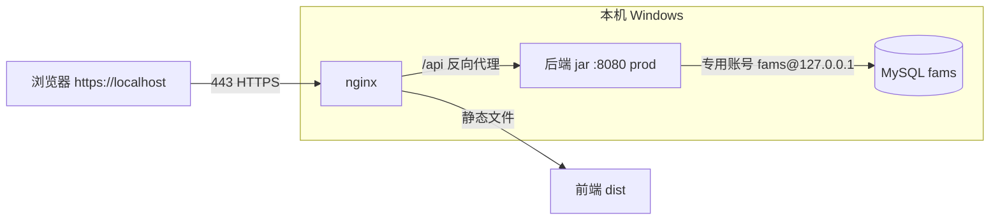

## 用户需求（第 1 阶段 · 企业级加固 · 纯配置/最小改动）

把 EAM-FAMS 从「本机 dev 联调形态」推进到「可在本机当企业系统用」的第一步，共三件事，**不写业务代码、不改通用查询引擎**：

1. **数据库账号收敛**：新建专用最小权限数据库账号（仅授权 `fams` 库），替换当前后端直连 `root` 的方式；并收回此前联调期创建的 `root@127.0.0.1` 全权限账户。
2. **口令治理（最小档）**：把 seed 中全员统一的 `123456` 明文口令，改为**各账号不同的强初始口令**，并**强制首登改密**（不做复杂度规则、不做失败锁定）。
3. **生产化运行形态**：后端由 `mvn spring-boot:run` + vite dev 改为生产形态——后端打 jar（专用 `prod` profile，外部化 JWT 密钥、收紧 CORS）、本机**安装 nginx 做 HTTPS 反向代理（自签证书）**、前端 `npm run build` 静态化由 nginx 托管。

## 明确排除（不在本轮）

- **数据范围隔离**：用户此前已决定单公司使用、不实现行级隔离（README 第 7 节已存档），本轮不涉及。
- **口令复杂度规则 / 失败锁定 / 定期改密强制**：本轮不做（仅强初始口令 + 首登改密）。注：`application.yml` 已存在 `password-min-length/max-age-days/max-failed-attempts/lock-minutes` 等属性，实施时需确认其是否已在代码中强制；若已强制，属既有行为，保持即可，不新增。

## 核心交付

- 后端连专用 DB 账号；seed 各账号强初始口令 + 首登改密闭环可用。
- 一键 `start-prod`：MySQL(服务) + 后端 jar(prod) + nginx(HTTPS) 三件套起来；`stop-prod` 可停。
- README 补充生产部署章节（账号/口令/证书/打包/反代）。

## 技术栈

- 后端：Spring Boot 2.7 + MyBatis-Plus；认证 JWT（`fams.security.jwt-secret`，已支持 `${JWT_SECRET:...}` 环境变量覆盖）；口令 BCrypt 在 `DataInitializer` 启动时把 seed 明文哈希落库（已验证）。
- 数据库：MySQL 8.0.44（服务 `MySQL80`，端口 3306），库 `fams`（utf8mb4，已建好）。
- 前端：Vue3 + Vite；通过 `VITE_API_BASE_URL` 配置后端地址。
- 生产反代：nginx（本机未安装，需下载）+ 自签 HTTPS 证书（PowerShell `New-SelfSignedCertificate` 或 openssl 生成）。

## 实现思路

### 1. 专用数据库账号

- 在 MySQL 建 `fams`@`127.0.0.1`（或 `localhost`），仅 `GRANT SELECT,INSERT,UPDATE,DELETE,... ON fams.*`，强口令。
- 把 `application-dev.yml` 与新增的 `application-prod.yml` 数据源账号改为该专用账号（默认值直接改 yaml，因为 `mvn` fork JVM 导致 `-D` 不透传）。
- 收回调试期建的 `root@127.0.0.1` 全权限账户（`DROP USER` 或回收 GRANT）。
- 同步更新 README 与 `start-dev-mysql.*` 的连接说明（不再是 root）。

### 2. 强初始口令 + 首登改密（唯一需少量业务代码处）

- **Seed 改口令**：`db/seed.sql` 与 `sql/02-seed/00-baseline.sql` 中 `org_users` 的 `123456` 明文，替换为各账号不同的强口令（如 `Admin@2026!`、`Zhangwei#8842` 等）；`DataInitializer.migratePlainPasswords()` 会在启动时把它们 BCrypt 化，无需改哈希代码。
- **首登改密字段**：`org_users` 新增 `must_change_password BOOLEAN`（两库 schema `db/schema.sql`、`sql/01-schema/00-schema.sql` 都加），契约 `resources.json` 的 `org-users` 增加 `mustChangePassword` 字段，seed 默认 `1`。
- **登录接口**：返回体增加 `mustChangePassword` 标记（读当前用户该字段）。
- **改密接口**：新增 `POST /api/auth/change-password`（`{oldPassword,newPassword}`），校验旧口令、BCrypt 新口令、置 `must_change_password=0`。后端对「仍需改密」的账号，除改密接口外返回 403 拦截（最小强制）。
- **前端**：登录后若 `mustChangePassword=true`，弹「首次登录请修改密码」模态框，阻断路由跳转，提交改密成功后才放行。

### 3. 生产化打包与 nginx

- 新增 `application-prod.yml`：`datasource` 指向 `fams`（专用账号）、`sql.init.mode=never`、`fams.security.jwt-secret` 走 `${JWT_SECRET}`（**不设默认值或设为占位**，强制部署时注入）、`cors.allowed-origins=https://localhost`、日志 `root=info`。
- 后端 `mvn package -DskipTests` 产出可执行 jar（已有 spring-boot-maven-plugin）。
- nginx：下载解压到本机；生成自签证书；配置 `listen 443 ssl`，`location /api` 反代 `http://127.0.0.1:8080`，`location /` 托管前端 `dist`。
- 前端 `npm run build`，构建时 `VITE_API_BASE_URL=/api`（相对路径，走 nginx 同域，免 CORS）。
- 新增 `start-prod.bat/ps1`（启动 MySQL 服务 + `java -jar` 后端 + nginx）、`stop-prod` 扩展（停 443/8080/Java/nginx）。保留原有 dev 脚本。

## 架构（目标生产拓扑）



## 目录结构与改动清单

```
EAM-FAMS/
├── fams-backend/
│   ├── src/main/resources/
│   │   ├── db/schema.sql                 # [MODIFY] org_users 加 must_change_password BOOLEAN
│   │   ├── db/seed.sql                   # [MODIFY] 各账号强初始口令 + must_change_password 默认 1
│   │   ├── sql/01-schema/00-schema.sql   # [MODIFY] 同上（MySQL 生产脚本同步）
│   │   ├── sql/02-seed/00-baseline.sql   # [MODIFY] 同上
│   │   ├── contract/resources.json       # [MODIFY] org-users 增加 mustChangePassword 字段定义
│   │   ├── application-dev.yml           # [MODIFY] 数据源改专用账号
│   │   ├── application-prod.yml          # [NEW] 生产 profile（外部化 JWT_SECRET、收紧 CORS、关 sql.init）
│   │   └── application.yml               # [MODIFY] 确认 jwt-secret 仅走环境变量（去掉硬编码默认）
│   └── src/main/java/com/fams/security/
│       └── AuthController.java(或等价)    # [MODIFY] 登录返回 mustChangePassword；新增 change-password 接口
├── fams-frontend/
│   ├── .env.production                  # [NEW] VITE_API_BASE_URL=/api
│   └── src/                             # [MODIFY] 登录后首登改密模态拦截 + 改密页/接口调用
├── deploy/
│   ├── nginx/nginx.conf                 # [NEW] HTTPS 反代 + 静态托管
│   └── certs/                           # [NEW] 自签证书（crt/key）
├── start-prod.bat / start-prod.ps1      # [NEW] 三件套启动
├── stop-prod.bat                        # [NEW] 停 nginx + 后端 jar + (可选)MySQL
└── README.md                            # [MODIFY] 新增「生产部署」章节
```

## 关键代码结构（新增/改动契约点）

```
// resources.json · org-users 字段（新增）
{ "name": "mustChangePassword", "type": "boolean", "required": false }
```

```sql
-- org_users（db/schema.sql 与 sql/01-schema/00-schema.sql 两处）
`must_change_password` BOOLEAN NOT NULL DEFAULT 1 COMMENT '是否强制首登改密'
```

```java
// 登录响应 DTO 增加
boolean mustChangePassword; // 取自 org_users.must_change_password

// 新增改密接口（最小实现）
@PostMapping("/auth/change-password")
public ApiResult<Void> changePassword(@RequestBody @Valid ChangePasswordReq req);
// ChangePasswordReq { String oldPassword; String newPassword; }
// 逻辑：校验旧口令 → BCrypt 新口令 → must_change_password=0；若 must_change_password=1 且非本接口，其他写接口返回 403
```

## 验证要点

- 用专用账号连库成功，root@127.0.0.1 已不可登录后端。
- 各演示账号可用各自强初始口令登录；首登被强制改密，改密后放行。
- 生产形态下：HTTPS 访问正常、中文无乱码、折旧方案启停持久化、领用默认本人+部门过滤代申请均不退化。