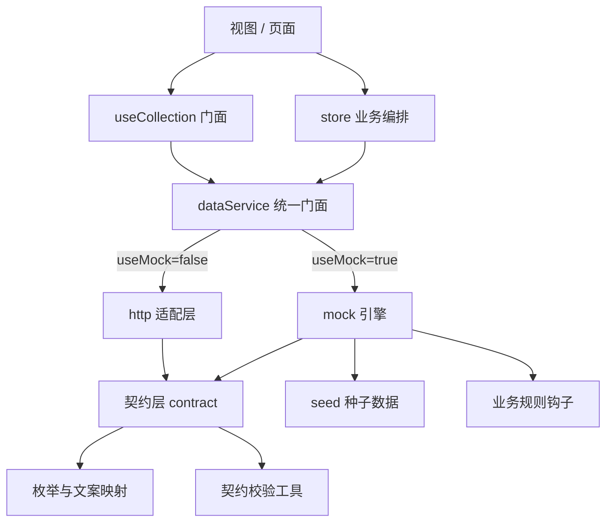

## 产品概述

对 `fams-frontend` 的数据层做契约化改造：把当前"演示型 mock"升级为契约驱动的"准接口"，使签约接真实后端时，前端仅需改 `.env` 关闭 mock，业务代码零改动。

## 核心功能

1. **API 契约层**：为全部约 40 个集合定义字段、类型、枚举、校验规则与查询能力，作为 mock 与后端的单一真源，并产出 Markdown 契约文档交后端实现。
2. **统一响应信封**：`{ code, message, data }`；列表 `data: { rows, total }`；http 与 mock 行为完全一致，含 404 / 409 / 422 / 500 及业务错误码。
3. **mock 引擎升级**：支持关键字、过滤、排序、分页（返回 rows/total）；内置业务规则（唯一性校验、引用完整性、库存联动、删除保护）；id 由"服务端"生成；支持延迟与错误注入。
4. **种子数据收归 mock 层**：21 处视图内联种子全部迁出，视图不再包含任何演示数据。
5. **业务语义债清算**：

- 外键 ID 化：`company / dept / user` 名称 → `companyId / deptId / userId`；单据冗余 `assetName` → 引用 `assetId`。
- 状态枚举化：中文展示词（空闲/派发中/启用/已入库…）→ 编码（IDLE / DISPATCHING / ENABLED…）+ 文案映射表。
- 日期 ISO 化：存储 ISO 8601，展示层格式化。
- 补齐审计字段：`createBy / createTime / updateBy / updateTime / version`。
- 统一分类口径：资产 `type` 与单据 `category` 收敛为同一套资产分类字典。

6. **契约校验工具**：dev 期自动校验种子数据是否符合契约 schema，不符即报错。
7. **切换说明文档**：README 与契约文档说明"改 .env 即切后端"。

## 技术栈

沿用现有技术栈，不新增运行时依赖：Vue 3.5 + Vite 6 + Pinia 2 + Element Plus 2.9；数据层自研（fetch 封装 + 内存 mock）；schema 校验轻量自研（不引入 zod/axios）。

## 实现方案

采用**契约驱动（Contract-First）**策略：先定义每个实体的契约 schema 与端点能力，mock 引擎与 http 适配层都从同一份契约派生行为，业务代码只依赖统一门面 `dataService`。这样 mock 与真实后端的行为差异被收敛在适配层内部，切换时前端零改动。

关键决策与权衡：

- **单一真源优于双份实现**：当前 mock 与 http 各自实现、行为已分叉（mock 忽略 params、http 遇 `{rows,total}` 会静默返回空数组）。契约层把字段、枚举、校验、查询能力集中定义，两边共用，从根上消除分叉。
- **业务规则下沉到 mock 引擎**：现唯一性/删除保护/库存联动写在 store 里（如 `org.js` 抛"仍有子公司"），切后端后这些规则应由服务端保证。改造后 mock 引擎内置规则钩子，store 只做编排，避免"mock 有校验、后端没校验"的落差。
- **id 由服务端生成**：停止前端 `C${Date.now()}` 与 mock 注入 `_id` 的双 ID 体系，统一由引擎生成，消除 `_id || id || code` 兜底定位。
- **分页兼容策略**：mock 同时支持"不传分页参数返回全量"与"传 page/pageSize 返回 `{rows,total}`"，页面按集合规模逐步迁移到服务端分页（固定资产台账等大列表优先），避免一次性全改的风险。
- **移除 `replaceAll` 依赖**：整表覆盖是 mock 专属能力，后端不提供；改为定向批量接口或拆解为多次 update，`useCollection.save()` 相应调整。

## 架构设计



- **契约层** `src/services/contract/`：实体 schema（字段/类型/枚举/校验）、端点能力（过滤/排序/分页字段）、统一错误码。
- **枚举层** `src/constants/enums.js`：状态编码 + 文案映射 + `statusLabel()` 帮助函数。
- **mock 引擎**：按契约执行过滤/排序/分页，执行业务规则钩子，生成 id，模拟延迟与错误。
- **http 适配层**：按契约信封解析 `{code,message,data}`，列表取 `rows/total`，非 0 code 抛 `ApiError`。
- **统一门面** `dataService`：`list(key, params)`、`page(key, params)`、`create`、`update`、`remove`、`batch`。

## 关键代码结构

```js
// src/services/contract/schema.js —— 实体契约（示意，接口级）
export const CONTRACTS = {
  assets: {
    key: 'fixed-assets',
    idField: 'id',
    fields: {
      id: { type: 'string' },
      code: { type: 'string', required: true, unique: true },
      name: { type: 'string', required: true },
      companyId: { type: 'string', ref: 'org-companies' },
      deptId: { type: 'string', ref: 'org-departments' },
      userId: { type: 'string', ref: 'org-users' },
      status: { type: 'enum', enum: 'ASSET_STATUS' },
      purchaseDate: { type: 'date' },
      amount: { type: 'number' },
      version: { type: 'number' }
    },
    query: { keyword: ['name', 'code'], filters: ['companyId', 'deptId', 'status'], sort: ['updateTime'], page: true },
    rules: { unique: ['code'], protect: { ref: ['fixed-asset-dispatch'], message: '该资产存在业务单据，不能删除' } }
  }
}
```

```js
// 统一响应信封与错误模型（接口级）
// 成功：{ code: 0, message: 'ok', data } ；列表：{ code: 0, message: 'ok', data: { rows, total } }
// 失败：抛出 ApiError({ code, message, status }) ，http 与 mock 行为一致
class ApiError extends Error {
  constructor(code, message, status) { super(message); this.code = code; this.status = status }
}
```

## 实施要点（防回归）

- **切换开关保持不变**：`src/services/index.js` 的 `useMock` 逻辑与 `.env`（`VITE_USE_MOCK` / `VITE_API_BASE_URL`）不动，仍是唯一切换点。
- **脏数据处理**：数据模型变更后旧 localStorage 结构不兼容，持久化键升版本为 `fams-mock-db-v2`，并在 README 提示清库。
- **枚举文案集中**：所有状态展示统一经 `statusLabel()`，禁止视图再硬编码中文状态判断；筛选与逻辑一律用编码。
- **日期展示集中**：存储 ISO，展示走统一格式化函数，禁止视图直接渲染原始字段。
- **种子迁移不遗漏**：用 [subagent:code-explorer] 全量定位 21 处内联 `useCollection` 种子后再迁出，避免残留。
- **字段改名影响面**：用 [skill:lsp-code-analysis] 对 `company / dept / user / status / assetName / assetNo` 做引用分析，确保改 ID 化后所有读写点同步。
- **性能**：分页与过滤在 mock 引擎内一次性完成（O(n) 过滤 + 切片），避免视图层重复全量遍历；大列表（资产台账）优先迁服务端分页。
- **验证**：改造后 `npm run build` 通过；用本地缓存 Chromium + 临时目录 playwright-core 做冒烟（登录 → 固定资产/低值资产/组织四页 → 增删改 → 分页），临时文件用完即删。

## 目录结构

```
fams-frontend/
├── docs/
│   └── API_CONTRACT.md            # [NEW] 对外 API 契约文档（信封、错误码、40 个实体的端点与字段表）
├── src/
│   ├── constants/
│   │   └── enums.js               # [NEW] 状态/类型枚举编码与文案映射 + statusLabel/labelOf 帮助函数
│   ├── services/
│   │   ├── index.js               # [MODIFY] 统一门面：导出 dataService/page/create/update/remove，保持 useMock 开关不变
│   │   ├── collections.js         # [MODIFY] 按需微调 key，与契约 id 对齐
│   │   ├── errors.js              # [NEW] ApiError 与错误码常量（404/409/422/500 与业务码）
│   │   ├── http.js                # [MODIFY] 按契约信封解析 {code,message,data}；列表取 rows/total；错误抛 ApiError；补 batch 映射
│   │   ├── contract/
│   │   │   ├── schema.js          # [NEW] 40 个实体的契约 schema（字段/类型/枚举/校验/查询能力/业务规则）
│   │   │   ├── validate.js        # [NEW] 契约校验工具：dev 期校验种子与写入数据是否符合 schema
│   │   │   └── index.js           # [NEW] 契约出口与按 key 查询能力的辅助方法
│   │   └── mock/
│   │       ├── index.js           # [MODIFY] 引擎升级：params 过滤/排序/分页、业务规则钩子、服务端生成 id、延迟与错误注入、localStorage 键升 v2
│   │       ├── query.js           # [NEW] 查询执行器：keyword/过滤/排序/分页，产出 {rows,total}
│   │       ├── rules.js           # [NEW] 业务规则钩子：唯一性、引用完整性、库存联动、删除保护
│   │       └── seed/
│   │           ├── asset.js       # [MODIFY] 固定资产种子：ID 外键、状态编码、ISO 日期、审计字段、单据引用 assetId
│   │           ├── lowValueAsset.js # [MODIFY] 低值资产种子：同上，部门改 deptId
│   │           ├── org.js         # [MODIFY] 组织种子：状态编码、ISO 日期、审计字段
│   │           ├── system.js      # [NEW] 系统管理类种子（字典/参数/流程/终端/消息/日志），承接视图内联种子
│   │           ├── reports.js     # [NEW] 报表类种子（折旧明细等），承接 FixedAssetReports 内联种子
│   │           └── settings.js    # [NEW] 基础设置类种子（位置/分类/折旧规则/折旧方案/审批流程）
│   ├── composables/
│   │   └── useCollection.js       # [MODIFY] 移除 seed 入参与 registerSeed；改用统一门面；save 不再依赖 replaceAll
│   ├── store/
│   │   ├── fixedAsset.js          # [MODIFY] 适配新字段与分页；业务规则交由引擎；id 不再前端生成
│   │   ├── lowValueAsset.js       # [MODIFY] 同上；库存联动改由引擎规则钩子保证
│   │   ├── org.js                 # [MODIFY] 移除前端生成 id；状态改编码；适配统一门面
│   │   ├── notify.js / audit.js   # [MODIFY] 适配统一门面与契约
│   └── views/
│       ├── fixed-asset/
│       │   ├── FixedAssetManagement.vue   # [MODIFY] 迁出 5 处内联种子；company/dept/user 改 ID 下拉；状态用枚举与 statusLabel；日期格式化；大列表改服务端分页
│       │   ├── FixedAssetSettings.vue     # [MODIFY] 迁出 6 处内联种子；适配枚举与统一分类字典
│       │   └── FixedAssetReports.vue      # [MODIFY] 迁出 2 处内联种子；适配 ID 外键与枚举
│       ├── low-value-asset/
│       │   ├── LowValueAssetManagement.vue # [MODIFY] 领用/退库部门改 deptId；日期与状态适配
│       │   ├── LowValueAssetReports.vue    # [MODIFY] 适配新语义
│       │   └── LowValueAssetSettings.vue   # [MODIFY] 适配枚举与分类字典
│       └── system/
│           ├── SystemDict.vue      # [MODIFY] 迁出 4 处内联种子
│           ├── SystemParams.vue    # [MODIFY] 迁出 1 处内联种子
│           ├── TerminalManage.vue  # [MODIFY] 迁出 2 处内联种子
│           ├── WorkflowConfig.vue  # [MODIFY] 迁出 1 处内联种子
│           └── SystemCompany/Dept/User/Role.vue # [MODIFY] 适配枚举编码与统一门面
└── README.md                      # [MODIFY] 新增「接口契约与 mock 切换」章节与清库说明
```

## Agent Extensions

### SubAgent

- **code-explorer**
- 用途：全量定位 21 处视图内联 `useCollection` 种子、硬编码选项数组与演示数据构造逻辑，确保迁移无遗漏。
- 预期结果：给出完整的文件与行号清单，作为种子迁出的依据。

### Skill

- **lsp-code-analysis**
- 用途：对 `company / dept / user / status / assetName / assetNo / updateTime` 等将改名的字段做引用与影响面分析。
- 预期结果：列出所有读写点，保证外键 ID 化与枚举化改造后无遗漏引用。