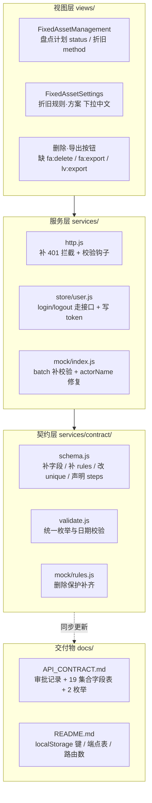

## 用户原始需求（verbatim）

「对前端进行综合评审，是否开发完成，是否还有什么待改善的，对进行后端和数据库开发都准备好了吗？」

## 需求澄清

这是一次**交付前评审 + 整改**任务，不是新增功能。需回答三个问题并给出可执行的整改清单。

## 评审结论（直接回答）

**1）是否开发完成：功能页面层面基本完成，但整体未达可交付状态。**

已完成：18 条业务路由，`views/` 下 29 个组件全部真实存在，无空壳、无「待开发/敬请期待」占位（全仓 TODO/FIXME 为 0）；菜单 ↔ 路由 ↔ 权限码三者高度对齐（菜单有而路由无 = 0 条）；测试 186 + 59 + 123 项全绿，`vite build` 通过。

**2）待改善：4 个阻塞级对接缺口 + 6 类数据模型问题 + 6 类前端打磨项。**

最严重的三条：

- **认证链路完全断裂**：`http.js` 读 `sessionStorage['token']` 发 `Authorization` 头，但全仓无一处写入该 key；`login()` 是本地明文比对密码；无 login/logout 接口；401 无拦截（文档却承诺了「401 → 跳转登录」）
- **http 模式不走契约校验**：切到真实后端后所有必填/类型/枚举/日期校验彻底失效
- **已声明 enum 却写中文**：盘点计划 `status='盘点中'`、折旧 `method='年限平均法'`、折旧设置下拉全中文数组 → 切后端必抛 422，功能直接不可用

**3）后端准备度：暂不具备开工条件。**

`docs/API_CONTRACT.md` 完成度约 70%，缺审批记录表、19 个集合无字段定义、2 个枚举未入表；PUT 语义（整行 vs 补丁）前后端矛盾；删除保护有 6 处缺口；审计字段与乐观锁约定未写进文档。**必须先完成本计划的第 1、2 批整改，才能把文档交给后端。**

## 范围边界

- 纳入：阻塞项修复、契约与数据模型纠偏、API 文档补全、权限码接线、死代码清理
- 不纳入（需用户另行决策）：固定资产类别「字典 + 自建树表」双轨的取舍、低值资产是否补盘点/报废、是否新增「个人中心/修改密码」页与 404 页

## 技术栈

沿用项目现有栈，不引入新依赖：

- Vue 3 `<script setup>` + Element Plus + Pinia + Vue Router（`createWebHistory`）
- 契约驱动数据层：`services/contract/schema.js`（唯一真源）+ `validate.js` + `mock/rules.js`
- 双模服务层：`services/index.js` 按 `VITE_USE_MOCK` / `VITE_API_BASE_URL` 分发 `mockService` / `httpService`
- 零 axios：`services/http.js` 是唯一网络出口（单处 `fetch`）
- 字典机制：`constants/enums.js`（29 枚举 + `ENUM_DICT_META`）+ `services/dictEnums.js` 装载器
- 测试：`node --experimental-loader ./.test-loader.mjs` 三个 `.test.mjs`（ESM，无测试框架）

## 实现方案与关键技术决策

### 决策 1：认证统一走「token 存 sessionStorage + 401 全局拦截」

- `store/user.js` 的 `login()` 改为调 `POST /auth/login`，拿到 `{ token, user }` 后：token 写入 `sessionStorage['token']`，user 写入 pinia 与 `sessionStorage['fams-user']`
- `logout()` 调 `POST /auth/logout` 后再清本地 —— **必须让服务端使 token 失效**，不能只 `sessionStorage.removeItem`
- 401 拦截下沉到 `http.js` 的 `request()` 单点：清 token → 清 user → `router.push('/login?redirect=' + 当前路径)`
- 路由守卫：从「只看本地 user」改为「有 token 才放行，无 token 跳登录」，并在进入业务路由前由服务端返回的用户权限刷新 `userStore`
- 路由守卫里的权限判定仍走 `userStore.can(code)`，但**必须明确告知后端：前端 `can()` 只控按钮显示，接口侧必须独立做角色鉴权**

> 安全约束（来自此前 A18 项目审计教训，新后端必须避免）：密码不得明文存储与比对，必须哈希加盐；不得存在免鉴权重置密码接口；登出必须使 token 失效；登录要有失败限流。

### 决策 2：枚举违规优先「写编码 + 展示走字典」，而非改契约

契约中 `DOC_STATUS` / `DEPRECIATION_METHOD` / `CALC_TIME` / `PURCHASE_MODE` 的定义是对的，错在视图层写了中文。

- 下拉统一改绑 `optionsOf('XXX')`（返回 `[{value,label}]`），与低值资产类别、资产类型已确立的写法一致
- 写入用 `codeOf('XXX', value)` 把可能的中文回退成编码
- 存量中文数据：在 `labelOf()` 已能正确显示的前提下，**种子数据一并改为编码**，避免留两套值域

### 决策 3：日期统一 ISO 8601，禁止 `toLocaleString`

全项目三套格式并存（`toISOString` / `YYYY-MM-DD HH:mm:ss` / `toLocaleString('zh-CN')`）。统一为 `toISOString()`，并删除 `nowText()` 里的斜杠格式分支。折旧计提的 `runDate` 是首个必崩点。

### 决策 4：契约补字段时同步补文档，二者不得分家

`validateFields` 只遍历 `contract.fields`，额外字段静默放过 —— 这是「前端写了但后端不知道」的根因。整改时每改一处契约，必须在同一次提交里更新 `docs/API_CONTRACT.md` 的对应字段表。

### 决策 5：batch 补校验而非禁用

`mock.batch()` 是固资分类树 `save()` 的唯一调用点。补齐 `assertValid` 与 `rules` 后，分类树的中文 `depreciationMethod` 会暴露为校验错误 —— 与决策 2 一起修，不能靠绕过。

## 实现要点（防回归）

- **`fams-mock-db-v10`**：契约字段变更会让旧 localStorage 数据结构不兼容，需按项目既有约定升到 v11（旧键自动失效按种子重建）
- **测试即回归网**：改完后必须跑全量 `npm test`（368 项）+ `npm run check`（模板函数静态检查）+ `vite build`
- **字典可新增项**：`allowedEnumCodes()` 的「内置 ∪ 字典项」语义不能回退，否则字典页新增的类别存不进去
- **快照字段**：低值单据的 `itemName/categoryName/spec/unit/price` 是办理当时快照，后端不可按 `itemId` 实时关联覆盖
- **PUT 全量替换语义**：前端传整行，文档与 `http.js:110` 注释必须改为「body 为整行（全量替换）」，后端不做稀疏 merge

## 架构设计

整改集中在三层，自上而下：



关键约束：**视图层的 enum 违规修复（A1/A2）依赖契约层不改语义**；**文档的每一次更新都必须与 schema.js 同批**。

## 目录结构

```
f:/work/EAM-FAMS/fams-frontend/
├── src/
│   ├── services/
│   │   ├── http.js                 # [MODIFY] 401 拦截跳登录；PUT 语义注释改为全量替换；暴露 create/update/batch 前的校验钩子
│   │   ├── index.js                # [MODIFY] 新增 authService 出口（login/logout/userInfo），与 dataService 并列
│   │   ├── errors.js               # [MODIFY] 补 duplicate / exceedReturned 构造器，删死代码 apiError.validation
│   │   ├── collections.js          # [MODIFY] 移除孤儿 key `docLists`（伪集合，匹配不到任何契约）
│   │   ├── contract/
│   │   │   ├── schema.js           # [MODIFY] 补 parentName / passwordResetAt / remark / handleResult；
│   │   │   │                       #          company→companyId；doc-lists unique 改 'code'；
│   │   │   │                       #          SYSTEM_FLOWS 补 rules；声明 steps 元素结构；
│   │   │   │                       #          补 4 类单据 protect、low-value-return、users/devices/flows/dict-types
│   │   │   └── validate.js         # [MODIFY] 审计字段纳入校验；日期格式统一 ISO
│   │   └── mock/
│   │       ├── index.js            # [MODIFY] batch 补 assertValid 与 rules；actorName 改读 fams-user；
│   │       │                       #          STORAGE_KEY v10 → v11
│   │       └── rules.js            # [MODIFY] 删除保护规则随契约扩充
│   ├── store/
│   │   ├── user.js                 # [MODIFY] login/logout 改走接口、写 sessionStorage['token']、
│   │   │                           #          401 时清态；删死导出 canAny
│   │   └── org.js                  # [MODIFY] 移除本地重复的删除保护（改由引擎抛 ApiError 1003）
│   ├── views/fixed-asset/
│   │   ├── FixedAssetManagement.vue    # [MODIFY] 盘点计划 status / 折旧 method 改绑 optionsOf；
│   │   │                               #          nowText 改 ISO；删除·导出按钮接 fa:delete / fa:export
│   │   └── FixedAssetSettings.vue      # [MODIFY] 折旧规则·方案下拉改绑字典 + codeOf 写入；
│   │                                   #          company 改 companyId；删除按钮接守卫
│   ├── views/low-value-asset/
│   │   ├── LowValueAssetManagement.vue # [MODIFY] 导出按钮接 lv:export
│   │   └── LowValueAssetReports.vue    # [MODIFY] 导出按钮接 lv:export
│   ├── config/permissions.js       # [MODIFY] 删死导出 ALL_PERMISSIONS（保留 3 个权限码并接线）
│   ├── constants/enums.js          # [MODIFY] 删死导出 STATUS_DISABLED / ENUM_TO_DICT_CODE /
│   │                               #          clearDictEnums / dictManagedEnums（保留 allowedEnumCodes 语义）
│   ├── styles/global.css           # [MODIFY] 删 .scope-trigger 与 .role-tag cursor 残留
│   └── router/index.js             # [MODIFY] 守卫改为 token 驱动，401 后带 redirect 回跳
├── docs/
│   ├── API_CONTRACT.md             # [MODIFY] 补 fixed-asset-doc-approvals 全表；补 19 个集合字段表；
│   │                               #          补 APPROVE_RESULT / APPROVE_CONDITION 枚举；
│   │                               #          PUT 语义改为全量替换；补审计字段与 version 约定；补库存三段结算说明
│   └── README.md                   # [MODIFY] localStorage 键改 v11；端点表补 /page、/{id}、/all；
│                                   #          响应体描述补 code/message；路由数改 18
├── .env.example                    # [MODIFY] 补 VITE_MOCK_LATENCY / VITE_MOCK_ERROR_RATE；
│                                   #          VITE_USE_MOCK 改 true 并加注释说明接后端时改 false
└── vite.config.js                  # [MODIFY] dev 端口 5174 → 5173；可选加 /api proxy
```

## 关键代码结构

前端与后端对接的两处核心契约，整改时必须精确：

```js
// services/index.js —— 认证出口与数据出口并列，二者互不混淆
export const dataService = useMock ? mockService : httpService   // 集合 CRUD
export const authService = useMock ? mockAuth : httpAuth         // login / logout / userInfo
```

```js
// services/http.js —— 401 单点拦截（全项目唯一网络出口，勿在多处重复实现）
// 约定：code === 401 → 清 sessionStorage['token'] + userStore.logout() →
//       router.push({ path: '/login', query: { redirect: route.fullPath } })
```

## Agent Extensions

### SubAgent

- **code-explorer**
- Purpose：整改前精确定位所有散落调用点 —— 全部中文枚举写入处、三套日期格式的所有产出点（`nowText` / `toLocaleString` / `YYYY-MM-DD HH:mm:ss`）、所有未守卫的删除与导出按钮、所有 `store` 层抛普通 Error 的位置
- Expected outcome：输出带绝对路径与行号的完整清单，确保整改无遗漏（此类问题在 95KB 的 `FixedAssetManagement.vue` 里人工排查极易漏项）