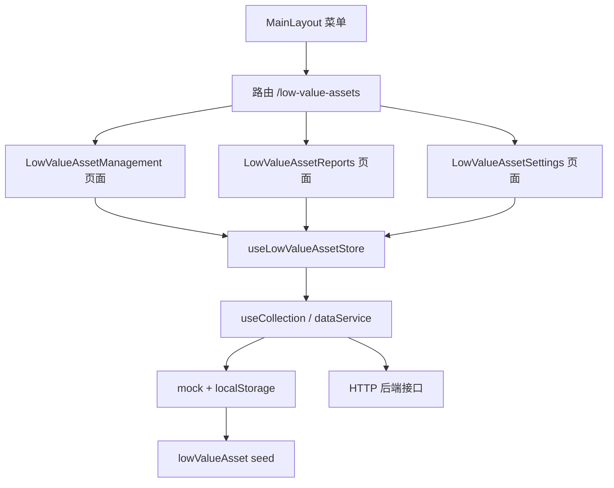

## Product Overview

在现有固定资产管理前端中新增“低值资产”独立模块，菜单位置位于“固定资产”与“组织架构”之间，形成与固定资产并列的完整业务闭环：低值资产台账、入库、领用、退库，以及对应的资产报表和基础设置。

## Core Features

- 菜单与路由：新增“低值资产”子菜单，包含“低值资产管理 / 低值资产报表 / 低值资产基础设置”，默认进入低值资产管理页。
- 低值资产管理页，采用页签组织：
- 库存台账：对齐参考图1，支持类别下拉（全部 / 办公用品 / 水 / 劳保用品 / 纸品）、关键字搜索、重置、导出；表格列为序号、物品类别、物品名称、规格型号、单位、物品单价(元)、物品数量，并提供新增、编辑、删除。
- 入库管理：入库单据列表与新增入库；录入物品、数量、单价、供应商、入库日期、经办人、备注，提交后自动增加库存。
- 领用管理：领用单据列表与新增领用；录入领用人、部门、数量、领用日期、用途等，提交时校验库存并自动扣减。
- 退库管理：退库单据列表与新增退库；提交后自动回补库存。
- 低值资产报表页：类别统计、部门领用统计、出入库汇总，支持按条件筛选、分页查看与导出 CSV。
- 低值资产基础设置页：类别设置、位置设置、审批设置；低值资产不计提折旧，因此不设置折旧页签。
- 数据默认使用内置 mock 演示数据并持久化到 localStorage，同时保持可切换后端接口的双模式能力；预置参考图中的九条低值易耗品数据和示例类别。
- 页面视觉沿用现有企业级蓝色主题、卡片、页签、表格与分页风格，交互与固定资产模块保持一致。

## 技术栈

- 前端框架：Vue 3.5（`<script setup>`）+ Vite 6
- 路由与状态：Vue Router 4 + Pinia 2
- UI：Element Plus 2.9 + @element-plus/icons-vue
- 数据层：现有 `services` 门面（mock/localStorage 与 HTTP 双模式）+ `useCollection` CRUD 封装
- 样式：复用 `src/styles/global.css` 的变量与 Element Plus 全局覆盖，不新增依赖

## 实现策略

1. 完全沿用“固定资产”模块的“三页面 + 一 store + 一套 collection key/seed”组织方式，新建独立 `low-value-asset` 目录，不改动既有固定资产业务逻辑，降低回归风险。
2. 业务状态集中在 `store/lowValueAsset.js`：页面只负责筛选、表单与展示，库存联动、单号生成、金额计算、库存不足校验统一由 store action 完成，保证 mock/HTTP 两种模式下行为一致。
3. 库存联动规则：入库 `stock += quantity`；领用 `stock -= quantity`（不足则拒绝）；退库 `stock += quantity`。单据与库存更新在同一次提交中完成，金额按提交时的单价快照计算，避免后续改价影响历史单据。
4. 类别、位置、审批流程来自基础设置集合，管理页与报表页通过 computed 派生选项和统计，避免在多个页面硬编码重复常量。
5. 报表为纯前端聚合：按类别、部门、业务类型分组，使用 `Map` 单次遍历，复杂度 O(n)；列表分页用 computed slice，避免重复深拷贝。导出沿用 `FixedAssetReports.vue` 的 Blob + CSV 方式，并加 `\uFEFF` BOM 保证 Excel 中文不乱码。
6. 删除保护：库存大于 0 或已被单据引用的物品禁止删除；被物品引用的类别/位置禁止删除，防止产生孤儿数据。

## 数据模型与集合 Key

在 `src/services/collections.js` 增加：

| Key | 说明 | 主要字段 |
| --- | --- | --- |
| `low-value-items` | 低值资产台账/库存 | id、code、category、name、spec、unit、price、stock、safetyStock、location、status、updateTime |
| `low-value-inbound` | 入库单据 | id、docNo、itemId、itemName、category、spec、unit、quantity、price、amount、supplier、inboundDate、operator、remark |
| `low-value-requisition` | 领用单据 | id、docNo、itemId、itemName、category、spec、unit、quantity、price、amount、receiver、dept、requisitionDate、purpose、operator、remark |
| `low-value-return` | 退库单据 | id、docNo、itemId、itemName、category、spec、unit、quantity、returner、dept、returnDate、reason、operator、remark |
| `low-value-settings-categories` | 类别设置 | id、code、name、status、remark、sort |
| `low-value-settings-locations` | 位置设置 | id、code、name、parentCode、parentName、manager、status |
| `low-value-settings-approval-flows` | 审批设置 | id、name、businessType（入库/领用/退库）、steps、status |


物品编码建议 `DZ + 年份 + 序号`；单据编号建议 `RK/PY/TK + 时间戳或序号`，与固定资产现有编号风格保持一致。

## 关键实现细节

- `registerSeed` 只有首次注册生效：store 模块初始化时集中注册全部低值资产 seed，再由 `MainLayout.onMounted` 按 `loaded` 标记调用 `loadAll()`，与 `fixedAsset` 完全一致。
- 新增 collection key 后，即使浏览器已存在 `fams-mock-db-v1`，mock 的 `ensure()` 也会按新 key 从 seed 初始化，无需清库；若开发中页面已打开，刷新即可。
- 更新行时统一使用 `_id || id || code` 作为主键；seed 行缺少 `_id` 时由 mock 自动补齐，页面不要直接依赖 `_id`。
- 数量与金额统一 `Number()` 转换，金额保留两位小数；提交前校验数量为正整数、库存充足、必填项完整，并用 `ElMessage` 提示。
- 列表筛选使用 `computed` 缓存；分页使用 `computed` 切片；导出仅遍历当前筛选结果，避免大列表重复计算。
- 不引入新的全局状态或样式体系；新增样式仅使用 `scoped`，并优先复用 `page-container`、`page-header`、`fill`、`search-form`、`pager`、`num`、`stat-strip` 等全局类。

## 架构设计



分层保持不变：视图层（3 个页面）→ 状态/业务层（lowValueAsset store）→ 数据访问层（dataService/useCollection）→ 存储实现（mock 或 HTTP）。

## 目录结构

```text
fams-frontend/
├── src/
│   ├── services/
│   │   ├── collections.js                      # [MODIFY] 新增低值资产 7 个集合 key
│   │   └── mock/
│   │       └── seed/
│   │           └── lowValueAsset.js            # [NEW] 低值资产种子数据：图1 九条物品、四类类别、示例入库/领用/退库单据、位置与审批流程
│   ├── store/
│   │   └── lowValueAsset.js                    # [NEW] 低值资产 store：registerSeed、loadAll、物品 CRUD、入库/领用/退库 action（含库存联动与校验）、stats computed
│   ├── views/
│   │   └── low-value-asset/
│   │       ├── LowValueAssetManagement.vue     # [NEW] 低值资产管理页：库存台账/入库管理/领用管理/退库管理四个页签，搜索、分页、新增/编辑/删除对话框、导出
│   │       ├── LowValueAssetReports.vue        # [NEW] 低值资产报表页：类别统计、部门领用统计、出入库汇总，CSV 导出
│   │       └── LowValueAssetSettings.vue       # [NEW] 低值资产基础设置页：类别设置、位置设置、审批设置（无折旧页签）
│   ├── layouts/
│   │   └── MainLayout.vue                      # [MODIFY] 在固定资产与组织架构之间插入“低值资产”子菜单（图标 Box），导入并初始化 lowValueAsset store
│   └── router/
│       └── index.js                            # [MODIFY] 新增 /low-value-assets、/low-value-asset-reports、/low-value-asset-settings 三条路由及 meta.title
└── README.md                                   # [MODIFY] 补充低值资产模块功能、路由表、目录结构与后端接口要求
```

## 页面实现要点

- 管理页：顶部 `page-header` 标题为“低值资产管理”，`el-tabs` 绑定 `activeTab`；库存台账筛选区按图1布局（左侧类别下拉，右侧关键字、搜索、重置、导出）；每个业务页签包含“新增”按钮、单据表格、分页和 `el-dialog` 表单；领用提交前调用 store 校验库存。
- 报表页：标题“低值资产报表”，右上角“导出报表”；三个页签分别展示统计卡片/表格，统计口径基于台账与三类单据。
- 设置页：标题“低值资产基础设置”，三个页签；类别页签预置全部/办公用品/水/劳保用品/纸品；位置页签对齐图3 的位置表格字段；审批页签按入库/领用/退库配置流程。
- 所有新增页面使用 `src/views/fixed-asset/*.vue` 作为结构与交互模板，保持中文文案、按钮位置、表格密度和分页样式一致。