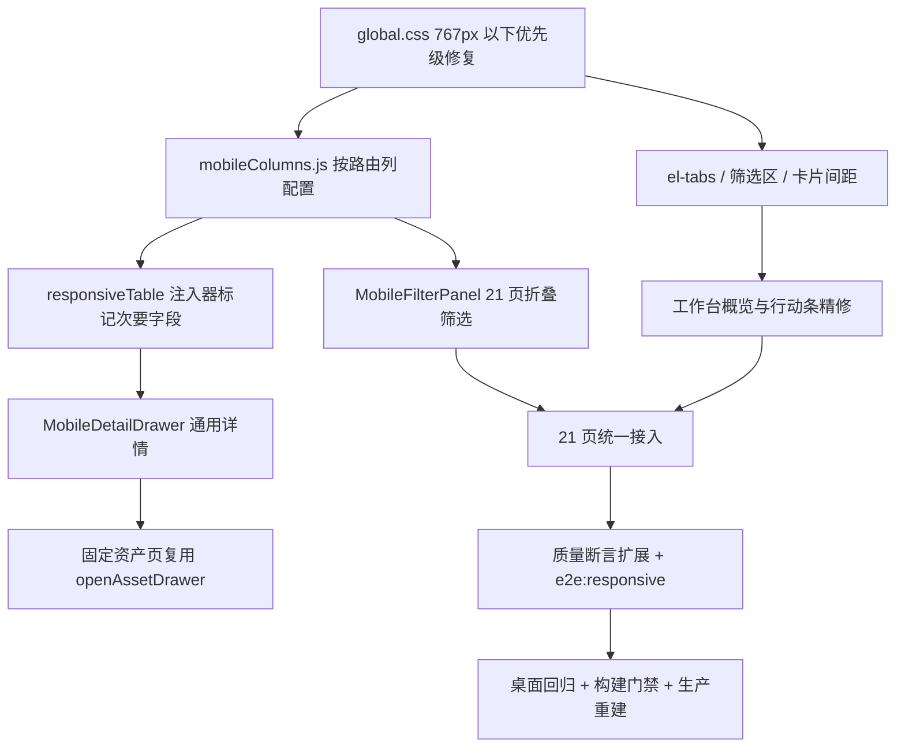

## User Requirements

用户在手机真机访问 `http://192.168.60.66/` 后反馈：页面能打开且无报错，但适配质量不够好，要求仔细分析并做进一步适配。附两张截图：`/fixed-assets` 资产管理页、`/workbench` 工作台页。

## Product Overview

在已完成的第一轮响应式改造基础上做第二轮精修。桌面端保持现有观感与操作不变；手机端把被挤压的筛选表单改为可折叠、控件全宽；把 13 列全量堆叠的长卡片改为 4~6 个核心字段加状态标签的紧凑卡片，点击卡片查看完整字段；工作台按截图重排概览数字与行动条。全量 21 个页面统一生效，两张截图页面重点精修。

## Core Features

- 全局修复：筛选表单 label 上置与控件全宽、页面内 el-tabs 末项可滚动、卡片内边距与行距收紧。
- 通用详情抽屉：卡片点击查看全部字段，字段口径与桌面表格一致；有原详情入口的页面优先复用。
- 卡片精简：按页面配置 4~6 个核心字段与状态标签，其余字段移入详情抽屉。
- 筛选折叠：21 页统一接入可折叠筛选面板，查询/重置/新增主操作常驻可达。
- 工作台精修：页头角色标签换行、概览数字降字号并纵向对齐、行动条卡片不被裁切。
- 质量断言扩展：量化检查控件宽度、卡片字段数、页签末项可见、概览数字不重叠、行动条卡片完整。


## Tech Stack Selection

沿用现有技术栈，不引入新框架、组件库、CSS 预处理器或图表库：Vue 3.5.13（script setup）、Vite 6、Element Plus 2.9.1、Pinia 2.3、vue-router 4.5；原生 CSS，global.css 为唯一样式真源，`main.js` 中 global.css 在 Element Plus CSS 之后引入的顺序不变。验证继续使用根目录 `@playwright/test` 与既有 `npm run e2e:responsive` 设施。

理由：本轮是显示层质量精修，Element Plus 的 el-form、el-tabs、el-drawer 已具备所需能力；换库会与 21 个页面、24 个 store 及 224 条存量 E2E 产生不可控冲突。经核查项目无 ECharts 等图表库，不得引入图表 resize 钩子。

## Implementation Approach

**总体策略**：以「全局 CSS 修根因 → 集中式列配置 → 通用卡片与详情组件 → 两页样板精修 → 全量推广 → 质量断言兜底」推进。桌面路径完全不动，所有变化限制在 767px 以下断点（必要时 1023px）或移动分支内。

**关键决策与权衡**：

1. **修 CSS 特异性而非逐页删内联宽度**。现有 `.el-form-item { display:block }` 特异性 0-1-0，输给 Element Plus 的 `.el-form--inline .el-form-item` 0-2-0，导致 label 未上置、控件被压成小框。改为 `.el-form--inline .el-form-item` 同级覆盖并强制 `.el-form-item__content .el-input/.el-select` 在手机档 `width:100% !important`。这样未接入折叠面板的页面也立即受益，避免 21 页逐个改模板。
2. **集中式移动列配置替代逐页模板**。新增 `src/constants/mobileColumns.js`，以路由 path 为键定义 4~6 个核心字段、状态字段与详情模式。扩展 `utils/responsiveTable.js` 注入器：扫描时按当前路由给次要单元格标记 `data-mobile-extra`，手机 CSS 隐藏；收集全部字段供详情抽屉使用。相比在 21 个页面写 MobileRecordList 模板，桌面 DOM 零改动、配置集中可审计、无重复代码。
3. **通用详情抽屉 + 既有入口复用**。新增 `MobileDetailDrawer.vue`，由卡片点击触发，用同一份列配置渲染完整字段；固定资产页已有 `openAssetDrawer(row)`，通过配置中的详情回调优先复用原抽屉，其余页面用通用抽屉。避免为每页新建详情弹窗。
4. **筛选折叠低风险推广**。`MobileFilterPanel.vue` 已存在且在 `SystemParams.vue` 验证过。推广时只在移动分支新增面板，桌面 `el-form` 结构、权限判断、查询口径原样保留；表单项通过默认 slot 复用，不复制 v-model 逻辑。
5. **质量断言而非仅结构断言**。上一轮 24/24 全绿却漏掉截图问题，因为只检查溢出与 DOM 互斥。新增可量化几何/计数断言，直接防止本次三类质量缺陷回归。

**性能与瓶颈**：注入器为 MutationObserver 加 120ms 节流与下一帧补扫，扫描复杂度 O(表格行数)，仅在手机档执行；列配置按路由 O(1) 查表；详情抽屉按需渲染，不增加列表 DOM。巡检主要开销是 16 视口 × 21 路由线性导航，继续 `workers:1` 串行、只读、不清库。

## Implementation Notes

- **桌面零回归**：上一轮桌面存量 E2E 子集 36/37，唯一失败为 `/api/org-users?pageSize=500` 后端接口问题，与前端无关；本轮不得引入新的桌面回归。所有新 CSS 规则必须位于 `@media (max-width:767px)` 内。
- **复用既有**：`MobileFilterPanel`、`MobileRecordList`、`MobileActionBar`、`useBreakpoint`、`SidebarMenu`、`MobileNavDrawer`、`utils/responsiveTable.js` 均已有，优先扩展而非重写；`SystemParams.vue`、`SystemLog.vue` 作为接入样板。
- **产品口径**：工作台层级「概览 → 行动条 → 待办」与 `wm:*` 权限收敛不变；待办只用卡片；顶栏公司视角与岗位切换在手机必须可达；卡片状态标签沿用桌面 el-tag 色；不新增调试浮标或尺寸指示器。
- **安全与产物**：不改 `fams-backend/src/main/resources/contract/*.json`（由 `export:contract` 导出并被 `build-prod.ps1` 做哈希校验）；巡检只读、不写业务数据、不建 fams_e2e。
- **环境**：Node 需 `$env:Path = "$env:USERPROFILE\.workbuddy\binaries\node\versions\22.22.2-6;$env:Path"`；新建或改写源码后核对头字节，防止 UTF-16LE（fffe）；运行巡检需 `$env:E2E_PASSWORD`（`tests/e2e/fixtures/env.ts` 默认值已过期，口令见 README 第 8 节）。
- **日志**：前端不新增 console 输出；巡检截图写入 `e2e-artifacts/<runId>/`，不打印账号或大 payload。

## Architecture Design

分层关系：全局 CSS 根因修复 → 集中列配置与详情抽屉 → 两页样板精修 → 21 页推广 → 质量断言 → 回归发布。桌面与移动在同一点分叉，桌面路径保持原样。



## Directory Structure

本轮在既有响应式改造产物上继续，修改或新增以下文件。

```text
f:/work/EAM-FAMS/
├── docs/
│   ├── responsive-adaptation.md          # [MODIFY] 新增第二轮精修章节：截图问题清单、根因、列配置规范、质量断言口径与验收结论。
│   └── qa/stage-gates.md                 # [MODIFY] §6 追加 R7 第二轮精修门禁与验收记录。
├── fams-frontend/
│   ├── src/
│   │   ├── constants/
│   │   │   └── mobileColumns.js           # [NEW] 按路由 path 映射 4~6 个核心字段、状态字段、详情模式；台账页统一真源，供注入器与详情抽屉共用。
│   │   ├── utils/
│   │   │   └── responsiveTable.js         # [MODIFY] 读取列配置，给次要单元格加 data-mobile-extra；收集行全字段供详情抽屉；保留现有首帧收敛与补扫逻辑。
│   │   ├── components/mobile/
│   │   │   ├── MobileDetailDrawer.vue     # [NEW] 通用详情抽屉：按列配置渲染全字段，支持自定义详情回调，header/footer 固定、body 滚动、安全区留白。
│   │   │   ├── MobileRecordList.vue       # [MODIFY] 增加 maxFields 与详情回调契约，作为可配置卡片方案的可选增强；保持与全局 CSS 方案互斥。
│   │   │   └── MobileFilterPanel.vue      # [MODIFY] 增加 defaultExpanded 与 sticky 操作区能力，便于 21 页统一折叠筛选与常驻主操作。
│   │   ├── styles/
│   │   │   └── global.css                 # [MODIFY] 修复 inline form 特异性、控件 100% 宽度、el-tabs 横向滚动、次要字段隐藏、详情入口按钮、卡片紧凑间距；新增工作台概览与行动条手机覆写；仅 767px 以下生效。
│   │   ├── views/
│   │   │   ├── fixed-asset/
│   │   │   │   └── FixedAssetManagement.vue  # [MODIFY] 重点精修：el-tabs 滚动、筛选折叠接入、卡片核心字段与 openAssetDrawer 复用、底部新增操作条；桌面表格与权限逻辑不动。
│   │   │   ├── workbench/
│   │   │   │   ├── Workbench.vue             # [MODIFY] 页头角色标签换行、行动条卡片高度与不裁切；保持概览→行动条→待办层级与 wm:* 权限。
│   │   │   │   └── components/OverviewPanel.vue # [MODIFY] 手机档概览数字降字号、纵向对齐、chips 收敛；1280/720 既有断点保留。
│   │   │   └── {其余 18 个路由页}.vue        # [MODIFY] 统一接入 MobileFilterPanel 移动分支，桌面模板与查询口径原样。
│   │   └── main.js                        # [MODIFY] 挂载 MobileDetailDrawer 全局实例并暴露详情事件桥接；保持 global.css 引入顺序与 a11y/响应式注入器注册顺序。
├── tests/responsive/
│   ├── fixtures/viewports.ts              # [MODIFY] 增加质量断言所需阈值常量（最小控件宽度、最大卡片字段数等）。
│   └── layout-matrix.spec.ts              # [MODIFY] 新增筛选控件宽度、卡片字段计数、页签末项可见、概览数字不重叠、行动条卡片不裁切断言；保留现有 24 条与重定向处理。
└── package.json                           # [MODIFY] 如需单独跑质量巡检，新增 e2e:responsive:quality 脚本；否则不改。
```

## Key Code Structures

集中式列配置契约（多模块依赖，接口级）：

```js
// src/constants/mobileColumns.js
export const MOBILE_COLUMNS = {
  '/fixed-assets': {
    primary: ['code', 'name', 'status', 'original'],
    statusProp: 'status',
    detail: { mode: 'custom', handler: 'openAssetDrawer' },
    actionProps: []
  }
  // 其余路由按同样结构配置，未配置时回退为“全部字段 + 通用详情抽屉”
}
```

详情事件桥接签名（接口级）：

```js
// src/components/mobile/MobileDetailDrawer.vue
// props: { modelValue: Boolean, title: String, fields: Array }
// emits: ['update:modelValue']
// 全局事件：fams:mobile-detail { route, row, fields }
```
	

## 设计策略

沿用现有企业级深蓝设计令牌与 Element Plus 组件体系，不新增字体族或颜色。第二轮精修聚焦手机端信息密度与可操作性：从「把桌面表格视觉转成卡片」升级为「为手机重新组织信息层级」。

### 核心页面

**资产管理页**：页头保留标题与必要的权限入口；页面内 el-tabs 改为横向可滑动，末项完整可见；筛选区默认收起为一行摘要，展开后单列全宽、label 上置；数据区改为紧凑卡片，首行突出资产编号与状态标签，中间显示 4~6 个核心字段，底部提供详情入口与原业务操作；底部固定新增操作条。

**工作台**：页头标题与角色标签分行；概览拆为三个语义分组，数字降字号并纵向对齐，长金额完整显示；行动条卡片加高至可完整读取，未被屏幕裁切；待办区保持卡片形态并上移到首屏。

**通用台账页**：统一折叠筛选与核心字段卡片，状态沿用桌面标签色，操作收进卡片底部，触控目标不小于 44px。

### 交互与响应

所有过渡遵守 prefers-reduced-motion；卡片按压有轻微反馈，抽屉与筛选展开有短动画；刘海与底部手势区用 env(safe-area-inset-*) 避让；横竖屏切换不重建表单 DOM；桌面观感与交互零变化。

## Agent Extensions

### SubAgent
- **code-explorer**
  - Purpose: 盘点 21 个路由页的 inline 筛选表单结构、el-table 列定义与既有详情入口，产出可核对的接入清单；推广后核对覆盖度与桌面结构未被误改。
  - Expected outcome: 形成逐页「筛选容器 / 核心字段 / 详情入口 / 是否已接入」清单，证明全量无遗漏、桌面模板零改动。

### Skill
- **lsp-code-analysis**
  - Purpose: 对 el-form、el-tabs、MobileFilterPanel、MobileDetailDrawer、useAppStore 做符号级引用与调用链分析，确认注入器与列配置的影响面闭合。
  - Expected outcome: 确认新增组件与列配置被全部目标页正确消费，无残留失效调用或重复实现。
- **playwright-cli**
  - Purpose: 在巡检断言之外，用 390x844 真机等价视口打开两页做独立实景核对，抓取筛选展开、卡片详情、工作台概览截图。
  - Expected outcome: 形成与自动化断言互相印证的实景截图证据，全部为只读操作，不写业务数据。
