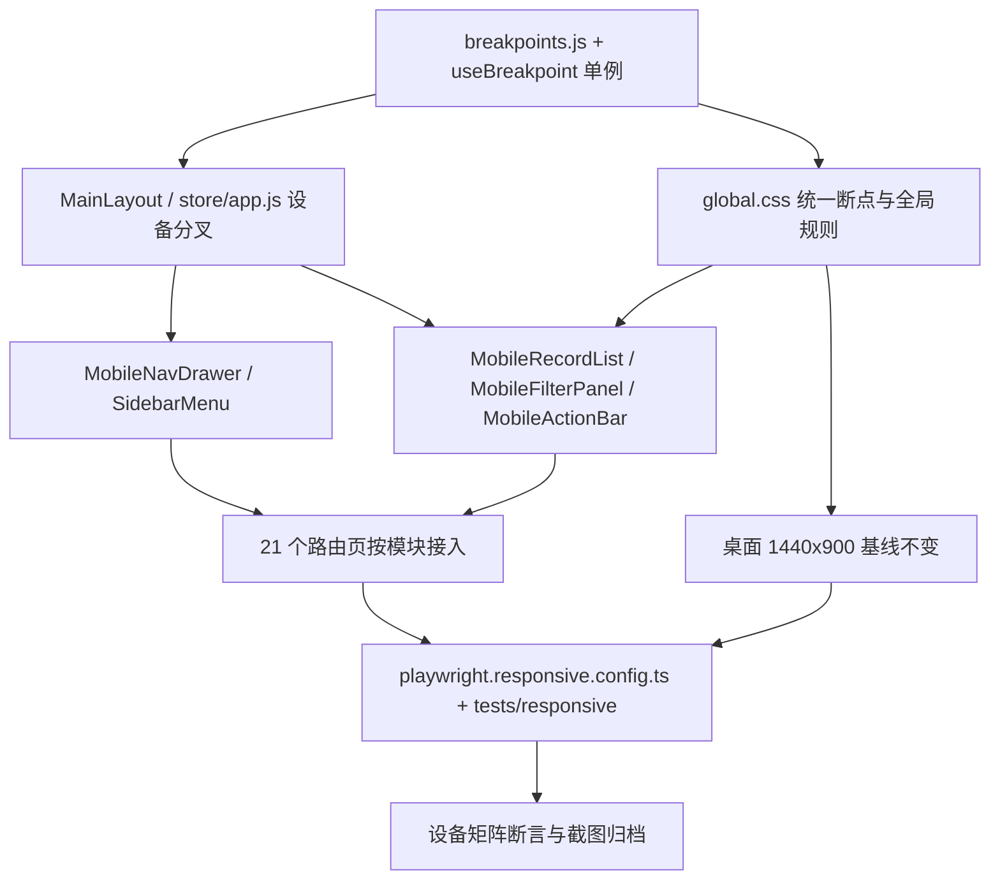

## User Requirements

对现有页面做响应式适配改造，使其在尽可能多的 PC、平板、手机（含横屏与竖屏）上都能良好显示。交付顺序被明确约束：先完成设备与断点分析（涵盖主流屏幕尺寸、分辨率与横竖屏场景），据此制定分阶段的适配规划，再严格按规划顺序逐项执行改造，完成后验证各设备下的布局与交互效果。

## Product Overview

一套覆盖桌面与移动端的完整多端显示方案：桌面保持现有观感与操作不变；平板按横竖屏切换宽松布局与分栏；手机提供完整移动体验——抽屉式导航、卡片化数据列表、可折叠筛选、近全屏表单与底部操作区。改造覆盖全部现有页面，不留下期；验收以自动化多视口巡检的断言与截图为主，无需逐档人工点测。

## Core Features

- 设备与断点分析：主流 PC、平板、手机尺寸与分辨率、横竖屏、安全区与矮屏场景清单，形成统一断点分级表与分阶段适配规划文档。
- 桌面端零回归：桌面展示、交互与既有布局保持不变。
- 平板适配：分栏降级、栅格重排、顶栏与页签紧凑化、横竖屏稳定。
- 手机完整体验：抽屉侧栏、精简顶栏（保留公司视角与岗位切换）、表格改卡片列表、筛选面板折叠、弹窗近全屏、底部主操作条、触控友好的点击区域。
- 全量覆盖：21 个路由页及公共组件统一接入，无遗漏页面。
- 多设备验证：按设备矩阵自动断言无横向溢出、关键控件可见可点、弹窗按钮可见、抽屉开合、横竖屏切换稳定，并输出各档截图归档。

## Tech Stack Selection

沿用现有栈，不引入任何新框架、组件库或 CSS 预处理器：Vue 3.5.13（`<script setup>`）+ Vite 6 + Element Plus 2.9.1 + Pinia 2.3 + vue-router 4.5；原生 CSS + `:root` 设计令牌（`fams-frontend/src/styles/global.css` 为唯一样式真源）。验证侧复用根目录既有 `@playwright/test` 设施（`playwright.config.ts`、`tests/e2e/fixtures/`），不新增测试框架。

理由：这是既有 B 端系统的显示层改造，Element Plus 已提供 `el-drawer`、`el-dialog`、`el-row/el-col` 的响应式 props 与安全区所需能力；引入新组件库会与现有 24 个 store、21 个页面及 224 条存量 E2E 产生不可控冲突。保持 `main.js:13` 中 global.css 在 Element Plus CSS 之后引入的顺序不变。

## Implementation Approach

**总体策略**：以「桌面 DOM 完全不变 + 移动端条件分支隔离 + 通用组件收敛重复」三层推进。先用一份统一断点基座替换散落的 `1440/1280/1200/1100/1024/900/800/720` 字面量；再改主骨架为移动端抽屉导航；随后用全局 CSS 规则集中解决弹窗、栅格、内联宽度、表单等共性溢出；最后用一组通用移动组件把 21 个页面接入，每阶段结束跑一次该阶段的多视口巡检与桌面 smoke，未通过不进入下一阶段。

**关键决策与权衡**：

1. **桌面分支零改动**：移动分支一律用 `v-if="isMobile"` 新增，桌面 `el-table`/`el-dialog`/`el-col` 结构、class、权限渲染逻辑不动。代价是模板出现条件分支，但换来 1440×900 存量 E2E 基线不退化；分支数量靠通用组件压缩。
2. **通用组件而非逐页手写卡片**：设计一份列配置 schema，`MobileRecordList` 由同一份「分页后数据」渲染卡片列表，与桌面表格互斥渲染（不同时存在，DOM 不翻倍）。21 页只需提供配置 + 操作 slot；高度定制页（向导式导入、盘点、左右分栏配置）以 slot 扩展，避免强行抽象。
3. **全局规则覆盖 53 处弹窗固定宽度与内联 px 宽度**：在移动断点内用限定作用域的覆盖规则统一处理，而非逐文件改 53 处 `width="1080px"` 与 `style="width:180px"`。代价是全局选择器必须严格限定在移动断点与特定容器内，防止外溢到桌面。
4. **双轨断点（技术限制）**：CSS 自定义属性不能用于 `@media` 条件。因此 CSS 断点字面量集中写在 global.css 顶部单一注释块，JS 侧常量集中在 `constants/breakpoints.js`，两者取值由规划文档统一，并由巡检加一条一致性断言防止漂移。
5. **独立巡检配置**：新建 `playwright.responsive.config.ts` 与 `tests/responsive/`，不修改现有 `playwright.config.ts` 的 1440×900 project，隔离回归面。
6. **`matchMedia` 单例监听**：`useBreakpoint` 用模块级共享响应式状态 + 一组 matchMedia 监听，全应用只注册一次，避免每个组件各自监听造成 N 个监听器与重复重渲染；判定复杂度 O(1)。图表横竖屏重绘用 `ResizeObserver` 而非全量 window resize 刷新。

**性能与瓶颈**：断点判定 O(1)；卡片列表复用分页数组，渲染量为 O(每页条数) 且与表格互斥；主要瓶颈是巡检的「视口数 × 路由数」线性遍历，沿用现有 `workers:1`、`fullyParallel:false` 串行执行，仅做只读导航与断言，避免并发访问生产库。

## Implementation Notes

- **复用既有**：断点与令牌补进 `global.css` 的 `:root`（已有 `--h-top`、`--w-side` 等）；`installA11y`（`src/utils/a11y.js`）与 `:focus-visible` 基线（global.css:1050-1082）必须覆盖新增抽屉、底部操作条、卡片按钮；`prefers-reduced-motion` 对抽屉动画同样生效；触控目标不小于 44px。
- **保留 P0 基线**：`global.css:1087-1097` 的 `.el-dialog` flex 列布局与 `__body` 独立滚动是「确定/取消始终可见」的保证，移动端近全屏改造必须在此基础上扩展，不得删除。
- **避免回归**：`MainLayout.vue:3` 的 `200px/64px` 硬编码改为按设备分支（桌面维持原值），并真正启用 `--w-side`；`store/app.js` 新增设备态与抽屉开合态，`sidebarCollapsed` 与 `toggleSidebar` 语义保持；`TodoPanel.vue:164-172` 的 `calcTableHeight` 在卡片分支需跳过或给可解析高度；ECharts 容器高度仍由页面 scoped 给，横竖屏由 ResizeObserver 触发 resize。
- **产品口径不可破坏**：工作台「概览→行动条→待办」层级与 `wm:*` 权限收敛不变；顶栏公司视角（含下级子树）与岗位切换在精简后必须保留；不新增任何调试浮标或尺寸指示器；卡片字段与状态标签与桌面表格一致。
- **影响范围与安全**：不改 `fams-backend/.../contract/*.json`（由 `export:contract` 导出、被 `build-prod.ps1` 哈希校验）；巡检只读、不清库、不写业务数据、不改权限矩阵；`deploy/nginx/html/index.html` 是未同步占位页，不视为产物缺陷。
- **环境细节**：本机 Node 不在 PATH，新 shell 先设 `$env:Path = "$env:USERPROFILE\.workbuddy\binaries\node\versions\22.22.2-6;$env:Path"`；Windows 新建文件可能产出 UTF-16LE，写完后核对头字节并转 UTF-8；`index.html` 补 `viewport-fit=cover` 配合 `env(safe-area-inset-*)`。
- **日志/产物**：前端不新增 console 输出；巡检断言结果与截图统一写入 `e2e-artifacts/<runId>/` 归档，不打印大 payload 或账号信息。

## Architecture Design

分层关系：断点基座（单一真源）→ 主骨架与全局规则 → 通用移动组件 → 21 个页面接入 → 独立巡检验证。桌面与移动在同一点分叉，桌面路径保持原样。



## Directory Structure

### 新增文件

```
f:/work/EAM-FAMS/
├── docs/
│   └── responsive-adaptation.md              # [NEW] 阶段一核心交付：主流设备矩阵（PC/平板/手机 CSS 像素、物理分辨率、DPR、横竖屏、安全区、矮屏）、统一断点分级表、每档布局策略、分阶段适配规划与逐阶段验收口径、设备×页面验证矩阵。作为断点取值的唯一文档真源。
├── fams-frontend/
│   ├── index.html                            # [MODIFY] viewport meta 追加 viewport-fit=cover，供 env(safe-area-inset-*) 生效；不改标题与入口脚本。
│   ├── src/
│   │   ├── constants/
│   │   │   └── breakpoints.js               # [NEW] 断点常量（xs/sm/md/lg/xl/xxl 与矮屏高度档）、设备分类阈值、 orientations，供 JS 侧与巡检共用的单一真源。
│   │   ├── composables/
│   │   │   ├── useBreakpoint.js             # [NEW] 模块级单例 matchMedia 监听，导出 isPhone/isTablet/isDesktop/isMobile/orientation/width 响应式引用；一次注册、卸载保护、SSR 无关。
│   │   │   └── useChartResize.js            # [NEW] 基于 ResizeObserver 的图表容器重绘钩子，供 ECharts 页面在横竖屏与抽屉开合时调用 resize。
│   │   ├── components/
│   │   │   ├── SidebarMenu.vue              # [NEW] 从 MainLayout.vue:10-49 抽出的菜单模板，桌面 aside 与移动抽屉共用一份，保证权限分组与路由 active 一致。
│   │   │   ├── MobileNavDrawer.vue          # [NEW] 移动端抽屉导航（el-drawer），承载 SidebarMenu、公司视角切换、岗位切换、帮助入口；含焦点管理与 aria 标注。
│   │   │   └── mobile/
│   │   │       ├── MobileRecordList.vue     # [NEW] 通用卡片列表：接收列配置 + 数据 + 主/次字段 + 分页状态，渲染可触控卡片；提供 row-actions slot 承接各页操作按钮与下拉。仅在移动分支渲染。
│   │   │       ├── MobileFilterPanel.vue    # [NEW] 通用可折叠筛选面板，把 el-form :inline 与内联 px 宽度项重排为单列全宽；提供默认 slot 复用原表单项与查询/重置/新增按钮。
│   │   │       └── MobileActionBar.vue      # [NEW] 底部固定主操作条，含安全区 padding、≥44px 触控目标、与页面 primary action 绑定，避免弹窗底部按钮被裁。
│   │   ├── store/
│   │   │   └── app.js                       # [MODIFY] 新增设备态（来自 useBreakpoint）、抽屉开合态与 setters；保留 sidebarCollapsed/toggleSidebar/addView/removeView/resetViews 全部既有语义。
│   │   ├── styles/
│   │   │   └── global.css                  # [MODIFY] 顶部集中断点字面量注释块与令牌；把 1440/1280/1100 等散落规则归并到统一档位；新增移动断点内的栅格全宽、弹窗近全屏（沿用 P0 flex 基线）、内联宽度覆盖、label 堆叠、分页精简、安全区与触控尺寸规则；保留可访问性与 reduced-motion 基线。
│   │   ├── layouts/
│   │   │   └── MainLayout.vue               # [MODIFY] 桌面保持 el-aside 200/64px 折叠逻辑；移动分支改为 el-drawer + 精简顶栏（保留公司视角与岗位切换）；挂载 MobileNavDrawer。
│   │   ├── components/
│   │   │   ├── TagsView.vue                 # [MODIFY] 移动端页签横向滚动、隐藏关闭按钮或压缩密度、触控尺寸达标。
│   │   │   ├── AppBreadcrumb.vue           # [MODIFY] 移动端单行省略、层级不溢出。
│   │   │   └── HelpCenter.vue              # [MODIFY] 已有 900px 断点归并到统一档位，抽屉在手机近全屏。
│   │   └── views/
│   │       ├── Login.vue                    # [MODIFY] 已有 1024px 断点归并；手机竖屏品牌栏收起、表单单列全宽、键盘弹出不遮挡提交按钮。
│   │       ├── workbench/
│   │       │   ├── Workbench.vue           # [MODIFY] el-row :span 15/9 补 :xs/:sm/:md 或移动断点全宽；保持概览→行动条→待办层级与 wm:* 权限收敛。
│   │       │   └── components/{OverviewPanel,TodoPanel,AlertPanel,MessagePanel}.vue  # [MODIFY] 卡片单列重排、既有 1280/720 断点归并；TodoPanel 的 calcTableHeight 在移动分支给可解析高度。
│   │       ├── fixed-asset/
│   │       │   ├── FixedAssetManagement.vue        # [MODIFY] 接入 MobileFilterPanel + MobileRecordList；桌面表格列（width=330 操作列等）原样保留。
│   │       │   ├── FixedAssetReports.vue           # [MODIFY] 1080px 弹窗由全局规则覆盖；报表图表接入 useChartResize。
│   │       │   ├── FixedAssetSettings.vue          # [MODIFY] 栅格与表单单列化。
│   │       │   ├── FixedAssetDocList.vue           # [MODIFY] 单据列表卡片化。
│   │       │   └── DocApprovalDialog.vue           # [MODIFY] 近全屏弹窗与底部操作区。
│   │       ├── low-value-asset/
│   │       │   ├── LowValueAssetManagement.vue     # [MODIFY] 同上接入通用组件。
│   │       │   ├── LowValueAssetReports.vue        # [MODIFY] 1080px 弹窗与图表重绘。
│   │       │   └── LowValueAssetSettings.vue       # [MODIFY] 栅格与表单单列化。
│   │       └── system/
│   │           └── {SystemCompany,SystemDept,SystemUser,SystemRole,SystemDict,SystemLog,WorkflowConfig,SystemParams,MessageCenter,MessageTemplate,TerminalManage,SystemDataImport,NoPermission}.vue  # [MODIFY] 13 个页面全量接入；org-split 与 WorkflowConfig 的 1200px 左右分栏归并到统一档位并降级为单列；SystemDataImport 向导页用 MobileActionBar 保证步骤按钮可见；状态标签与字段口径保持一致。
├── playwright.responsive.config.ts           # [NEW] 独立巡检配置：testDir=./tests/responsive，复用现有 auth/env/artifacts fixtures 与 baseURL；定义 PC/平板/手机横竖屏多 project；不改现有 playwright.config.ts 的 1440×900 project。
├── tests/responsive/
│   ├── fixtures/viewports.ts                 # [NEW] 设备矩阵定义（尺寸、DPR、isMobile、orientation、名称）与断点一致性校验数据。
│   ├── layout-matrix.spec.ts                # [NEW] 按设备矩阵逐路由断言：无横向溢出、关键控件可见可点、抽屉开合、卡片/表格按档切换、触控目标尺寸、弹窗确定取消可见、横竖屏切换稳定；全程只读。
│   └── breakpoints.spec.ts                  # [NEW] 校验 CSS 断点字面量与 breakpoints.js 常量一致，防止双轨漂移。
├── package.json                             # [MODIFY] 根 E2E 工程新增 e2e:responsive 脚本（指向新配置），不改既有 e2e 脚本。
└── docs/
    ├── design-system.md                     # [MODIFY] §7 响应式改为完整多端断点表并删除「不做完整移动端」决策；§8 移除/更新遗留项 1；§9 验收清单补多视口自动化巡检结论。
    └── qa/stage-gates.md                    # [MODIFY] 若含验收门禁章节，同步补入多视口巡检作为显示层门禁。
```

### 关键约束

所有 `views/` 页面接入时必须保持桌面 `el-table` 的 `prop/width/fixed`、权限 `v-if="can(...)"`、状态渲染与深链 `?tab=&sub=` 逻辑原样，仅新增移动分支；弹窗固定 px 宽度由全局规则覆盖，不逐处修改。

## Key Code Structures

断点常量与设备判定（JS 侧单一真源，签名级）：

```js
// src/constants/breakpoints.js
export const BREAKPOINTS = { xs: 0, sm: 576, md: 768, lg: 1024, xl: 1280, xxl: 1600 }
export const HEIGHT_BREAKPOINTS = { short: 800, landscapePhone: 500 }
export const VIEWPORT_MATRIX = [/* { name, width, height, dpr, isMobile, orientation } */]

// src/composables/useBreakpoint.js
export function useBreakpoint() // => { tier, isPhone, isTablet, isDesktop, isMobile, orientation, width, height, isShort }
```

通用卡片列表的列配置契约（多页面依赖，接口级）：

```js
// MobileRecordList props 契约
{
  columns: [/* { prop, label, primary?, secondary?, formatter?, hideOnMobile?, tag? } */],
  rows: [],            // 复用页面已有的分页后数组，与 el-table 同源
  rowKey: 'id',
  emptyText: '',
  // slots: row-actions({ row })、card-header({ row })、card-extra({ row })
}
```

## 设计风格

企业级深蓝 + 轻玻璃层次 + 卡片化信息架构，桌面维持现有稳重观感，移动端转为「一屏一任务」的紧凑节奏。沿用现有 `:root` 设计令牌与色板，不新增字体族或颜色，仅调整各断点下的字号、间距与层级；所有过渡遵守 `prefers-reduced-motion`。

## 屏幕规划

### 1. 登录页

- 顶栏：品牌标识 + 系统名，手机竖屏压缩为单行 48px。
- 主视觉：桌面左右品牌分栏，平板保留缩略品牌图，手机隐藏品牌图。
- 表单区：单列全宽输入、label 上置、提交按钮 ≥44px，键盘弹出时按钮仍可见。
- 底栏：版权与版本信息，手机降为极简一行，不遮挡表单。

### 2. 工作台

- 顶栏：汉堡抽屉入口、公司视角与岗位切换（收纳进账户面板但必须可达）、待办与消息徽标。
- 概览区：数字卡片按 4/2/1 列随断点降级，主数字等宽突出。
- 行动条：PC 横排按钮，手机改为可横向滑动的紧凑胶囊组。
- 主内容：待办卡片优先、预警与消息其次，严格保持「概览→行动条→待办」层级；待办只用卡片。
- 底栏：底部操作条承载首要动作与页面切换，含安全区留白。

### 3. 台账列表页（固定资产/低值资产/系统管理通用形态）

- 顶栏：页面标题 + 新增入口，手机把次要图标折叠进「更多」。
- 筛选区：桌面 inline 多列；平板两列；手机收进可折叠面板，展开后单列全宽输入。
- 数据区：桌面表格保持原样；手机改卡片列表，主字段加粗、次字段灰阶、状态用既有标签色，行操作收进卡片底部按钮组与下拉。
- 分页区：手机隐藏每页条数与跳页，保留上下页与总数，贴底固定不遮挡卡片。
- 底栏：底部操作条固定「新增/查询」等主操作，触控目标 ≥44px。

### 4. 表单与详情弹窗页

- 顶栏：标题 + 关闭，手机近全屏且固定不随内容滚动。
- 内容区：单列全宽表单、label 上置、分组折叠，body 独立滚动。
- 操作区：确定/取消固定于底部且始终可见，含安全区留白。
- 底栏：与操作区合一，危险操作保留二次确认色。

## 响应式与交互

断点统一为 xs/sm/md/lg/xl/xxl 六档 + 矮屏高度档；横竖屏切换不重排已输入表单、图表通过 ResizeObserver 重绘；抽屉带遮罩与焦点管理，卡片轻微按压反馈、按钮 hover/active 微动效；触控目标不小于 44px；刘海与底部手势区用 `env(safe-area-inset-*)` 避让；桌面 1440×900 观感与交互零变化。

## Agent Extensions

### SubAgent

- **code-explorer**
- Purpose: 阶段一盘点全库断点字面量、固定列宽、弹窗宽度与 21 个页面清单；阶段五逐模块核对移动分支接入覆盖度与遗漏文件。
- Expected outcome: 产出可核对的「现状清单」与「接入覆盖清单」，证明全量页面无遗漏、桌面结构未被误改。

### Skill

- **lsp-code-analysis**
- Purpose: 对 `el-table`/`el-dialog`/`el-col`/`useAppStore`/`useBreakpoint` 做符号级引用与调用链分析，定位全部消费点。
- Expected outcome: 确认断点基座改造的影响面闭合，且新增组件被全部目标页面正确引用，不残留失效调用。
- **playwright-cli**
- Purpose: 在巡检 spec 之外按关键视口打开页面做独立实景核对，抓取布局截图并验证抽屉开合与弹窗按钮可见。
- Expected outcome: 形成与自动化断言互相印证的实景截图证据，全部为只读操作，不写业务数据。