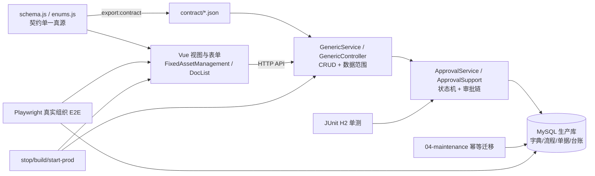

## User Requirements

依据已确认的《固定资产业务规范（目标口径）与现状对照》文档，把目标口径完整落地到系统中；回归验证要按系统内真实部门、真实人员账号与真实审批链走对应的业务流程，由助手实际执行测试并给出结果；允许同步更新基础字典与数据结构并重启服务完成验证，但不得清空、重导或改写存量业务数据。

## Product Overview

固定资产全生命周期统一为「登记建账 → 实际入库 → 领用借出 → 在用变更／维修／盘点 → 处置退出」：新增资产是登记、入库是实际资产入库，两者不强制串行；借出归还并入退库，经仓管验收后资产回仓库；期初导入的历史数据保留例外，切换日由管理员指定。界面保持现有风格与配色，仅调整页签归属、表单字段、按钮文案与状态展示。

## Core Features

- 资产变更收敛为调拨、维修、信息更正三类，共用一张变更单；维修引入「维修中」状态与「修毕验收」环节，信息更正留更正前后快照。
- 资产处置收敛为报废、变卖、捐赠、转让四类；后三类强制财务与审计参与，转让仅限集团内独立核算主体、出公司即出账。
- 借出归还改为关联原借出单的退库单，经部门主管确认与仓管验收审批，归还后资产回仓库并清空使用人，全程留单据与审批轨迹。
- 期初导入保留历史例外，不倒补单据，标注来源与批次；切换日由管理员指定，之后新增一律走登记。
- 按 8 个有资产部门、各角色真人账号各走一条完整审批链的回归验证，产出可复跑的核对清单与分部门报告。

## Tech Stack Selection

沿用现有栈，不引入新框架或工具链（与 `docs/e2e/plan-真实角色E2E.md:13-18` 一致）：

- 前端：Vue 3 + Element Plus + Pinia + Vite；契约单一真源 `fams-frontend/src/services/contract/schema.js`，`npm run export:contract`（`tools/export-contract.mjs`）导出 `resources.json` / `enums.json` / `permissions.json` 到 `fams-backend/src/main/resources/contract/`。
- 后端：Spring Boot 2.7 + MyBatis `SqlProvider` + 契约驱动 CRUD（`GenericService` / `GenericController`）；MySQL 8 生产库，H2 内存库单测。
- 测试：后端 JUnit + MockMvc（`fams-backend/pom.xml`，`build-prod.ps1` 内 `mvn clean package` 强制执行）；前端 Node 单测 `npm run test` + `check:perm`；E2E 复用既有 `@playwright/test` 与 `tests/e2e/fixtures/*`。
- 部署：`stop-prod.ps1` → `build-prod.ps1` → `start-prod.ps1`；DDL 用 `root@localhost`（`fams` 仅 DML）。
- **明确不使用** `agent-browser` / `playwright-cli` 等外部浏览器 CLI：项目已有 `e2e:real-org` 脚本，外部 CLI 会破坏既有运行方式与清理约定。

## Implementation Approach

以 `docs/fixed-asset-business-rules.md` §3／§4 为目标行为、§5 的 17 条差距为核对表、§6 的 7 项为范围基线，按「契约与数据 → 后端状态机 → 前端适配 → 测试改写 → 部署验证」串行推进。同文件改造（尤其 `ApprovalService.java` 与 `schema.js`）集中在一批完成，避免多次冲突。

关键决策与取舍：

1. **`back` 拆独立静态契约**：参照 `BORROW_DOCS`（`schema.js:829-859`）先例，新增 `BACK_DOCS` 并加入 `CONTRACT_LIST`（`:862-876`），同时从 `CONTRACT_PATTERNS.test`（`:891`）与 `DYNAMIC_KEYS`（`:944-948`）排除 `fixed-asset-doc-lists-back`。否则共用模板加字段会连带 8 张表，且导出时生成重复 key。字段为通用 9 字段加可空 `borrowDocId`（`f.ref('fixed-asset-doc-lists-borrow')`），非空即归还型，暂不新增枚举。
2. **归还复用 WF3，不新建单据与流程**：删除 `ApprovalService.java:110-113` 的 `action=return` 短路与 `:329-372` 的 `registerBorrowReturn`；`RETURN` 分支 DONE 时按 `borrowDocId` 回写借出单 `returned/returnDate/returnBy`，并校验借出单为 `DONE`、未归还、`assetId` 一致及防重复；台账 `IDLE + userId=null` 沿用 `:507-510` 既有回写。WF3 现有「部门主管确认 → 仓管员验收入库」（`00-baseline.sql:313`）天然满足仓管验收裁决。
3. **存量生产数据兼容读、不物理改写**：字典项用 `status` 停用（`system_dict_items` 已有该列）而非删除；`borrow_doc_id` 新增列可空；旧 `dispose_type.TRANSFER`（调拨）、`change_type.OTHER`、已 `returned` 的借出单、标「期初导入」的资产与用户手工维护的真实账号全部保留。**严禁清空／重导／批量 UPDATE 生产业务数据**。
4. **WF8 按处置方式强制财务+审计，不采信客户端 ctx**：`ApprovalSupport.java:124-145` 的 `conditionStep` 仅支持 `NONE/AMOUNT_GT/HAS_DIFF`。新增「按处置方式」条件类型，并在 `ApprovalService.java:119` 的 `effectiveCtx(bizType, previous, request.getCtx())` 中从单据 `previous` 读取 `disposeType` 覆盖客户端传值（该行注释已明确「客户端可以伪造 ctx 把条件环节跳过」）。报废沿用 `00-baseline.sql:318` 的金额门槛，变卖／捐赠／转让无条件触发 R4 + R6。
5. **状态前置校验集中在服务端**：`assetId` 必填、资产下拉按状态过滤、`syncAssetLedger`（`:497-532`）补 `TRANSFER`（更新归属）／`REPAIR`（`REPAIRING`）／`CORRECTION`（快照留痕）与修毕验收回用，消除 WF5/WF6/WF7 的 `default: break`；`AMOUNT_GT` 改 fail-closed（金额缺失不再静默判定条件成立，改为服务端兜底或拒绝提交），`SEQUENCE` 语义修正需谨慎——`ApprovalSupport.currentStep`（`:161-171`）影响 WF2/WF3/WF4/WF6/WF9/WF10/WF11 全部流程，须以全量回归兜底。
6. **期初切换日管理员指定**：系统参数持久化 + 写操作日志，`FixedAssetImportService.java:285-302` 读取并加硬边界与批次号；切换日后关闭期初口子，`sourceTag=期初导入` 不得被日常新增复用。
7. **§7.3 四项未定口径保留现状**（维修期间盘点、领用人字段来源、已核销资产范围、信息更正折旧基数），本次不擅自决断、不扩大范围。

性能与可靠性：契约导出为一次性的 O(集合数) 操作；服务端校验集中在审批入口与 `syncAssetLedger`，避免每条单据多次全表扫描（`assetStatus` 单次点查）；真实组织 E2E 沿用 `beforeAll` 一次登录 + 资产快照 + 每部门只取必备资产 + `afterAll` 差集逆序清理，复杂度随 8 部门线性增长；DDL 全部用 `information_schema` 幂等检查（参照 `10-asset-source-tag.sql`）；回归只写 `E2E_ORG_` 前缀数据，绝不删真实账号。

## Implementation Notes

- **执行顺序硬约束**：`enums.js` / `schema.js` → `npm run export:contract` → 核对 `resources.json` 中 `back` 为静态集合、`enums.json` 新枚举 → DDL/字典/流程迁移脚本 → 后端 → 前端 → 测试。**契约 JSON 禁止手改**，否则下次导出被抹掉。
- **本机环境**：Node 不在 PATH，每个新 shell 先执行 `$env:Path = "$env:USERPROFILE\.workbuddy\binaries\node\versions\22.22.2-6;$env:Path"`；`build-prod.ps1:15-22` 已内置自动探测。新建源码／脚本／文档后核对头字节（正常为 `35,32,229,155`），出现 `fffe` 需转 UTF-8；`.ps1` 保持 ASCII-only。
- **构建即门禁**：`build-prod.ps1` 依次执行 `mvn clean package`（全量 JUnit）、`npm run test`、`check:perm`、`vite build`，任何一步红则不出 jar/dist；不得用 `-DskipTests` 绕过。本机验证必须按 stop → build → start 重启，否则旧 jar 导致新接口 404。
- **日志与数据保护**：沿用 `log.info/warn`，不打印口令、token、完整单据 payload；SQL 变更先 `mysqldump --single-transaction` 只读快照留档；迁移脚本单事务、可重复执行，结尾给出复核 SELECT。
- **爆炸半径控制**：不改低值资产库存语义、不改三层数据范围、不改环境标识、不重设计 UI 视觉；不启用外部浏览器 CLI；§7.3 四项标注为「待裁决，保留现状」写入同步后的文档。
- **影响面预警**：本次是口径变更而非补判断，`19-real-org-flow.spec.ts` 的 FZ-02（归还 `BORROWED→IN_USE`）、FZ-03（WF6 大额维修）、FZ-04（WF7 台账状态保持）、FZ-05（WF8 按金额加财务／审计）及 `P5InventoryDepreciationTest.borrowReturnRestoresAssetStatus` 预期全部失效，须逐条改写，不能沿用旧断言。

## Architecture Design

现有分层保持不变，本次是在既有链路内替换口径：



数据流向：用户操作 → 前端按 `docKey` 渲染表单 → 契约驱动 CRUD 落单据 → `ApprovalService` 按 `system_workflow_flows` 推进 → `DONE` 时 `syncAssetLedger` 回写台账。归还链路改为：借出单 `DONE` → 发起带 `borrowDocId` 的退库单（WF3）→ 仓管验收 `DONE` → 台账 `BORROWED→IDLE` 且 `userId=null`，同时回写借出单归还标记。

## Directory Structure

以下为本次将创建或修改的文件（`[NEW]` / `[MODIFY]`）：

```
f:/work/EAM-FAMS/
├── docs/fixed-asset-business-rules.md          # [MODIFY] 口径验收基线；仅当实现与 §3/§4 有偏差时补记，并把 §7.3 四项标为「待裁决、保留现状」
├── README.md                                  # [MODIFY] §盘点闭环 / §数据闭环 / §数据可见范围同步归还退库、四类处置、期初切换日口径
├── fams-frontend/
│   ├── src/constants/enums.js                 # [MODIFY] CHANGE_TYPE 增 CORRECTION 停 OTHER；DISPOSE_TYPE 改 SCRAP/SALE/DONATE/TRANSFER_OUT；ASSET_STATUS 增 REPAIRING、清理 DISPATCHING/DISPOSING 假状态
│   ├── src/services/contract/schema.js        # [MODIFY] 新增 BACK_DOCS 静态契约（含可空 borrowDocId）加入 CONTRACT_LIST；CONTRACT_PATTERNS 与 DYNAMIC_KEYS 排除 back；变更/处置/借出单字段扩展（更正快照、受让方/凭证号/出账依据、预计归还日）
│   ├── src/services/approval.js               # [MODIFY] 移除 registerBorrowReturn 前端调用，改为创建带 borrowDocId 的 DRAFT 退库单
│   ├── src/store/fixedAsset.js                # [MODIFY] 保持新增登记直写 IDLE；状态过滤与资产下拉选项按新状态机调整
│   ├── src/views/fixed-asset/FixedAssetManagement.vue   # [MODIFY] 「资产变更」页签收纳调拨/维修/信息更正三子签并从「资产处置」迁出（保留 fa:repair 权限判断）；处置页四类方式渲染；新增/入库文案区分；RECORD_SOURCES 挂归还退库单
│   ├── src/views/fixed-asset/FixedAssetDocList.vue      # [MODIFY] 归还登记按钮改「发起归还退库」；canReturnRow 改校验 DONE 且未归还借出单；删除归还登记弹窗改为生成退库草稿；资产下拉按状态过滤；表单按 docKey 扩展字段
│   ├── src/views/fixed-asset/FixedAssetReports.vue      # [MODIFY] 按新状态/处置方式适配统计口径（已核销资产范围按 §7.3 保留现状）
│   ├── src/services/mock/seed/                 # [MODIFY] asset.js / system.js / org.js 同步新枚举与假状态清理
│   └── tools/export-contract.mjs              # [只读参考] 已核对输出三份 JSON，正常无需改动
├── fams-backend/
│   ├── src/main/resources/contract/           # [MODIFY] resources.json / enums.json 由 export:contract 生成，禁止手改
│   ├── src/main/resources/db/seed.sql         # [MODIFY] 同步 WF5/WF6/WF8 steps、字典项与角色说明
│   ├── src/main/java/com/fams/module/approval/ApprovalService.java        # [MODIFY] 删 return 短路与 registerBorrowReturn；RETURN DONE 回写借出单；syncAssetLedger 补 TRANSFER/REPAIR/CORRECTION 与修毕验收；状态前置校验与互斥锁；派发 userId；effectiveCtx 注入 disposeType
│   ├── src/main/java/com/fams/module/approval/ApprovalSupport.java       # [MODIFY] 新增按处置方式条件类型；AMOUNT_GT fail-closed；SEQUENCE 语义修正
│   ├── src/main/java/com/fams/imports/FixedAssetImportService.java       # [MODIFY] 读取管理员指定切换日、加硬边界与批次号、禁止 sourceTag 被日常新增复用
│   ├── src/main/java/com/fams/engine/GenericService.java                 # [MODIFY] 仅在与新增校验/数据范围冲突时最小调整，复用 scopedRaw 与 version 乐观锁（409）
│   ├── sql/04-maintenance/13-fixed-asset-business-rules.sql             # [NEW] 幂等迁移：borrow_doc_id 加列+索引、字典项启用/停用、WF5/WF6/WF8 steps 更新、系统参数（期初切换日）+ 操作日志；含结尾复核 SELECT
│   ├── sql/02-seed/00-baseline.sql            # [MODIFY] 与迁移脚本等价的流程/字典基线
│   └── src/test/java/com/fams/                # [MODIFY] p5/P5InventoryDepreciationTest.java 归还断言改 BORROWED→IDLE 且 userId 清空；p*/ 补状态互斥、四类处置、三类变更、REPAIRING/修毕验收、归还重复 409、财务+审计强制、期初边界用例；TestAccounts.java 不改
├── deploy/sql/mysql/baseline-data.sql         # [MODIFY] 补齐流程 INSERT 与字典，消除四处 seeds 不同步
├── db-baseline/e2e-baseline.sql               # [MODIFY] 补 approverType 与新 steps
├── tests/e2e/
│   ├── 19-real-org-flow.spec.ts               # [MODIFY] 按新口径逐条改写 FZ-00~FZ-10，8 部门各一条完整真实审批链；CTX_LARGE_* 改按处置方式强制财务+审计；归还断言改退库单+IDLE
│   ├── fixtures/realOrg.ts                    # [MODIFY] 夹具按新枚举/流程/归还链路调整，保持只写 E2E_ORG_ 前缀、差集清理、不删真实账号
│   ├── 15-doc-state-machine.spec.ts           # [MODIFY] 状态机与互斥断言
│   ├── 17-dept-approval-chain.spec.ts         # [MODIFY] P9-05 纵向审批链断言
│   ├── 04/05/06/09/12/20-*.spec.ts           # [MODIFY] 按新枚举、页签归属与归还语义批量校正断言与注释
│   └── docs/e2e/                             # [MODIFY] runbook.md、real-org-verification.md、sql/real-org-check.sql、plan-真实角色E2E.md 同步复核清单与报告口径
└── docs/dept-approval.md / docs/qa/escaped-defects.md   # [MODIFY] 同步审批链与登记逃逸缺陷
```

实现要求：所有 SQL 迁移脚本单事务、幂等（`information_schema` 检查，参照 `10-asset-source-tag.sql`）；`stop-prod.ps1` / `build-prod.ps1` / `start-prod.ps1` 本身不改，只按既有顺序调用；新增文件核对 UTF-8 无 BOM。

## Agent Extensions

### SubAgent

- **code-explorer**
- Purpose: 以 very thorough 级别全仓盘点旧口径引用点（`BORROWED→IN_USE`、`action=return`、`dispose_type.TRANSFER`、`change_type.OTHER`、`DISPATCHING/DISPOSING`、按金额加财务/审计的 `CTX_LARGE_*`、四处 seeds、`E2E_` 断言、文档旧措辞），并核对 `schema.js` 静态契约注册链与 `ApprovalService.syncAssetLedger` 调用链。
- Expected outcome: 产出一份带文件路径与行号的「旧口径引用清单」，作为第 2~5 步的改造 checklist 与第 6 步回归覆盖核对依据，避免 17 条差距漏改。