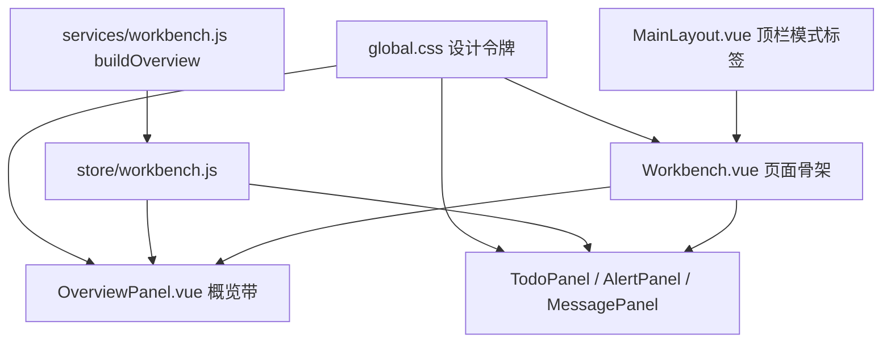

## User Requirements

- 工作台页面已完成「概览带 → 行动条 → 待办主体」的层级调整，需要通过专业 UI 评审继续打磨，使其同时适配领导与业务审批人两类使用者。
- 本次覆盖评审提出的全部 18 项优化，包括数据语义纠错、视觉层级、对齐栅格、交互状态、空态设计与响应式断点。
- 除代码改动外，需要把字号、间距、色彩语义、数字排版规则沉淀为可复用样式，并产出一份简短的设计约束文档，供后续看板类页面统一。

## Product Overview

工作台是登录后的默认首页，也是领导看经营全局、审批人处理单据的唯一入口。页面固定为一屏，从上到下依次呈现资产与低值家底、审批时效、待我处理的事项，以及待办与预警消息明细。本次优化不改变这套信息架构，只让数字更可信、层级更清晰、空状态更有引导性，并保证在矮屏与窄屏下依然完整可读。

## Core Features

- 概览数据准确可信：低值资产展示自身的分类分布，不再串用固定资产类别；无审批记录时不再显示「平均 0 小时」这类误导值；数量类指标补齐单位。
- 视觉层级重建：经营数据成为页面视觉焦点，金额与统计回归中性色，只有需要行动的数字使用强调色；数字采用等宽排版，纵向稳定对齐。
- 结构对齐统一：左右卡片标题与页签处于同一基线，概览列、行动条、卡片头共用同一套内容缩进。
- 状态表达更克制：待办与预警为 0 时不再占据最强色块，预警正常时给出明确的健康状态；概览每一列可整块点击进入对应报表。
- 空状态具备引导：空态内容垂直居中，提供「去创建资产」「查看流程配置」等主动作，排障说明收进可展开区域。
- 多屏适配：矮屏自动压缩插画与说明，窄屏概览自动降列，页面不产生整页滚动或内容裁切。
- 设计规则沉淀：字号阶梯、间距、颜色语义、数字排版形成统一定义与文档，后续看板直接复用。

## Tech Stack

- 前端框架：Vue 3.5（`<script setup>`）+ Vue Router 4 + Pinia
- UI 组件库：Element Plus 2.9（沿用，不引入新依赖）
- 构建工具：Vite 6
- 样式体系：原生 CSS + CSS 变量（`src/styles/global.css` 已有浅色/深色两套主题）
- 测试：Node 原生断言脚本（`npm test`，含 `workbench.test.mjs`）

## Implementation Approach

采用「先立规范、再改页面、最后补断点与文档」的顺序推进，避免边改边造 token 导致样式二次返工。

**1. 令牌优先（Token First）**
在 `global.css` 补齐四类基础令牌：字号阶梯（11/12/13/14/16/20/24）、4px 倍数间距、数字排版（复用已有 `--font-num` + `font-variant-numeric: tabular-nums`）、颜色语义（数据用 `--t-main`，可操作用 `--c-primary`，风险用 `--c-danger`，健康用 `--c-success`）。深色主题 `[data-theme="dark"]` 必须成对补值，禁止写死浅色底。

**2. 数据语义修正保持向后兼容**
`buildOverview` 返回值只做**增量扩展**，不改变已有字段类型，避免影响其他消费方（`store/workbench.js`、报表页、`workbench.test.mjs`）：

- 新增 `lowValue.topTypes`，按低值物品自身分类字段聚合 Top5。字段名需在低值 store 与 mock seed 中确认后再用，不得臆造；若确认不到可靠分类字段，则该列 chips 直接移除，只保留物品数、库存金额、审批占用三个指标。
- 保留 `approval.avgHours` 为 number，新增 `approval.sampleCount`（参与平均的已办结条数）。UI 以 `sampleCount > 0` 判断是否展示时长，避免破坏既有类型契约。

**3. 视觉层级与语义色**
概览主数字提升到 22–24px、`font-weight: 700`、颜色 `--t-main`；行动条数字回落到 18px，靠位置与底色而非字号取胜。金额符号小一号，值与单位间距 2px。三列竖线由 2px 主色改为 1px `--bd`。

**4. 结构对齐**
右卡补一个与左卡等高的卡片头，使两侧 tabs 基线一致；三处内容缩进统一到 16px 栅格。左卡标题由「我的待办」改为「我的单据」，让标题与「我发起的 / 我已处理」语义相符。

**5. 交互状态**
待办与预警仅在数量大于 0 时启用主色底/警示色；为 0 时退回白卡，预警格给出绿色「正常」状态点。概览整列成为可点击区域（hover 淡底 + 右侧箭头），跳转沿用现有路由 `/fixed-asset-reports`、`/low-value-asset-reports`。刷新改为图标按钮 + tooltip 降低视觉重量。顶栏模式标签在 `dataMode === 'mock'` 时显示「演示数据」，生产环境隐藏。

**6. 空态与断点**
空态改为 flex 垂直居中，主文案下方补主动作按钮，长排障说明收进「为什么没有待办？」折叠区。断点分两档：`max-height: 720px` 隐藏插画、说明折叠、chips 单行截断；`max-width: 1280px` 概览三列降为两列并允许换行，行动条保持单行不折。

**7. 性能与稳定性**
`buildOverview` 已在一次遍历内完成统计，新增分类聚合仍为 O(m) 单次 Map 累加，不引入 N+1 或重复遍历。所有视图数据仍走 computed 缓存，断点与状态均为纯 CSS 或轻量 computed，不新增全局监听（`TodoPanel` 已有的 resize 监听保持单一职责）。改动只触及工作台相关文件与顶栏标签，不重构其他页面。

## Implementation Notes

- 文字强色变量是 `--t-main`（不是 `--t-strong`），弱色 `--t-weak`、次色 `--t-sub`；数字字体已有 `--font-num`，直接复用。
- 一屏布局的高度链不能破坏：概览 `flex-shrink: 0`，主体 `flex: 1; min-height: 0`，列容器保持 `overflow: hidden`；任何新增块都不得让 `.workbench-page` 产生整页滚动。
- `.page-container` 全局有 `min-height: 100%`，工作台靠 `min-height: 0 !important` 覆盖，改动时不要误删该覆盖。
- 权限模型不变：内容可见性继续由 `wm:todo / wm:alert / wm:overview / wm:message` 决定，概览带仍由 `wm:overview` 控制领导/审批人视角。
- Element Plus `el-table` 的 `max-height` 只接受数值，`TodoPanel` 的 240–520 夹取逻辑保留，不要改成百分比。
- 颜色新增一律走变量并同步深色主题，避免深色模式下出现白底或对比度不足。
- 验证命令需先设置 Node 路径：`$env:Path = "$env:USERPROFILE\.workbuddy\binaries\node\versions\22.22.2-6;$env:Path"`；随后 `npm run build`、`npm test`。浏览器点测由用户手动完成，不跑自动化浏览器测试。

## Architecture Design

改动集中在「样式基座 → 数据聚合 → 页面视图」三层，不新增模块与依赖：



数据流保持单向：`buildOverview` 输出概览快照 → Pinia computed → 各面板渲染；交互（点击指标、整列下钻、空态 CTA）只做路由跳转或页签切换，不写回业务数据。

## Directory Structure

```
fams-frontend/
├── src/
│   ├── styles/
│   │   └── global.css                # [MODIFY] 新增字号阶梯、间距、数字排版工具类与语义色变量；深色主题成对补值
│   ├── services/
│   │   └── workbench.js              # [MODIFY] buildOverview 增加 lowValue.topTypes 与 approval.sampleCount；保留原有字段类型
│   ├── views/workbench/
│   │   ├── Workbench.vue             # [MODIFY] 行动条条件强调、概览整列下钻、刷新降噪、16px 缩进、卡片更名、响应式断点
│   │   └── components/
│   │       ├── OverviewPanel.vue     # [MODIFY] 修正低值 chips 数据源、空态时长判断、单位补齐、数字层级与语序、竖线减重、整列可点
│   │       ├── TodoPanel.vue         # [MODIFY] 空态居中与 CTA、排障说明折叠、最小字号 12px
│   │       ├── AlertPanel.vue        # [MODIFY] 空态居中与健康状态表达、CTA 跳转
│   │       └── MessagePanel.vue      # [MODIFY] 空态居中与 CTA、11px 时间戳提升到 12px
│   └── layouts/
│       └── MainLayout.vue            # [MODIFY] 模式标签仅 mock 环境显示「演示数据」
├── docs/
│   └── UI_DESIGN_GUIDE.md            # [NEW] 简短设计约束：字号阶梯、间距、颜色语义、数字排版、卡片头与空态规范
├── workbench.test.mjs                # [MODIFY] 补充 lowValue.topTypes 与 sampleCount 断言，保持原断言通过
└── package.json                      # [不变] 不新增依赖与脚本
```

## Key Code Structures

```js
// services/workbench.js — buildOverview 返回值增量（保持向后兼容）
{
  lowValue: { itemKinds, stockAmount, reservedTotal, topTypes: [{ name, value }] },
  approval: { submitCount, agreeCount, rejectCount, avgHours, sampleCount, processing, pendingByStep }
}
```

## 设计定位

保持现有后台系统的克制与秩序感，不改变品牌色与整体版式，只做「层级校正 + 细节收紧」。目标是让领导在第一屏读出经营规模，让审批人在两次点击内完成处理。

## 视觉层级

- 第一层：概览三组经营数字，主数字 22–24px、700 字重、深中性色，单位与标签 12px 弱色。
- 第二层：行动条「待我审批 / 预警 / 我在途」，数字 18px，仅在数量大于 0 时使用主色底与警示色。
- 第三层：卡片标题与页签，13px / 600，与内容区保持同一 16px 缩进基线。
- 第四层：辅助说明、chips、时间戳，统一 12px 弱色，不再低于 12px。

## 结构对齐

- 三块内容区（概览列、行动条格、卡片头）左边缘严格对齐到同一栅格。
- 左右卡片头等高，页签基线齐平；卡片标题与右侧操作按钮同行两端对齐。
- 概览三列用 1px 灰色分隔线，仅保留分组语义，不抢数字的视觉权重。

## 色彩语义

- 数据与金额：`--t-main`，只读信息不使用主色，避免与可点击链接混淆。
- 可操作与下钻：`--c-primary`，配合 hover 淡底与箭头提示。
- 风险：`--c-danger`，仅预警数量大于 0 时出现在数字与图标上。
- 健康：`--c-success`，用于预警为空时的「正常」状态点。
- 深色主题沿用同名变量，不额外定义色值。

## 交互与反馈

- 概览整列可点击，hover 时整列淡底过渡 0.15s，右侧出现右箭头。
- 指标格 hover 描边主色，数量为 0 且不可下钻的格不显示手型光标。
- 空态提供单一主动作按钮，按钮样式随所在卡片语义（待办用主色、预警用文字按钮）。
- 刷新改为无边框图标按钮，hover 显示 tooltip，不再占用页头主位。

## 响应式

- 高度小于 720px：隐藏空态插画，排障说明默认折叠，chips 单行截断。
- 宽度小于 1280px：概览由三列降为两列，第二行跨列；行动条保持单行等分。
- 任何断点下页面都不产生整页纵向滚动，超出内容在卡片内部滚动。

## Agent Extensions

### SubAgent

- **code-explorer**
- Purpose: 在实施数据语义修正前，快速确认低值物品的分类字段名（低值 store、mock seed、`buildOverview` 的 items 数据来源），以及 `overview` 字段的其他消费方，避免臆造字段或破坏既有契约。
- Expected outcome: 给出低值分类字段的确切名称与所有 `overview.*` 消费点清单；若确实不存在可靠分类字段，则明确建议移除该列 chips 而非新增假数据。