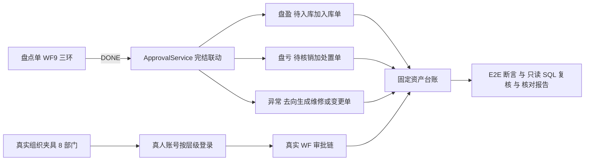

## 产品概述

按已确认的口径分四期补齐盘点与数据闭环，并用福州数据技术研究院有限公司的真实部门、真实人员账号和真实审批流程完成回归验证与数据核对。

## 核心 Features

- **异常闭环**：盘点明细登记为「异常」时必须选择处理去向（转维修单 / 转变更单 / 已说明）；未处理不得送审或完结，完结后按去向生成待审单据。
- **分批保存**：盘点结果可先保存已登记部分，之后继续盘点；送审仍要求全部明细登记完毕，盘点员进度按分派数量正确计算。
- **盘点报表**：在既有明细导出上追加差异汇总（盘盈、盘亏、异常清单与合计、盘点单号、期间）。
- **借出归还**：在原借出单登记归还日期与备注，登记后资产状态回到使用中，操作可追溯。
- **导入告警**：导入借出中、维修中、派发中、处置中的资产时行级告警但放行，并标注「期初导入」；不阻断期初数据。
- **口径边界**：明确盘点流程保留角色池的原因、盘点终端当前仅覆盖设备登记与异常登记的边界。
- **真实组织回归**：覆盖该公司在册资产的 8 个部门，按使用人、部门负责人、分管领导、财务、仓管、审计、资产管理员的真实层级登录，走真实审批链；自动化断言台账状态、派生单据、审批轨迹与部门配置前后一致，并交付可复跑 SQL 复核清单和分部门分层的核对报告。

## 技术栈选型

沿用现有栈，不引入新框架或新工具链：

- 后端：Spring Boot 2.7 + MyBatis `SqlProvider` 动态 SQL，契约驱动 CRUD（`GenericService` / `GenericController`），MySQL 8 生产库、H2 内存库单测。
- 前端：Vue 3 + Element Plus + Pinia + Vite，契约单一真源为 `fams-frontend/src/services/contract/schema.js`，经 `npm run export:contract` 生成后端 `contract/*.json`。
- 测试：后端 JUnit + MockMvc（`P5InventoryDepreciationTest` 等共 127 条）；E2E 复用项目既有 `@playwright/test` 与 `tests/e2e/fixtures/*`，不使用外部浏览器 CLI，避免破坏既有运行方式。
- 部署：`stop-prod.ps1` → `build-prod.ps1` → `start-prod.ps1`；DDL 与字典迁移用 `root@localhost` / `Fzidt@123`，`fams` 只有 DML。

## 实现策略

按「一期盘点闭环 → 二期数据闭环 → 三期口径边界 → 四期真实组织回归」串行推进。一期与二期都改 `ApprovalService.java`、`schema.js`，串行可避免同文件冲突；四期必须在功能冻结、生产栈重建后执行，保证断言针对最终行为。

关键决策与取舍：

1. **1B 复用既有集合与流程**：异常去向复用 `fixed-asset-doc-lists-repair` / `-change` 与 WF6 / WF7，沿用 `syncInventorySurplus` / `syncInventoryLoss` 的 `createIndependent` 独立事务模式，不新增集合、不新增资产状态，降低状态机复杂度。新增「未选去向」校验放在后端送审前置（与 `pendingCheckCount` 同处），前端只做提示，不采信客户端 `hasDiff`。
2. **3B 后端零改动**：`saveCheckResults` 放开「还有 N 项未登记」拦截；后端 `pendingCheckCount` 已在送审时兜底，因此不会出现绕过审批；`counters.done` 改为按该盘点员分派数计算。
3. **4B 单独静态契约**：`fixed-asset-doc-lists-*` 共用一套动态契约模板，直接给共用模板加字段会连带 8 张表。改为在 `CONTRACT_LIST` 中为 borrow 定义静态契约，并同步从 `DYNAMIC_KEYS` 排除 `fixed-asset-doc-lists-borrow`，避免导出时生成重复 key；仅 `fixed_asset_doc_lists_borrow` 加列。归还联动复用 `ApprovalService` 的 `updateQuietly` + `patchField` 与审批动作端点中等价的非推进型动作，不新建 Controller / 端点。
4. **5B 告警不阻断**：`FixedAssetImportResult` 增加 `warnings`，`SystemDataImport.vue` 增加告警表；资产表新增可选 `source_tag` 列承载「期初导入」标注。不推翻已定的「期初允许无单据、状态以台账为准」。
5. **2A / 6A 仅文档**：盘点单跨部门、明细横跨多个部门，纵向审批的部门维度不适用，WF9 保留角色池并在 `docs/dept-approval.md` 写明例外；终端边界写入 README。避免为不成立的维度改造 `ApproverResolver`。
6. **7B 纯前端**：`exportInventory` 增加汇总行与合计，不新增后端导出接口。

性能与复杂度：E2E 覆盖 8 个部门且每部门走完整层级，用例数约翻倍，串行执行时间上升。缓解措施：共享一份真实组织夹具（`beforeAll` 一次登录、批量取部门与资产快照），每部门只取必备资产，不重复全表遍历；`afterAll` 批量逆序清理；SQL 复核全部为只读 SELECT，不产生额外写入热点。派生单据生成仍是 O(异常明细数) 的独立事务，与现有盘盈/盘亏同量级。

## 实现要点（防回归）

- **契约单一真源**：严禁手改 `contract/resources.json` / `enums.json`；先改 `schema.js` / `constants/enums.js` 再 `export:contract`，导出后逐项比对 `git diff`，确认折旧计划明细 8 列与 `DOC_APPROVALS.targetUserId` 未再被抹掉。新增枚举须同步 `ENUM_DICT_META` 与三处字典 seed。
- **迁移与表结构**：任何新增列或字典项同步 `deploy/sql/mysql/schema.sql`、`fams-backend/src/main/resources/db/schema.sql`、`fams-backend/sql/01-schema/00-schema.sql` 及三处 baseline seed；迁移脚本编号 `08/09/10` 放 `sql/04-maintenance/`，全部 `ON DUPLICATE KEY UPDATE` / 幂等，用 root 执行。新增字段一律可选，保证旧数据兼容。
- **爆炸半径控制**：不自动清库、不删真实账号；测试单据挂在真人名下，清理只删单据、派生资产、审批轨迹；不改动部门 `leader_id` / `vp_id`（若必须临时改，先快照后恢复并断言一致）；保留用户手工草稿盘点单 `PD20261104001`；归还动作只作用于已完结且未归还的借出单。
- **日志与安全**：复用现有 `log.info/warn`，只记 `docId`、`assetId`、单号，不打印整包 `items`；真实账号初始口令仅存夹具常量，不写入日志、报告与产物；派生单据失败只 warn、不推翻主事务；单号毫秒级 + 随机盐并按列宽 `cut`，避免唯一键冲突把审批变成 500。
- **验证链**：每期结束跑后端单测与前端单测；结构变更后执行 `stop-prod` → `build-prod` → `start-prod`，再做接口健康检查与 `npm run e2e:p10`、`e2e:p9`，最后跑全量 E2E；`build-prod` 的 127 条单测与权限契约检查必须全绿。
- **用例风格**：沿用 `P10-xx` / `P9-xx` 命名、`apiList` / `act` / `withApi` 工具、`afterAll` 逆序清理，并在 `docs/e2e/test-plan-p1-p5.md` 与 `docs/qa/escaped-defects.md` 登记。

## 架构设计

分层不变：契约层（前端 schema → 后端 JSON）→ 通用引擎层（`GenericService` 校验/引用/乐观锁/审计）→ 审批服务层（`ApprovalService` 状态机与完结联动）→ 前端视图层（Element Plus 表单与表格）→ 验证层（JUnit + Playwright + 只读 SQL）。新增能力全部落在既有层内，不新增架构模式。



数据闭环补充链路：借出单审批通过置 `BORROWED`，归还登记后由服务端回写 `IN_USE`；导入告警写入结果 `warnings` 与资产 `source_tag`，不改变导入事务的提交语义。

## 目录结构

### 一期：异常闭环、分批保存、报表汇总

```
fams-backend/src/main/java/com/fams/module/approval/ApprovalService.java  # [MODIFY] 新增 syncInventoryAbnormal：完结时按明细去向用 createIndependent 生成 DRAFT 维修/变更单；新增「未选去向」送审前置校验（与 pendingCheckCount 同处）；复用 cut/numberOf/putIfPresent 工具；失败只 warn
fams-frontend/src/views/fixed-asset/FixedAssetManagement.vue  # [MODIFY] 盘点清单加「处理去向」下拉与必填校验；saveCheckResults 放开全部登记完才保存的拦截、counters.done 按分派数计；exportInventory 追加差异汇总行与合计；沿用 checkItems/checkListEditable
fams-frontend/src/constants/enums.js  # [MODIFY] 新增 INVENTORY_DISPOSAL 枚举与 ENUM_DICT_META（dictCode inventory_disposal）
fams-backend/src/main/resources/contract/enums.json  # [MODIFY] 由 export:contract 生成，禁止手改
fams-backend/src/main/resources/db/seed.sql  # [MODIFY] 新增 inventory_disposal 字典类型与 3 个字典项
fams-backend/sql/02-seed/00-baseline.sql  # [MODIFY] 同上，保持三处基线一致
deploy/sql/mysql/baseline-data.sql  # [MODIFY] 同上
fams-backend/sql/04-maintenance/08-inventory-disposal.sql  # [NEW] 幂等插入字典类型与字典项，生产库用 root 执行
fams-backend/src/test/java/com/fams/p5/P5InventoryDepreciationTest.java  # [MODIFY] 补异常转维修单、未选去向不得送审、去向为「已说明」不生成单据等用例
tests/e2e/18-inventory-flow.spec.ts  # [MODIFY] 新增 P10-13 起用例：异常去向落地、部分保存后刷新继续盘再送审、CSV 汇总可解析
```

### 二期：借出归还

```
fams-frontend/src/services/contract/schema.js  # [MODIFY] 新增 borrow 静态契约（returnDate/returnRemark/returnBy/returned），从 CONTRACT_PATTERNS 与 DYNAMIC_KEYS 排除该 key，避免重复生成
fams-backend/src/main/resources/contract/resources.json  # [MODIFY] 由 export:contract 生成；核对 8 类动态单据仍各自存在且字段未被连带修改
deploy/sql/mysql/schema.sql  # [MODIFY] 仅 fixed_asset_doc_lists_borrow 增 4 列
fams-backend/src/main/resources/db/schema.sql  # [MODIFY] 同上，H2 单测建表同步
fams-backend/sql/01-schema/00-schema.sql  # [MODIFY] 同上，基线建表同步
fams-backend/sql/04-maintenance/09-borrow-return.sql  # [NEW] 幂等加列迁移脚本
fams-backend/src/main/java/com/fams/module/approval/ApprovalService.java  # [MODIFY] 新增非推进型归还动作：校验 DONE 且未归还，写归还字段并 patchField 台账状态回 IN_USE，留痕不推进审批状态
fams-frontend/src/services/approval.js  # [MODIFY] 新增归还动作常量与调用封装，沿用既有 act 通道
fams-frontend/src/views/fixed-asset/FixedAssetDocList.vue  # [MODIFY] 借出页签增加「归还登记」按钮与表单，仅对已完结未归还单据可用
fams-frontend/src/constants/enums.js  # [MODIFY] 如需新增轨迹结果值则同步枚举与字典，保持前后端一致
tests/e2e/17-dept-approval-chain.spec.ts  # [MODIFY] 补借出到归还的状态回写与越权归还被拒用例
```

### 二期：导入告警与期初标注

```
fams-backend/src/main/java/com/fams/imports/FixedAssetImportService.java  # [MODIFY] 状态解析处对借出中/维修中/派发中/处置中记录 warnings 并写 sourceTag=期初导入；FixedAssetImportResult 增加 warnings 列表；模板说明补告警口径
fams-frontend/src/services/contract/schema.js  # [MODIFY] ASSETS 增加可选 sourceTag 字段（随后重新导出 resources.json）
deploy/sql/mysql/schema.sql  # [MODIFY] fixed_assets 增 source_tag 列
fams-backend/src/main/resources/db/schema.sql  # [MODIFY] 同上
fams-backend/sql/01-schema/00-schema.sql  # [MODIFY] 同上
fams-backend/sql/04-maintenance/10-asset-source-tag.sql  # [NEW] 幂等加列迁移脚本
fams-frontend/src/views/system/SystemDataImport.vue  # [MODIFY] 结果区增加告警表，与失败明细区分展示，不阻断导入
fams-backend/src/test/java/com/fams/p8/P8DataImportTest.java  # [MODIFY] 补告警但放行、标注落库、空闲状态不告警用例
tests/e2e/10-import-reset.spec.ts  # [MODIFY] 补导入结果告警展示断言
```

### 三期：口径边界与文档

```
docs/dept-approval.md  # [MODIFY] 写明 WF9 保留角色池为纵向审批例外，说明盘点单跨部门导致部门维度不成立
README.md  # [MODIFY] 盘点闭环口径补充异常去向、分批保存、借出归还、导入告警；终端管理边界说明
docs/e2e/test-plan-p1-p5.md  # [MODIFY] 第 8 节扩展用例表、第 9 节新增缺陷行、第 11 节补验收记录
docs/qa/escaped-defects.md  # [MODIFY] 登记本轮新增缺陷条目与对应回归用例
docs/deployment.md  # [MODIFY] 第 3.5 节补 08/09/10 迁移记录；重申契约导出顺序
```

### 四期：真实组织回归与数据核对

```
tests/e2e/fixtures/realOrg.ts  # [NEW] 真实组织夹具：按 org-structure-fzidt.csv 的初始口令登录，构建福州公司 8 个有资产部门的部门/层级账号矩阵，提供 beforeAll 快照与 afterAll 只读账号、只删单据的清理
tests/e2e/19-real-org-flow.spec.ts  # [NEW] 按 8 个部门 × 真实 WF1/WF2/WF4/WF6/WF8/WF9 审批链走真实流程，断言台账状态、派生单据、审批轨迹、部门配置前后一致；含「公司领导」部门 leader 为 R7 的层级例外处理与 R2 仅 admin 的兜底
docs/e2e/sql/real-org-check.sql  # [NEW] 可复跑只读复核 SQL：分部门单据数、台账状态分布、审批人命中、派生单据与来源单号、残留测试数据、手工盘点单完好性
docs/e2e/real-org-verification.md  # [NEW] 分部门分层核对报告模板与最终实测结果，含每部门每环节通过情况与数据检查结论
package.json  # [MODIFY] 根目录新增 e2e:real-org 脚本，指向 19-real-org-flow.spec.ts
```

## 关键结构（接口级）

真实组织夹具为四期所有用例共用，需精确约定：

```ts
/** 一个真实部门 × 完整审批层级（来自生产库与 org-structure-fzidt.csv） */
export interface RealOrgDept {
  deptId: string
  deptName: string
  assetCount: number
  actors: {
    user: RealOrgActor
    deptLeader: RealOrgActor
    vp: RealOrgActor
    assetManager: RealOrgActor
    finance?: RealOrgActor
    warehouse?: RealOrgActor
    auditor?: RealOrgActor
  }
}

export interface RealOrgActor {
  id: string
  username: string
  name: string
  roleIds: string[]
  password: string
}
```

新增业务字段契约（盘点明细位于 items JSON，无需改表；借出归还与 sourceTag 需加列）：

```ts
type InventoryDisposal = 'REPAIR' | 'CHANGE' | 'EXPLAINED' | ''
interface BorrowReturnFields {
  returnDate?: string
  returnRemark?: string
  returnBy?: string
  returned?: boolean
}
```