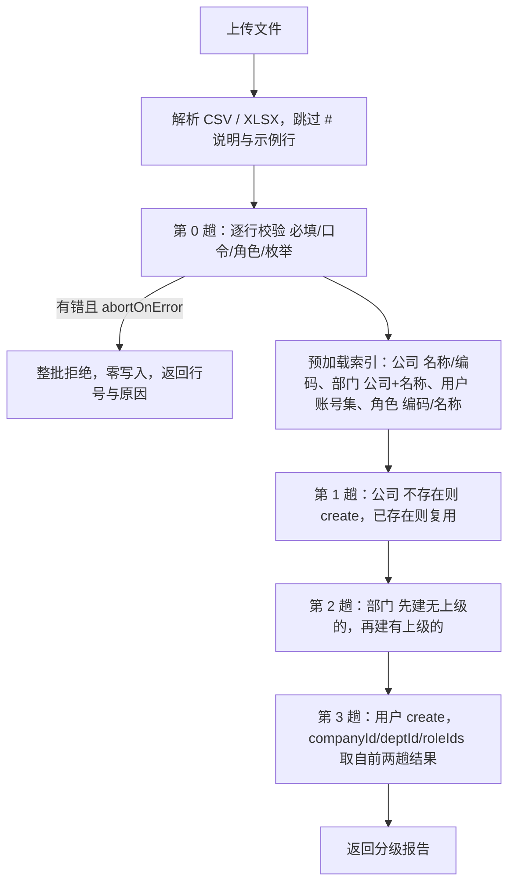
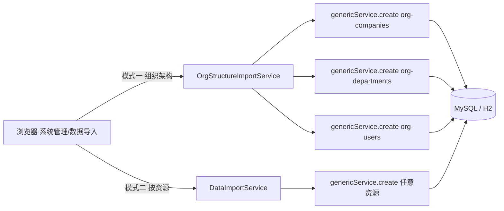

## 用户需求

> 按用户角度来理解，公司部门用户应该一张表就要可以导入才对，分三张表太复杂了，规划好只做一张表

## 产品概述

客户导入组织架构时，当前要分别下载并填写 `org-companies` / `org-departments` / `org-users` 三张模板，且必须自己填写 `companyId` / `deptId` 主键（引用校验要求目标记录已存在），顺序错了就整体失败——这对业务人员极不友好。

本需求改为**业务视角的一张扁平表**：客户只维护一张「公司—部门—人」的表，一次上传；系统内部自动拆分为三张资源表落库，并自动处理归属关系与重复复用。

## 核心功能

- **单表模板**：中文表头的一张表，含「说明行 + 示例行」（以 `#` 开头，导入时自动跳过，与现有模板风格一致）。
- **一行的粒度决定建什么**：只填公司→建公司；公司+部门→建部门；公司+部门+姓名→建用户。客户用同一张表即可描述完整组织树。
- **自动复用（幂等）**：多行共享同一公司/部门时不会重复创建，自动匹配已有记录；客户无需填写任何主键。
- **自动编码**：公司编码/部门编码留空时按规则自动生成并保证唯一。
- **用户口令合规**：沿用现有 `PasswordPolicy`（≥8 位、含两类字符、不与账号相同），落库自动 BCrypt 加密；角色按编码或名称匹配。
- **分级结果报告**：逐行报告「新建公司/复用公司、新建部门/复用部门、新建用户」与失败原因（带行号）。
- **保留原「按资源导入」**：资产、低值等其他数据仍走原有按资源导入，前端提供模式切换。

## 技术栈

- 后端：Spring Boot 2.7 + MyBatis-Plus（Java 8），契约驱动的通用引擎（`ResourceRegistry` / `RowCodec` / `RuleEngine` / `GenericService`）
- 认证与口令：JWT + `PasswordPolicy` + BCrypt（`GenericService.create` 对 `org-users` 已内置加密）
- 文件解析：CSV（零依赖手写解析，已存在）+ XLSX/XLS（Apache POI 5.2.5，已引入）
- 前端：Vue3 + Vite + Element Plus
- 测试：`@SpringBootTest` + H2（test profile），JUnit 5
- 覆盖率门禁：jacoco（BUNDLE ≥ 0.75）

## 实现思路

### 1. 核心策略：业务扁平表 → 内部三表拆分

新增一层「组织架构导入」业务服务，位于现有「按资源导入」之上：

- **对外**：一张中文扁平表（客户视角）。
- **对内**：仍调用 `genericService.create("org-companies" / "org-departments" / "org-users", row)` 落库，**完全复用**审计戳、口令 BCrypt、钩子与业务规则，不绕过任何校验。

这样既满足"一张表"的体验，又不破坏既有的契约引擎与一致性。

### 2. 单表模板列定义

| 序号 | 中文表头 | 内部含义 | 必填 | 说明 |
| --- | --- | --- | --- | --- |
| 1 | 公司名称 | org_companies.name | 是 | 已存在则复用，不存在则新建 |
| 2 | 公司编码 | org_companies.code | 否 | 留空自动生成；填写时按编码优先匹配 |
| 3 | 部门名称 | org_departments.name | 否 | 留空表示该行只建公司 |
| 4 | 上级部门 | org_departments.parent_id（按名称解析） | 否 | 留空为一级部门；填写时父部门须在本文件或库中已存在 |
| 5 | 姓名 | org_users.name | 否 | 留空表示该行只建部门 |
| 6 | 登录账号 | org_users.username | 有姓名时必填 | 全局唯一，重复则报错（不覆盖他人口令） |
| 7 | 初始口令 | org_users.password | 有姓名时必填 | 明文，落库自动 BCrypt；须满足复杂度 |
| 8 | 岗位 | org_users.position | 否 |  |
| 9 | 手机 | org_users.phone | 否 |  |
| 10 | 邮箱 | org_users.email | 否 |  |
| 11 | 角色 | org_users.role_ids | 否 | 按角色编码（ROLE_ADMIN）或名称（系统管理员）匹配，支持多个 |
| 12 | 状态 | org_users.status | 否 | 默认 ENABLED，枚举校验 |


模板沿用三行结构：第 1 行中文表头、第 2 行 `#说明`、第 3 行 `#示例`（示例贴近真实，如 `示例科技有限公司 / 研发部 / 张三 / zhangsan / Zhang@2026!`）。

### 3. 处理算法（预加载 + 多趟，避免 N+1）

为避免逐行查库，先在内存建立索引，再分趟处理：



关键细节：

- **第 2 趟排序**：先处理 `上级部门` 为空的行，再处理有上级的行，保证父部门先落库；若父部门既不在库也不在文件中，则该行报错。
- **第 3 趟**：`username` 已存在则报错（明确不覆盖，避免误改他人口令）；`role_ids` 落库为角色主键的 JSON 数组（如 `["R1"]`）。
- **编码自动生成**：公司 code 留空 → `GS-` + 序号（以现有公司数为基数，补零 4 位，冲突则递增）；部门 code 留空 → `BM-` + 序号。
- **结果报告**：`total / createdCompanies / reusedCompanies / createdDepartments / reusedDepartments / createdUsers / failures[{row, message}]`，并给出状态 `OK / PARTIAL / FAILED / REJECTED_INVALID`。

### 4. 与现有能力的复用关系

- 解析：把现有 `DataImportService` 的 `parseCsv` / `parseExcel` / 行模型抽出为可复用的内部方法（保持现有按资源导入行为完全不变）。
- 落库：统一走 `genericService.create(key, row)`。
- 权限：页面入口沿用 `sys:import`；后端再按 `org-companies` / `org-departments` / `org-users` 的 POST 权限校验（与现有 `require(key)` 语义一致，能新增单条即可导入）。

## 实现备注

- **幂等是单表方案的成败关键**：必须以「公司名称」「公司+部门名称」为业务键做内存索引复用，绝不能依赖客户填写主键；这也是本方案彻底去掉 `companyId`/`deptId` 列的前提。
- **不覆盖既有口令**：账号重复直接判为失败行，而非更新，避免导入动作意外改掉他人的登录口令。
- **性能**：索引一次性预加载，行处理为内存 Map 查找，复杂度 O(行数)；组织架构量级（数百至数千行）无压力。避免在循环内调用 `genericService.list`。
- **错误处理**：第 0 趟统一校验后再落库，保证 `abortOnError` 语义下"要么全成功、要么零写入"；跨行依赖错误（如父部门缺失）在第 2 趟捕获并记入该行。
- **日志**：仅在失败/异常时记录（含行号与资源 key），避免逐行 info 日志造成刷屏；不记录口令等敏感字段。

## 架构设计



两个服务并列，共享解析工具与权限策略；`OrgStructureImportService` 是面向业务场景的薄编排层，不复制任何校验/落库逻辑。

## 目录结构

```
EAM-FAMS/
├── fams-backend/src/main/java/com/fams/imports/
│   ├── DataImportService.java            # [MODIFY] 抽出 CSV/XLSX 解析与行模型为可复用方法，行为保持不变
│   ├── DataImportController.java         # [MODIFY] 新增 org-template / org-upload 端点与权限校验
│   └── OrgStructureImportService.java    # [NEW] 组织架构单表导入：预加载索引 + 四趟处理 + 编码生成 + 分级报告
├── fams-backend/src/test/java/com/fams/p9/
│   └── P9OrgStructureImportTest.java     # [NEW] 单表导入测试
├── fams-frontend/src/services/http.js    # [MODIFY] 新增 org-template 下载与 org-upload 上传方法
├── fams-frontend/src/views/system/
│   └── SystemDataImport.vue              # [MODIFY] 模式切换 + 组织架构导入区 + 分级结果报告
└── README.md                             # [MODIFY] 补充组织架构单表导入说明
```

## 关键代码结构

```java
// 组织架构单表导入的分级结果（对外响应 data）
public class OrgImportResult {
    int total;                 // 数据行总数
    int createdCompanies;      // 新建公司数
    int reusedCompanies;       // 复用公司数
    int createdDepartments;    // 新建部门数
    int reusedDepartments;     // 复用部门数
    int createdUsers;          // 新建用户数
    String status;             // OK / PARTIAL / FAILED / REJECTED_INVALID
    List<Failure> failures;    // { row, message }
}
```

```java
// 服务编排入口（四趟处理）
public OrgImportResult doImport(MultipartFile file, boolean abortOnError);
// 内部：parse() -> validate() -> index() -> upsertCompanies() -> upsertDepartments() -> createUsers()
```

## 验证要点

- 只填公司名的行 → 仅建公司；公司+部门 → 建部门并归属正确；公司+部门+姓名 → 建用户且 `company_id`/`dept_id` 正确、`password` 为 BCrypt。
- 多行共享同一公司/部门 → 只建一次，其余标记为复用（幂等）。
- 文件中后出现上级部门时，父部门先落库，子部门 `parent_id` 正确。
- 口令不合规 / 账号重复 / 公司名为空 → 整批拒绝，数据库中零新增。
- 下载模板后不删说明与示例行、直接追加数据上传 → 可正常导入。
- 端到端：生产栈（nginx HTTPS → jar → MySQL）验证一次完整组织架构导入，并清理测试数据。

在现有「数据导入」页面顶部增加模式切换，将「组织架构导入」作为默认推荐模式，「按资源导入」降级为高级模式保留给资产等其他数据。

页面自上而下分为四个区块：

1. 模式切换区：用分段控件在两个模式间切换，默认选中「组织架构导入（推荐）」，并给出一句话差异说明。
2. 操作区（组织架构模式）：下载模板按钮 + 上传控件 + 校验模式开关（整批校验 / 跳过错误行），沿用现有交互与按钮风格。
3. 模板说明区：以表格列出单表的中文列（列名称、必填、说明、示例），并明确提示「模板第 2/3 行为说明与示例，以 # 开头，导入时自动跳过，可直接在示例行下方追加数据」，同时提示一行的粒度规则（只填公司→建公司；加部门→建部门；再加姓名→建人）。
4. 结果区：概况指标（新建公司/复用公司/新建部门/复用部门/新建用户）+ 失败明细表格（行号 + 原因），沿用现有卡片与表格样式。

两个模式复用同一页面框架与结果展示组件，保持视觉与交互一致；组织架构模式不展示内部资源字段表，避免把 `org-companies` 等内部概念暴露给客户。