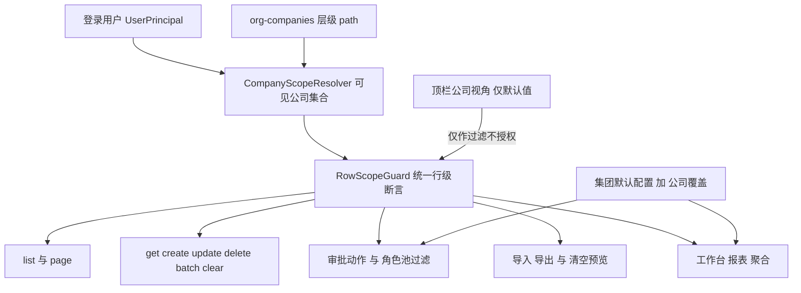
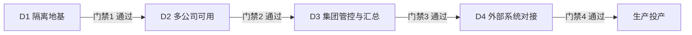

## 用户要求

- 针对现有系统制定从 D1 到 D4 四个阶段的实施计划，明确每个阶段的交付目标、任务范围与验收标准；每个阶段必须完成并通过测试后，方可进入下一阶段。
- 梳理对话中的编号：四个实施阶段用 D1~D4，与上一轮 P0~P3 四期一一对应；上一轮那四个决策口径改称 Q1~Q4，不再与阶段编号混用。
- 修正并同步先前的需求表述：「对接人员的组织架构调整，接口对接工作联系陈国；人员组织架构信息予以保留，对接角色的权限需重新梳理与调整」。据此更新后续计划文档「20261112.txt」，并清理其他文档中「删除现有人员组织」的旧描述。
- 整体方案须遵循企业级开发标准，确保系统具备高可用性、安全性、可维护性与可扩展性，能够真正投入生产环境使用。

## 产品概述

公司管理页已建立三级公司架构（一级集团、二级研究院、三家三级子公司），目前研究院单公司测试基本通过。目标是把系统从「单公司使用」升级为「集团化多公司使用」：先按阶段交付、逐阶段验收，最终形成一份可投产、可回滚、可交接的集团化版本，并同步修正组织架构对接的规划口径。

## 核心功能

- 数据可见范围按公司层级统一管控：集团、二级、三级公司各按授权查看与办理业务，跨公司查看、改写、审批、导入、清空一律被阻断。
- 顶栏由只读公司标识变为可切换的公司视角；资产、单据、报表、工作台、待办与预警按所选公司呈现，新建记录自动归属正确公司。
- 组织树完整展示三级公司与下属部门；人员与部门信息完整保留，角色权限与数据范围重新梳理。
- 集团汇总报表与按公司下钻、跨公司转让的出账与入账闭环、公司级配置覆盖与集团默认继承。
- 每阶段设放行门禁：测试通过、只读数据复核、文档同步、备份与回滚演练、用户手动点测确认后，才允许启动下一阶段；任一门禁失败即回滚，不进入下一阶段。
- 组织架构对接与流程引擎对接作为最后一阶段，本地人员组织架构信息保留，接口对接联系陈国、流程引擎联系术欢。

## Tech Stack Selection

沿用已核实的项目栈，不引入新框架：

- 后端：Spring Boot 2.7.18 + JDK8 + 通用契约驱动 CRUD（`GenericService` / `GenericController` / `ResourceMeta`）+ MySQL 8 + Spring Security JWT；测试 JUnit + Jacoco 门禁。
- 前端：Vue 3.5 + Vite 6 + Element Plus 2.9 + Pinia 2 + 自研测试 loader；权限契约检查 `check:perm`。
- 契约单一真源：`fams-frontend/src/services/contract/schema.js` → `npm run export:contract` 生成 `fams-backend/src/main/resources/contract/*.json`；另有 `export:db`、`export:pdman`。
- 工程与交付：Windows/PowerShell，`build-prod.ps1` 四步门禁（后端全量测试并打包、前端 4 组单测、`check:perm`、前端构建）、`stop-prod.ps1` / `start-prod.ps1`、nginx 反向代理、`scripts/publish/sync-repos.ps1` 单向发布到内网前后端仓与 GitHub。
- 测试资产：Playwright 用例与夹具仅作为验收清单维护，按项目既定口径不运行自动化浏览器测试，点测由用户手动完成。

## Implementation Approach

采用「门禁式渐进改造」：先把服务端数据范围做成唯一断言入口，再开放界面能力，最后做汇总、闭环与外部对接；每阶段产出可验证的交付物、数据快照和回滚点。

关键决策与权衡：

1. **统一断言下沉到服务层，而非只做在 Controller**：`GenericController` 只有 8 个端点，但 `ApprovalService`、`DataImportService`、`DataResetService`、`DepreciationService` 会直接调用 `create/update/patchField/writeQuietly`。只在 Controller 加校验会留下旁路，因此抽 `RowScopeGuard` 作为所有读写路径的必经断言，Controller 保留权限码判定与既有 `AssetOwnerPolicy` 兜底，形成双层防护。
2. **公司层级用 path 字段 + 主体级缓存的可见公司集合**：现状 `COMPANY` 是 `company_id = 本人公司` 精确等值，`parent_id` 完全不参与鉴权。改为「本公司 + 全部下级 + 显式授权公司」的集合，用 IN 条件过滤；`CompanyScopeResolver` 每请求解析一次并缓存到 `UserPrincipal`，复杂度 O(层级深度) 且避免递归查库 N+1；代价是公司增删改时要重算子树 path 并失效缓存，写入路径需配套维护。
3. **语义与枚举统一**：`DATA_SCOPE` 的 `COMPANY` 标签已是「本公司及以下」但实现是精确匹配，`DEPT` 标签「本部门及以下」但实现是精确 deptId；`ORG_SCOPE` 存而不用。D1 一次性把标签、实现、`orgScope` 参与范围判定三者对齐，并用迁移脚本给存量角色显式赋值，避免默认 `ALL` 造成放行。
4. **公司视角只作默认值与展示，不参与授权**：前端请求头携带所选公司，服务端始终以主体授权集合为准，杜绝「前端隐藏按钮」式伪隔离。
5. **配置分级用「集团默认 + 公司覆盖」的覆盖解析，不复制多套流程实例**：`system-workflow-flows`、`system-params`、折旧方案、消息模板保持单一来源，避免 D4 对接外部流程引擎时返工。
6. **D4 保留本地组织**：按修正后的口径，本地 `org-companies` / `org-departments` / `org-users` 全部保留为业务外键与离线兜底，新增映射同步层与角色权限重新梳理，不删除任何本地组织表。
7. **避免技术债**：复用既有契约导出、`ResourceMeta` 字段白名单、`QuerySpec` 参数化查询、审计切面与维护脚本目录；仅新增 `CompanyScopeResolver`、`RowScopeGuard` 两个组件（现有 `scopedRaw` 为 private 且只服务 list/page，无法覆盖 get/写/审批，抽取是必要而非新架构）；`GenericService` / `ApprovalService` 大文件拆分放到 D3 渐进进行，本轮不做大规模重构。

性能与可靠性：可见公司集合每请求解析一次并缓存；行级断言是元数据判断加 IN 条件，配合 `company_id` 复合索引；工作台改后端按公司分页聚合，避免一次性装载 11 类单据导致 O(N) 前端遍历；报表按公司分组用数据库聚合下钻；单号生成保持全表最大值并加索引，避免并发撞号。瓶颈在 `JwtAuthFilter` 每次请求重载主体，因此公司集合必须在主体构建时算好，禁止每次递归查库。

## Implementation Notes

- 契约纪律：所有字段、唯一性、枚举改动先改 `schema.js` 与 `constants/enums.js`，再执行 `npm run export:contract`，同时核对 `permission-resources.json` 并跑 `npm run check:perm`；禁止手改后端 `contract/*.json`。新增集合必须在权限契约登记，配合 fail-closed 启动期校验。
- 数据库变更：生产库 `fams` 仅 DML，加列与索引需 MySQL 管理员账号；脚本放 `fams-backend/sql/04-maintenance/`，命名延续 `19-`、`20-` 序号，幂等、只做加法、`information_schema` 判列判索引，结尾带复核 SELECT；执行前用 `mysqldump --single-transaction` 做 `db-baseline/` 只读快照。
- 发布与部署：改动涉及已部署产物时按已授权顺序 `stop-prod.ps1 → build-prod.ps1 → start-prod.ps1` 重建重启并说明站点短暂不可用；交付到内网仓先跑 `scripts/publish/sync-repos.ps1` 默认 dry-run，确认后再带 `-Apply`；注意 `deploy-kit/` 中 `nginx.conf`、`start-prod.bat` 属手工同步项，改了建库 SQL 必须发布一次。
- 日志与审计：`OperationLogAspect` 扩为 append-only，补 `companyId`、traceId、IP、UA，并覆盖登录、审批、导入、折旧、重置口令；失败日志沿用 200 字截断，不写口令、手机号等敏感信息，高频读请求不记日志避免日志表灌满；日志写入失败仍只告警、不影响业务。
- 影响面控制：不改任何公司主键，不重导、不清库；默认 `ALL` 收敛为最小权限前，必须先用迁移脚本为存量角色显式赋值；`approverNeedsUnscopedDocs` 的「整体放开」改为「按当前环节点名到人」放行，避免审批人借待办看全公司数据；公司视角切换器与新范围语义用开关控制，可一键回退；`pickOrgUnit` 夹具改为挑选有部门的公司，防止无部门集团公司成为列表首项破坏既有测试。
- 测试口径：不跑自动化浏览器 E2E，点测由用户手动完成；后端全量 JUnit、前端 4 组单测、`check:perm`、`npm run build` 作为自动门禁。CSV 模板保持 UTF-8 BOM；新建源码或文档后核对头字节，避免 UTF-16LE。
- 文档同步：需求修正的目标文本为「2. 对接人员的组织架构调整，接口对接工作联系陈国；人员组织架构信息予以保留，对接角色的权限需重新梳理与调整。」；需清理的旧表述位于 `docs/后续升级计划20261112.txt:11`、`fams-frontend/README.md:229`、`fams-backend/README.md:88`，以及 README 第 7 节中「get 详情接口未做范围校验、跨公司隔离需真实多公司数据再验证」的过期结论。

## Architecture Design

现状数据流：登录 → `UserDetailsServiceImpl` 构造 `UserPrincipal`（权限码并集 + `dataScope`）→ `GenericService.list/page` 仅在这两处调用 `scopedRaw` 追加过滤 → 其余 get、写、审批、导入、清空、工作台全量拉取均无范围约束。目标是把这条链收敛为单一断言入口。





### 编号映射与口径固化

| 阶段 | 对应上一轮 | 主题 | 输入口径 |
| --- | --- | --- | --- |
| D1 | P0 | 隔离地基与生产安全整改 | Q1~Q4 全部固化签字 |
| D2 | P1 | 多公司可用 | Q1、Q2、Q3、Q4 |
| D3 | P2 | 集团管控、汇总、工程化 | Q3、Q4 |
| D4 | P3 | 外部组织与流程引擎对接 | 修正后的组织架构对接表述 |


Q1 集中管控（集团统一字典与参数、各公司数据隔离、集团可看全部）；Q2 `COMPANY` = 本公司及所有下级展开 + 显式多公司授权；Q3 集团默认 + 公司级覆盖；Q4 转让在受让公司自动建卡、低值库存按公司独立。四项在 D1 开工前一次性确认并写入 `docs/group-multicompany-plan.md`，作为后续阶段输入，阶段进行中不再变更。

### D1 隔离地基（原 P0）

- 交付目标：所有数据入口统一受行级范围约束；生产审计报告 P0 清单关闭；三级组织树可见；规划口径与文档同步修正完成。
- 任务范围：新增 `CompanyScopeResolver`、`RowScopeGuard`；`GenericService` 的 list/page/get/create/update/delete/batch/clear 全接入；`GenericController`、`ApprovalController`、`DataImportController`、`DataResetService`、`DepreciationController` 的直调路径同步接入；`DATA_SCOPED_PREFIXES` 扩至所有带 `companyId` 集合（盘点单与计划、折旧报表与明细、审批轨迹、报表、通知、日志）；修正 `scopedRaw` 的 COMPANY/DEPT 语义与 `approverNeedsUnscopedDocs` 例外；`PermissionPolicy` 改 fail-closed、未登记集合启动期拒绝、`DELETE /all` 限管理员、组织主数据写按公司范围。安全 P0：`AuthController` / `JwtProvider` 登出黑名单与有效期收敛、`Login.vue` 移除账号口令展示、凭据轮换与首登改密、`application-prod.yml` 与证书治理、nginx 80 跳 443 与安全响应头及访问日志、通用 PUT 的 status 服务端只读、低值状态迁移白名单、审计 append-only、版本化迁移与自动备份恢复演练。迁移脚本：`19-company-path.sql`（path/level 回填）、`20-scope-indexes.sql`、`21-role-datascope-backfill.sql`。遗留修复：`org.js` 的 `deptTree` 递归、`SystemCompany.vue` 的 parentId 空值归一与防环。
- 验收标准：README 第 7 节验收用例表逐条通过；按 id 直查、改、删其他公司数据全部 403；P0 清单每项有可验证证据；5 家公司、71 台资产、29 部门、138 账号归属核对零悬空；备份恢复演练成功；组织树完整显示三级。
- 门禁 1：`mvn clean package` 全量 JUnit（新增范围断言与跨公司负向用例）、前端 4 组单测、`check:perm`、`npm run build`、只读 SQL 复核、生产库快照与回滚演练、重建生产栈后健康检查 UP、用户按第 7 节手动点测确认。任一失败回滚快照，D2 不启动。

### D2 多公司可用（原 P1）

- 交付目标：集团与子公司用户在同一系统内按授权公司工作，新建记录归属正确，组织、审批、编码、库存、导入按公司隔离。
- 任务范围：`MainLayout.vue` 只读标识升级为公司视角切换器，新增 `store/companyScope.js`，`services/http.js` 注入公司视角请求头，`store/user.js` 处理会话持久化与切换账号清理；契约扩字段（公司 path/level、用户授权公司集合、角色适用范围、低值物品 companyId、系统参数与流程模板 companyId、处置单受让公司 id、编码复合唯一）；前端下拉按可见集合收窄、新建默认公司修正、组织与流程配置页按公司过滤、低值库存按公司独立；后端组织架构导入模板加「上级公司」列并回填 path、资产导入授权校验、`ApproverResolver` 的 ROLE 角色池按单据公司过滤、单号公司前缀或复合唯一、折旧方案公司级继承；迁移脚本 `22-user-company-scope.sql`、`23-low-value-company.sql`、`24-code-unique.sql`。
- 验收标准：切换公司视角后资产、单据、报表、工作台仅出该公司数据；子公司账号看不到其他公司；新建资产默认归属所选公司；A 公司仓管不出现在 B 公司审批人池；各公司独立编号不冲突；低值领用只扣本公司库存；三级组织树部门可见。
- 门禁 2：后端 JUnit 跨公司正向与负向用例、前端 4 组单测、`check:perm`、构建、契约重新导出无差异、只读 SQL 复核无跨公司脏数据与重复编码、用户手动点测（切换视角、新建、审批、领用、导入）。通过后方可进入 D3。

### D3 集团管控与汇总（原 P2，含生产级工程化）

- 交付目标：集团层可汇总下钻，跨公司转让闭环，配置分级生效，补齐并发、缓存、监控、可维护性整改。
- 任务范围：报表与工作台增加公司维度筛选、合并汇总、下钻、导出带公司列，工作台改后端分页聚合；`ApprovalService` 实现 TRANSFER_OUT 闭环（受让公司自动建卡、出账与入账留痕、审批轨迹完整，调拨仍不跨公司）；流程模板、折旧方案、消息模板、编号前缀实现集团默认加公司覆盖；P1/P2 工程化：乐观锁条件更新与受影响行检查、库存条件扣减、数据库唯一与外键约束、测试环境改用 MySQL 容器消除 H2 漂移、导入整体事务、logback 滚动与 MDC traceId、actuator 与指标告警、前端错误上报、nginx 访问日志、备份自动化与恢复演练、接口限流、渐进拆分大类与巨型组件并引入静态检查、缓存与会话外置为水平扩展准备；同步发布脚本与交付仓副本。
- 验收标准：集团合并报表与按公司下钻一致；转让完结后原台账已核销、受让公司生成新卡、凭证与出账依据齐备；公司级配置覆盖生效且可继承集团默认；并发更新返回 409、库存不超卖；监控指标与 traceId 可查；恢复演练有 RTO/RPO 记录。
- 门禁 3：全量 JUnit（并发、转让、报表聚合用例）、前端单测、`check:perm`、构建、备份恢复演练、只读 SQL 对账（71 台真实资产状态无污染）、用户手动点测（集团报表、转让链、工作台）。通过后方可进入 D4。

### D4 外部系统对接（原 P3）

- 交付目标：完成组织架构与流程引擎对接，本地人员组织架构信息保留，角色权限重新梳理与调整，达到对外投产条件。
- 任务范围：新增组织同步映射层，外部组织单元与本地公司、部门、用户做幂等增量同步并保留本地表作为业务外键与离线兜底，明确冲突策略与失败告警；按修正口径不删除任何本地组织数据；重新梳理角色权限，产出角色—权限—数据范围矩阵并复核签字，重算角色权限码、数据范围与公司适用范围，保留管理员兜底与 fail-closed；流程引擎抽象为可切换的提供方，本地流程模板保留为回退，流程配置交杜娟、接口联系人术欢；容器化与编排、灰度发布、版本化契约与接口文档、清除兼容 hack、按包覆盖率门槛、链路追踪、等保与上线检查单。
- 验收标准：外部组织同步后本地 5 家公司、29 部门、138 账号不丢失且引用零悬空；断网时本地组织仍可登录与审批；角色权限矩阵复核通过；外部流程可配置且可回退本地；上线检查单全绿（凭据、传输、备份、监控、审计、限流、发布回滚）。
- 门禁 4：全量回归与用户手动点测（外部同步、断网回退、审批链、投产检查单）、灾备切换演练、只读 SQL 复核。门禁 4 通过后宣布投产。

### 企业级四性落地映射

| 维度 | D1 | D2 | D3 | D4 | 可验证指标 |
| --- | --- | --- | --- | --- | --- |
| 安全性 | P0 全项、fail-closed、统一断言、审计不可篡改 | 公司归属服务端强制、角色池过滤、导入授权 | 状态机白名单、并发一致、限流 | 权限矩阵复核、等保检查 | 越权负向用例全 403、日志可还原一次完整审批链、生产产物无口令字面量 |
| 高可用性 | 自动备份与恢复演练、健康检查 | 迁移可回滚、视角开关可回退 | 监控告警、指标、恢复 RTO/RPO | 灰度发布、灾备切换 | 演练记录、健康检查 UP、失败可回退到快照 |
| 可维护性 | 契约单一真源、文档同步、审计切面收敛 | 契约导出无差异、目录规范 | 拆分大类与巨型组件、静态检查、版本化迁移 | 版本化接口文档、清除兼容 hack | `check:perm` 通过、重新导出无差异、构建门禁四步全绿 |
| 可扩展性 | path 字段与索引、主体级缓存 | 公司集合 IN 查询、后端分页聚合 | 缓存与会话外置、连接池与限流、水平扩展 | 提供方抽象、容器化编排 | 列表与报表无全表扫描、公司数增加不线性劣化、可切换外部流程 |


### 风险与红线

- 先服务端断言后界面；公司视角不得参与授权判定；不改公司主键、不重导清库、不删除本地人员组织架构。
- 生产审计报告的 P0 整改是 D1 的硬门槛，未通过不得宣称「可投产」；P1 映射 D2/D3，P2/P3 映射 D3/D4。
- D4 之前组织改造只做授权与范围层，避免与外部组织架构对接冲突；接口对接联系人陈国、流程引擎联系人术欢保持不变。
- 所有 DDL 需管理员账号，所有前端或后端代码改动需重建生产栈；发布前先 dry-run 并核对交付适配版手工同步文件。

## Directory Structure

```text
EAM-FAMS/
├── docs/
│   ├── 后续升级计划20261112.txt        # [MODIFY] 第 2 条替换为修正后的准确表述：对接人员组织架构调整、接口联系陈国、人员组织架构信息保留、对接角色权限重新梳理与调整；其余 6 条保持不变
│   ├── group-multicompany-plan.md       # [NEW] 四阶段总计划：D1~D4 与 P0~P3 映射、Q1~Q4 口径、每阶段交付目标/任务范围/验收标准/门禁/回滚办法、企业级四性映射、投产检查单
│   ├── qa/stage-gates.md                # [NEW] 阶段门禁记录模板：测试项、通过标准、执行证据、用户点测确认、签字与放行记录，四阶段各一份
│   ├── deployment.md                    # [MODIFY] 补自动备份、版本标记、回滚演练、探活、监控告警、日志滚动与容量；与交付适配版同步
│   ├── production-audit-report.md       # [MODIFY] 按阶段更新 S-01~S-10 与 M 系列问题状态，登记复核结论
│   ├── fixed-asset-business-rules.md    # [MODIFY] 补跨公司转让的出账入账落地口径与受让公司建卡规则
│   ├── dept-approval.md                 # [MODIFY] 补角色池按公司过滤、归口角色例外的公司边界
│   └── e2e/sql/real-org-check.sql       # [MODIFY] 增加公司维度与越权残留的只读复核 SELECT
├── README.md                            # [MODIFY] 第 7 节更新为集团化实现口径，删除 get 未校验与待真实多公司验证的过期结论，标记验收表执行状态
├── fams-frontend/README.md              # [MODIFY] 第 229 行清理「删除现有人员组织」旧表述，同步为修正后的口径
├── fams-backend/README.md               # [MODIFY] 第 88 行清理同一旧表述；补契约导出与权限矩阵复核说明
├── fams-frontend/src/services/contract/schema.js   # [MODIFY] 契约单一真源：公司 path/level、用户授权公司集合、角色适用范围、低值物品与系统参数及流程模板 companyId、处置单受让公司 id、编码复合唯一
├── fams-frontend/src/constants/enums.js            # [MODIFY] DATA_SCOPE 语义与公司级配置范围枚举
├── fams-frontend/src/config/permissions.js         # [MODIFY] 登记新增权限码与集合映射，保持 check:perm 对齐
├── fams-frontend/package.json                     # [MODIFY] 视需要补门禁脚本，保持 export:contract 与 check:perm 命令不变
├── fams-backend/src/main/resources/contract/resources.json          # [MODIFY][由导出生成] 字段、唯一性、引用、过滤字段与删除保护；禁止手改
├── fams-backend/src/main/resources/contract/enums.json              # [MODIFY][由导出生成] DATA_SCOPE 标签与实现对齐
├── fams-backend/src/main/resources/contract/permission-resources.json # [MODIFY][由导出生成] 新集合权限规则、fail-closed 清单、只读集合
├── fams-backend/src/main/java/com/fams/security/CompanyScopeResolver.java  # [NEW] 可见公司集合解析：本公司加下级展开加显式授权，path 缓存与失效
├── fams-backend/src/main/java/com/fams/security/UserPrincipal.java        # [MODIFY] 增加可见公司集合与 orgScope 结果，默认范围收敛
├── fams-backend/src/main/java/com/fams/security/UserDetailsServiceImpl.java # [MODIFY] 构造主体时注入公司集合解析结果
├── fams-backend/src/main/java/com/fams/security/AuthController.java        # [MODIFY] 登出黑名单与 token 失效
├── fams-backend/src/main/java/com/fams/security/JwtProvider.java           # [MODIFY] 有效期收敛与版本校验
├── fams-backend/src/main/java/com/fams/security/LoginAttemptService.java   # [MODIFY] 限流与验证码策略
├── fams-backend/src/main/java/com/fams/security/DataInitializer.java       # [MODIFY] 首登改密与口令轮换迁移
├── fams-backend/src/main/java/com/fams/engine/RowScopeGuard.java           # [NEW] 统一行级断言：读、写、批量、清空、审批、导入导出共用一套规则
├── fams-backend/src/main/java/com/fams/engine/GenericService.java          # [MODIFY] 八个端点接入 guard；范围集合扩展；COMPANY 与 DEPT 语义修正；角色池按公司过滤；单号公司维度；状态服务端只读
├── fams-backend/src/main/java/com/fams/engine/GenericController.java       # [MODIFY] 保留权限码与资产使用人兜底，叠加范围校验；DELETE /all 限管理员
├── fams-backend/src/main/java/com/fams/engine/PermissionPolicy.java        # [MODIFY] fail-closed、启动期契约完整性校验、组织主数据写按公司范围
├── fams-backend/src/main/java/com/fams/engine/AssetOwnerPolicy.java        # [MODIFY] 本人发起规则叠加公司归属校验
├── fams-backend/src/main/java/com/fams/engine/SqlProvider.java             # [MODIFY] 乐观锁条件更新、库存条件扣减、公司集合 IN 条件
├── fams-backend/src/main/java/com/fams/module/approval/ApproverResolver.java # [MODIFY] ROLE 环节按单据 companyId 过滤角色池，保留部门点名解析
├── fams-backend/src/main/java/com/fams/module/approval/ApprovalController.java # [MODIFY] 审批动作接入范围断言
├── fams-backend/src/main/java/com/fams/module/approval/ApprovalService.java  # [MODIFY] D3 转让闭环与受让公司建卡、审批路径统一走 guard
├── fams-backend/src/main/java/com/fams/module/system/OperationLogAspect.java # [MODIFY] 审计 append-only、公司标识、traceId、IP 与 UA、覆盖登录审批导入折旧
├── fams-backend/src/main/java/com/fams/module/depreciation/DepreciationService.java # [MODIFY] 公司级方案继承与覆盖解析
├── fams-backend/src/main/java/com/fams/imports/OrgStructureImportService.java # [MODIFY] 上级公司列、path 回填、授权校验；保留三表拆分与幂等复用
├── fams-backend/src/main/java/com/fams/imports/FixedAssetImportService.java  # [MODIFY] 按公司名称匹配后校验当前用户对该公司的授权
├── fams-backend/src/main/java/com/fams/imports/DataImportController.java     # [MODIFY] 导入与模板端点接入范围校验与整体事务
├── fams-backend/src/main/java/com/fams/imports/DataResetService.java        # [MODIFY] 清空预览与清空按公司范围收敛
├── fams-backend/src/main/java/com/fams/security/OrgSyncService.java         # [NEW][D4] 外部组织映射同步层：幂等增量、冲突策略、失败告警、本地组织保留
├── fams-backend/src/main/java/com/fams/module/approval/FlowProvider.java     # [NEW][D4] 流程提供方抽象，本地实现为默认、外部引擎可切换与回退
├── fams-backend/src/main/resources/application-prod.yml                     # [MODIFY] 凭据外置、日志与监控配置、生产 profile 收敛
├── deploy/nginx/conf/nginx.conf                                            # [MODIFY] 80 跳 443、安全响应头、访问日志与请求体限制
├── deploy/certs/                                                            # [MODIFY] 私钥移出版本库并重签证书，同步交付适配版说明
├── fams-backend/sql/04-maintenance/19-company-path.sql                     # [NEW] 公司层级 path 与 level 加列回填，幂等
├── fams-backend/sql/04-maintenance/20-scope-indexes.sql                    # [NEW] company_id 复合索引与查询支撑
├── fams-backend/sql/04-maintenance/21-role-datascope-backfill.sql          # [NEW] 存量角色范围显式赋值，避免默认放行
├── fams-backend/sql/04-maintenance/22-user-company-scope.sql               # [NEW][D2] 用户授权公司集合与角色适用范围
├── fams-backend/sql/04-maintenance/23-low-value-company.sql                # [NEW][D2] 低值物品公司归属与库存拆分
├── fams-backend/sql/04-maintenance/24-code-unique.sql                      # [NEW][D2] 编码复合唯一约束与存量冲突检查
├── deploy/sql/mysql/schema.sql                                             # [MODIFY] 与新迁移保持一致，移除生产路径 DROP，发布时同步 deploy-kit
├── fams-backend/sql/01-schema/00-schema.sql                                # [MODIFY] 三处 schema 漂移收敛，避免升级后缺列
├── fams-frontend/src/layouts/MainLayout.vue                                # [MODIFY] 顶栏只读标识升级为公司视角切换器，保留权限判定与标签页逻辑
├── fams-frontend/src/store/companyScope.js                                  # [NEW] 公司视角状态、可见公司集合、切换与持久化、会话清理
├── fams-frontend/src/store/org.js                                           # [MODIFY] deptTree 递归支持三级公司、公司树层级与视角联动
├── fams-frontend/src/store/user.js                                          # [MODIFY] 登录与恢复时初始化公司视角，切换账号清理现场
├── fams-frontend/src/store/workbench.js                                     # [MODIFY] 按公司视角装载，改后端分页聚合，避免全量拉取
├── fams-frontend/src/services/http.js                                       # [MODIFY] 请求头携带公司视角，保持统一错误信封与在途写复用
├── fams-frontend/src/services/workbench.js                                  # [MODIFY] 待办、预警、概览聚合按公司过滤与分组
├── fams-frontend/src/views/system/SystemCompany.vue                        # [MODIFY] parentId 空值归一、防环、层级展示
├── fams-frontend/src/views/system/SystemDept.vue                           # [MODIFY] 组织树三级展示、列表与写入按公司范围
├── fams-frontend/src/views/system/SystemUser.vue                           # [MODIFY] 公司下拉按授权集合收窄、跨公司归属阻断
├── fams-frontend/src/views/system/SystemRole.vue                           # [MODIFY] 角色适用范围与数据范围重梳理后的表单与列表
├── fams-frontend/src/views/system/WorkflowConfig.vue                       # [MODIFY] 公司级流程覆盖与集团默认继承
├── fams-frontend/src/views/system/SystemDataImport.vue                     # [MODIFY] 组织架构模板上级公司列与公司授权校验提示
├── fams-frontend/src/views/fixed-asset/FixedAssetManagement.vue            # [MODIFY] 新建默认公司、公司筛选、转让受让方表单与渐进拆分
├── fams-frontend/src/views/fixed-asset/FixedAssetDocList.vue               # [MODIFY] 新建默认公司修正与公司维度筛选
├── fams-frontend/src/views/fixed-asset/FixedAssetReports.vue               # [MODIFY] 公司维度汇总、下钻与导出带公司列
├── fams-frontend/src/views/fixed-asset/FixedAssetSettings.vue              # [MODIFY] 公司级折旧方案与编号前缀覆盖
├── fams-frontend/src/views/low-value-asset/LowValueAssetManagement.vue     # [MODIFY] 低值物品与库存按公司独立
├── fams-frontend/src/views/workbench/Workbench.vue                         # [MODIFY] 概览与行动条按公司视角呈现
├── fams-frontend/src/views/workbench/components/TodoPanel.vue              # [MODIFY] 待办按公司分组与过滤
├── fams-frontend/src/views/Login.vue                                       # [MODIFY] 移除账号与初始口令公示
├── fams-frontend/src/approval.test.mjs                                     # [MODIFY] 补公司范围相关前端单测断言
├── fams-backend/src/test/java/com/fams/p14/GroupScopeGuardTest.java         # [NEW] 行级断言、fail-closed、公司层级展开与缓存用例
├── fams-backend/src/test/java/com/fams/p14/CrossCompanyNegativeTest.java    # [NEW] 按 id 越权读写删、跨公司审批、导入与清空的负向用例
├── fams-backend/src/test/java/com/fams/p14/TransferClosureTest.java         # [NEW][D3] 跨公司转让出账入账、派生卡与轨迹用例
├── tests/e2e/04-permission-matrix.spec.ts                                  # [MODIFY] 补 COMPANY 跨公司正反向验收用例（登记，不跑浏览器）
├── tests/e2e/fixtures/data.ts                                              # [MODIFY] pickOrgUnit 改为挑选有部门的公司
├── tests/e2e/fixtures/permissionMatrix.ts                                  # [MODIFY] 登记新增集合与权限规则
├── scripts/publish/sync-repos.ps1                                          # [MODIFY] 视需要补交付同步项与敏感文件拦截清单
└── build-prod.ps1                                                          # [MODIFY] 将契约漂移与新增门禁纳入失败即中止，保持 ASCII 编码
```

## Agent Extensions

### SubAgent

- **code-explorer**
- Purpose: 在 D1 开工前做 very thorough 级全库排查，定位 `GenericService` 八个端点、`ApprovalService` 与导入/清空/折旧直调路径、所有带 `companyId` 的集合以及 `scopedRaw` 之外的数据读取入口。
- Expected outcome: 产出「数据范围盲区清单」，逐条标注调用点、是否已接入统一断言、需修改的文件，作为 D1 任务范围与门禁 1 的验收基线，确保零旁路。

### Skill

- **lsp-code-analysis**
- Purpose: 对 `scopedRaw`、`get`、`create`、`update`、`remove`、`batch`、`clear`、`userIdsOfRole`、`ApproverResolver.resolve` 做定义、引用与调用层级分析，确认改动影响面与既有兜底逻辑。
- Expected outcome: 产出调用层级与引用报告，验证统一断言下沉到服务层后不漏审批、导入、资产使用人兜底等路径，并给出需同步调整的测试夹具清单。