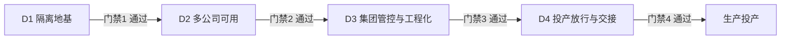

# 集团化多公司四阶段实施计划（D1~D4）

> 制定日期：2026-11-16　｜　范围：本期仅实现「系统自身独立的集团化多公司管理」
> 门禁原则：**每个阶段必须完成并通过测试后方可进入下一阶段**；任一门禁失败即回滚到该阶段开始前的只读快照，不启动下一阶段。
> 门禁记录与证据：`docs/qa/stage-gates.md`（含 D1 数据范围盲区清单与调用层级复核结论）。
> 测试口径：后端全量 JUnit、前端 4 组单测、`check:perm`、构建为自动门禁；只读 SQL 复核、备份与回滚演练、上线检查单、用户手动点测为人工门禁；不运行自动化浏览器 E2E。

---

## 1. 本期范围

**本期交付**：集团 → 二级研究院 → 三家三级子公司的多公司体系，在同一套系统内按授权公司工作：统一行级数据范围、公司视角切换、三级组织树、公司级业务隔离与编码/库存独立、集团汇总与跨公司转让闭环、公司级配置覆盖、生产级安全与工程化整改，最终以不依赖外部接口的投产放行与交接收口。

**不在本期范围**：外部组织架构接口、流程引擎对接、PC 端迁入柳讯、移动端迁入柳讯、扫码盘点与 UHF RFID（即 `docs/后续升级计划20261112.txt` 第 2~7 条中除「多公司管理」外的内容）；依赖外部联调的验收项（外部组织同步后零丢失、断网回退实测、外部流程可配置与回退）本期不验收。详见 `docs/external-integration-prerequisites.md`。

**投产条件**：门禁 4（投产放行与交接）通过即可投产，**不以外部接口为前提**。投产时系统以本地组织主数据 + 本地流程模板完整运行。

---

## 2. 编号映射与口径固化

| 阶段 | 对应上一轮 | 主题 | 输入口径 |
| --- | --- | --- | --- |
| D1 | P0 | 隔离地基与生产安全整改 | Q1~Q4 全部固化签字 |
| D2 | P1 | 多公司可用 | Q1、Q2、Q3、Q4 |
| D3 | P2 | 集团管控、汇总、转让闭环与工程化 | Q3、Q4 |
| D4 | 原 P3 重定义 | 投产放行与交接（不依赖外部接口） | 修正后的组织架构对接口径、上线检查单 |

| 口径 | 内容 |
| --- | --- |
| Q1 | 集中管控：集团统一字典与参数、各公司数据隔离、集团可看全部 |
| Q2 | `COMPANY` = 本公司及所有下级展开 + 显式多公司授权；`DEPT` 含子部门；`orgScope` 参与范围判定 |
| Q3 | 集团默认配置 + 公司级覆盖，不复制多套流程实例 |
| Q4 | 跨公司转让在受让公司自动建卡；低值库存按公司独立 |

Q1~Q4 已在本计划确认时一次性固化，阶段进行中不再变更。

### 需求表述修正（同步范围）

目标文本：「**2. 对接人员的组织架构调整，接口对接工作联系陈国；人员组织架构信息予以保留，对接角色的权限需重新梳理与调整。**」

- `docs/后续升级计划20261112.txt:11` — 已同步。
- `fams-frontend/README.md:229`、`fams-backend/README.md:88` — 已清理「删除现有人员组织」旧表述。
- `README.md` 第 7 节 — 已标注「改造中，D1 门禁通过前现状结论仍有效」，D1 通过后再修订实现口径与验收表状态。
- 落地归属：本地 `org-companies` / `org-departments` / `org-users` 全部保留；「角色权限重新梳理与调整」在 D1/D2 落地（范围语义、角色适用范围、权限码与数据范围重算），D4 做权限矩阵复核签字；联系人陈国/术欢仅作为后续待接口阶段备注。

---

## 3. 阶段总览

服务端目标链路：登录构造 `UserPrincipal` → `CompanyScopeResolver` 解析「本公司 + 全部下级 + 显式授权公司」可见集合（path 字段、主体级缓存）→ `RowScopeGuard` 统一行级断言 → list/page/get/create/update/delete/batch/clear、审批动作与角色池、导入导出与清空预览、工作台与报表聚合全部经过同一断言。顶栏公司视角仅作默认值与展示，不参与授权。

---

## 4. 各阶段交付目标、任务范围、验收标准与门禁

### D1 隔离地基

- **交付目标**：所有数据入口统一受行级范围约束；生产审计报告 P0 清单关闭；三级组织树可见；规划口径与文档同步完成；本地角色权限与数据范围重算落地。
- **任务范围**（详细盲区清单见 `docs/qa/stage-gates.md` 第 1 节）：新增 `CompanyScopeResolver`、`RowScopeGuard`；`GenericService` 全部读写/批量/清空/内部方法接入；`GenericController` 8 端点串联；审批、导入、清空、折旧、审计、DataInitializer 的直调路径与 Mapper 直连钩子同步接入；范围集合由契约元数据驱动，覆盖所有带 `companyId` 集合；修正 `COMPANY`/`DEPT` 语义与 `approverNeedsUnscopedDocs` 例外；`PermissionPolicy` fail-closed、`DELETE /all` 限管理员、组织主数据写按公司范围；`UserPrincipal` 补 orgScope 与可见公司集合、`dataScopeOf` 去默认 ALL；`SystemRole.vue` 与角色迁移完成权限重梳理。P0 安全整改：登出黑名单与 token 有效期收敛、登录页移除账号口令展示、凭据轮换与首登改密、配置与证书治理、nginx 80 跳 443 与安全响应头及访问日志、通用 PUT 的 status 服务端只读、低值状态迁移白名单、审计 append-only、版本化迁移与自动备份恢复演练。迁移脚本 `19-company-path.sql`、`20-scope-indexes.sql`、`21-role-datascope-backfill.sql`。遗留修复：`org.js` 的 `deptTree` 递归、`SystemCompany.vue` 的 parentId 空值归一与防环。
- **验收标准**：README 第 7 节验收用例表逐条通过；按 id 直查、改、删其他公司数据全部 403；P0 清单每项有可验证证据；5 家公司、71 台资产、29 部门、138 账号归属核对零悬空；备份恢复演练成功；组织树完整显示三级。
- **门禁 1**：`mvn clean package` 全量 JUnit（含范围断言与跨公司负向用例）、前端 4 组单测、`check:perm`、`npm run build`、只读 SQL 复核、生产库快照与回滚演练、重建生产栈后健康检查 UP、用户按第 7 节手动点测确认。任一失败回滚快照，D2 不启动。

### D2 多公司可用

- **交付目标**：集团与子公司用户按授权公司工作，新建记录归属正确，组织、审批、编码、库存、导入按公司隔离。
- **任务范围**：顶栏只读标识升级为公司视角切换器，新增 `store/companyScope.js`，`services/http.js` 注入公司视角请求头，`store/user.js` 处理会话持久化与切换账号清理；契约扩字段（公司 path/level、用户授权公司集合、角色适用范围、低值物品 `companyId`、系统参数与流程模板 `companyId`、处置单受让公司 id、编码复合唯一）；前端下拉按可见集合收窄、新建默认公司修正、组织与流程配置页按公司过滤、低值库存按公司独立；后端组织架构导入模板加「上级公司」列并回填 path、资产导入授权校验、`ApproverResolver` 的 ROLE 角色池按单据公司过滤、单号公司前缀或复合唯一、折旧方案公司级继承；迁移脚本 `22-user-company-scope.sql`、`23-low-value-company.sql`、`24-code-unique.sql`。
- **验收标准**：切换公司视角后资产、单据、报表、工作台仅出该公司数据；子公司账号看不到其他公司；新建资产默认归属所选公司；A 公司仓管不出现在 B 公司审批人池；各公司独立编号不冲突；低值领用只扣本公司库存；三级组织树部门可见。
- **门禁 2**：后端 JUnit 跨公司正向与负向用例、前端单测、`check:perm`、构建、契约重新导出无差异、只读 SQL 复核无跨公司脏数据与重复编码、用户手动点测（切换视角、新建、审批、领用、导入）。通过后方可进入 D3。

### D3 集团管控与工程化

- **交付目标**：集团层可汇总下钻，跨公司转让闭环，配置分级生效，补齐并发、缓存、监控、可维护性整改。
- **任务范围**：报表与工作台增加公司维度筛选、合并汇总、下钻、导出带公司列，工作台改后端分页聚合；`ApprovalService` 实现 `TRANSFER_OUT` 闭环（受让公司自动建卡、出账与入账留痕、轨迹完整，调拨仍不跨公司）；流程模板、折旧方案、消息模板、编号前缀实现集团默认 + 公司覆盖；P1/P2 工程化：乐观锁条件更新与受影响行检查、库存条件扣减、数据库唯一与外键约束、测试环境改用 MySQL 容器消除 H2 漂移、导入整体事务、logback 滚动与 MDC traceId、actuator 与指标告警、前端错误上报、nginx 访问日志、备份自动化与恢复演练、接口限流、渐进拆分大类与巨型组件并引入静态检查、缓存与会话外置；同步发布脚本与交付仓副本。
- **验收标准**：集团合并报表与按公司下钻一致；转让完结后原台账已核销、受让公司生成新卡、凭证与出账依据齐备；公司级配置覆盖生效且可继承集团默认；并发更新返回 409、库存不超卖；监控指标与 traceId 可查；恢复演练有 RTO/RPO 记录。
- **门禁 3**：全量 JUnit（并发、转让、报表聚合用例）、前端单测、`check:perm`、构建、备份恢复演练、只读 SQL 对账（71 台真实资产状态无污染）、用户手动点测（集团报表、转让链、工作台）。通过后方可进入 D4。

### D4 投产放行与交接（不依赖外部接口）

- **交付目标**：完成上线检查、灾备与回滚演练、权限矩阵复核签字、交付文档与版本标记、发布脚本 dry-run 与交付仓同步、用户手动点测验收；门禁 4 通过后宣布投产。
- **任务范围**：整理 `docs/qa/stage-gates.md` 四阶段门禁记录；产出角色—权限—数据范围矩阵并复核签字；更新 `docs/production-audit-report.md` 问题状态；`docs/deployment.md` 补自动备份、版本标记、回滚演练、探活、监控告警；`build-prod.ps1` 纳入契约漂移与新增门禁失败即中止；`scripts/publish/sync-repos.ps1` 先 dry-run 再 `-Apply`；投产检查单覆盖凭据、传输、备份、监控、审计、限流、发布回滚；用户手动点测按检查单执行。
- **验收标准**：上线检查单全绿；灾备切换与回滚演练成功且有 RTO/RPO 记录；权限矩阵复核通过；四阶段门禁记录、版本标记、交付仓副本齐备；生产产物无口令字面量；健康检查 UP；用户点测确认。
- **门禁 4**：全量回归、备份恢复演练、灾备切换演练、只读 SQL 复核、发布脚本 dry-run 结果核对、用户手动点测验收、上线检查单签字。通过后投产，不以外部接口为前提。

**回滚办法**：每阶段开工前 `mysqldump --single-transaction` 生成 `db-baseline/` 只读快照并记录 commit/版本标记；门禁失败时恢复快照、回滚代码改动、重建上一版本生产栈，并在 `stage-gates.md` 记录失败项与处置。DDL 由 MySQL 管理员账号执行，脚本幂等、只做加法。

---

## 5. 企业级四性落地映射

| 维度 | D1 | D2 | D3 | D4 | 可验证指标 |
| --- | --- | --- | --- | --- | --- |
| 安全性 | P0 全项、fail-closed、统一断言、审计不可篡改 | 公司归属服务端强制、角色池过滤、导入授权 | 状态机白名单、并发一致、限流 | 权限矩阵复核、上线检查单 | 越权负向用例全 403、日志可还原完整审批链、生产产物无口令字面量 |
| 高可用性 | 自动备份与恢复演练、健康检查 | 迁移可回滚、视角开关可回退 | 监控告警、指标、恢复 RTO/RPO | 灾备切换演练、发布回滚 | 演练记录、健康检查 UP、失败可回退到快照 |
| 可维护性 | 契约单一真源、文档同步、审计切面收敛 | 契约导出无差异、目录规范 | 拆分大类与巨型组件、静态检查、版本化迁移 | 版本标记、交付文档、门禁记录 | `check:perm` 通过、重新导出无差异、构建门禁四步全绿 |
| 可扩展性 | path 字段与索引、主体级缓存 | 公司集合 IN 查询、后端分页聚合 | 缓存与会话外置、连接池与限流、水平扩展 | 投产检查单中的容量与告警基线 | 列表与报表无全表扫描、公司数增加不线性劣化 |

---

## 6. 后续待接口阶段（不在本期）

外部组织架构接口、流程引擎对接、PC/移动端迁入柳讯、扫码盘点与 UHF RFID 均后置。接口需求清单与前置条件见 `docs/external-integration-prerequisites.md`（联系人：陈国 / 术欢 / 杜娟）。**接口到位后另立计划**，本期不创建 `OrgSyncService.java` 与 `FlowProvider.java`，不实现任何外部调用，本地流程模板保持唯一运行来源。

---

## 7. 风险与红线

- 先服务端断言、后界面能力；公司视角不得参与授权判定；不改公司主键、不重导清库、不删除本地人员组织架构。
- 生产审计报告 `docs/production-audit-report.md` 的 P0 整改是 D1 硬门槛；P1 映射 D2/D3，P2/P3 映射 D3/D4。
- 契约单一真源：字段/唯一性/枚举改动先改 `fams-frontend/src/services/contract/schema.js` 与 `constants/enums.js`，再 `npm run export:contract` 生成后端契约，禁止手改后端 `contract/*.json`。
- 所有 DDL 需 MySQL 管理员账号；所有前后端代码改动按已授权顺序 `stop-prod.ps1 → build-prod.ps1 → start-prod.ps1` 重建；发布前先 dry-run 并核对交付适配版手工同步文件。
- 本期不实现任何外部接口；D4 之前组织改造只做授权与范围层。

---

## 8. 投产检查单（D4 使用）

| 项 | 检查内容 | 证据 |
| --- | --- | --- |
| 凭据 | 生产产物无口令字面量、DB/JWT/管理员口令已轮换、首登改密生效、私钥不在版本库 | 构建产物检索、`git ls-files` |
| 传输 | 80 跳 443、HSTS/CSP/帧防护、证书有效、请求体限制 | nginx 配置与响应头 |
| 备份 | 自动备份、版本标记、恢复演练记录、RTO/RPO | `db-baseline/` 与演练记录 |
| 监控 | 健康检查、日志滚动与容量、traceId、指标告警、nginx 访问日志 | 日志与监控截图 |
| 审计 | append-only、登录/审批/导入/折旧/重置留痕、公司标识 | 操作日志抽样 |
| 权限 | 权限矩阵复核签字、fail-closed、跨公司负向用例全 403 | `stage-gates.md` |
| 发布 | 构建门禁四步全绿、发布 dry-run 与 `-Apply`、回滚可用 | 构建与发布日志 |
