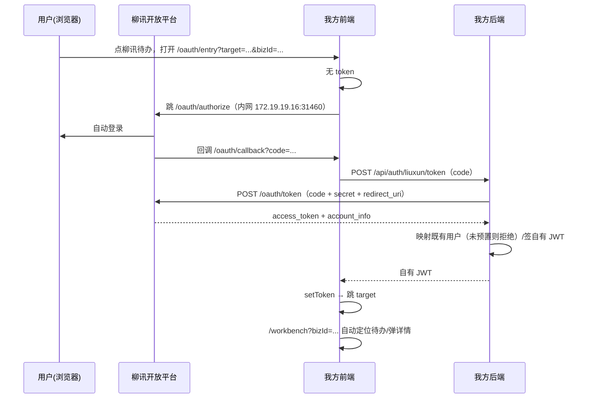

# 柳讯开放能力平台对接工作文档

> 状态：**P0 前置确认中，尚未动代码**
> 来源：`docs/柳讯开放能力平台接口文档 (1).docx`（已用 PowerShell .NET 解压提取，临时文本在 `%TEMP%/liuxun_api.txt`）
> 最后更新：2026-11-23

---

## 一、背景与目标

本项目（EAM-FAMS 经营性资产管理系统）拟对接柳讯开放能力平台，当前聚焦两件事：

1. **免登**：柳讯账号登录后进入资产系统，不再单独输密码。
2. **待办触达**：把本地审批/盘点等待办推到柳讯工作台，用户从柳讯点击免登回来处理。

本期不加外部组织同步、流程引擎替换（见 `docs/external-integration-prerequisites.md:44-50`：本期明确不做）。

---

## 二、接口文档要点

### 2.1 环境地址

| 环境 | 内网 | 外网 |
|---|---|---|
| 测试 | `http://172.19.19.16:31460` | `https://testability.liuxun.fzidt.com:44330` |
| 生产 | `http://192.168.51.2:31460` | `https://ability.liuxun.fzidt.com:44330` |

**已定**：测试阶段服务端和浏览器都走内网 `172.19.19.16:31460`。配置按 profile 隔离，secret 走环境变量 + `deploy/.secrets`。

### 2.2 接口清单

| 类别 | 接口 | 用途 |
|---|---|---|
| 授权 | `GET /oauth/authorize` | 授权码模式，浏览器跳柳讯自动登录页，回调带 `code` |
| 授权 | `POST /oauth/token` | `grant_type=authorization_code` 换 token（含 `account_info`）；`grant_type=client_credentials` 服务端取纯 token |
| 用户 | `GET /api/user/query?userName=手机号` | 按手机号查柳讯用户 ID/姓名/头像/邮箱 |
| 待办 1 | `POST /api/todo` | 创建待办，返回 `result` = 待办 ID |
| 待办 2 | `PUT /api/todo/{id}` | 更新待办 |
| 待办 3 | `DELETE /api/todo/{id}` | 删除待办 |
| 待办 4 | `PUT /api/todo/complete` | 完成待办（`todoId`、`userId`、`submitData`） |
| 待办 5 | `POST /api/todo/query` | 检索，`status`: 0-待办 1-完成 |
| 待办 6 | `POST /api/todo/query/brief` | 检索简略（todoId + status） |
| 待办 7 | `POST /api/todo/query/ids` | 检索待办 ID 列表 |
| 待办 8 | `PUT /api/todo/urging/{todoId}` | 催办 |
| 消息 | `POST /api/conversation/application/message/push` | 推消息到应用会话，`conversationType` 固定 3 |

**关键结论：文档里没有任何回调 / webhook / 事件推送接口。** 待办全部是我方主动调用。

### 2.3 授权响应样例

授权码模式返回：
```json
{
  "access_token": "...",
  "token_type": "bearer",
  "expires_in": 7199,
  "scope": "account contact retrieveMsg sendMsg system",
  "account_info": {
    "id": 157,
    "userName": "18695732001",
    "realName": "张三",
    "telephone": "+86-18695732001"
  }
}
```
客户端模式返回同样结构但**没有 `account_info`**。token 约 2 小时过期，文档**未给 refresh_token 接口**，需缓存 + 到期重取。

### 2.4 文档缺陷（联调时按实测为准）

| 问题 | 处理 |
|---|---|
| `code=0` 成功，**无错误码表** | 向柳讯要错误码说明，否则失败难定位 |
| 无 refresh_token | 客户端模式缓存并重取；授权码模式过期后需重新跳登录 |
| 第 4 章标题误写"会话管理模块"（实为待办） | 文档质量差，其他描述也要实测核对 |
| `id` / `todoId` 混用；创建请求体有 `refId` 但参数表未列，`noticeConversationType` 在参数表但示例没有 | 按文档写死会踩坑 |
| `/api/todo/query/brief` 参数表列了 `status`，请求体示例却没有 | 同上 |
| `/api/todo/urging/{todoId}` 参数描述写的是 `id` | 同上 |
| `userName` 响应类型写成 `int`，实际是手机号字符串 | 笔误，按字符串处理 |
| `msgType` / `msgContentType` 枚举值未给 | 消息推送暂缓，待枚举明确再做 |

### 2.5 P1 实测结果（2026-11-23）

**已通过：**
- 内网连通：`Test-NetConnection 172.19.19.16 31460` = True；部署机 IP 确认 `192.168.60.66`。
- 客户端模式拿 token：`POST /oauth/token` 表单方式成功，**query 方式也成功**。
- 实测 `expires_in=7199`；响应比文档多一个 `jti` 字段。
- **实际 scope 是 `account contact retrieveMsg sendMsg`，比文档样例少 `system`**（文档样例含 `system`）。
- 认证头格式：`Authorization: Bearer <token>`（裸 token 返回 401）。

**阻塞问题：**
1. **客户端模式 token 无法调用任何业务接口**（`/api/user/query`、`/api/todo`、`/api/todo/query` 全部 403）：
   ```json
   {"error":"insufficient_scope","error_description":"Insufficient scope for this resource","scope":"system"}
   ```
   这些接口要求 `system` scope，但给 client `100000050` 分配的 scope 里没有。
   - 尝试请求 `scope=system` → 400 `invalid_scope: Invalid scope: system`，加 scope 也拿不到。
   - **需柳讯方给 client `100000050` 增加 `system` scope**，否则客户端模式完全不能用。
2. **授权码模式也走不通**：`GET /oauth/authorize?...redirect_uri=http://192.168.60.66/oauth/callback` 报错：
   ```
   OAuth Error: invalid_request — "At least one redirect_uri must be registered with the client."
   ```
   **需柳讯方把 `http://192.168.60.66/oauth/callback` 注册到 client `100000050` 的回调白名单**。注册后才能模拟完整授权码流程拿带 `system` 的 token。
3. 柳讯登录页是 `GET /login/custom?requestKey=...`，提交到 `POST /login/custom/form?requestKey=...`（JSON：`username/password/remember`），登录成功返回 `redirectUrl` 带 `ssoTicket`。这部分自动化可行，但卡在上面的回调注册。

**结论（当时）**：P1 未完全通过，两个 P0 阻塞需柳讯方处理。

### 2.6 真实联调结果（2026-11-23 晚，柳讯配置已修复）

**柳讯侧已改好**：client `100000050` 已加 `system` scope（实测 scope = `account contact retrieveMsg sendMsg system`），`http://192.168.60.66/oauth/callback` 已注册。P1 两个阻塞均解除。

**真实接口全部验证通过**：
- 用户查询：`GET /api/user/query?userName=13625070487` → `id=138`、realName=田有隆、email=tianyoulong@fzidt.com。**注意真实柳讯用户 ID 是 138，不是文档样例的 157**。
- 待办：`POST /api/todo` 创建成功（todoId=9149/9150）、`/api/todo/query/ids` 按 bizId 检索命中、**`DELETE /api/todo/{id}` 删除成功**（测试单据均已清理）。
- 授权码流程：`/oauth/authorize` → 登录页 `POST /login/custom/form` → 带 ssoTicket 的 redirectUrl → `302 Location: http://192.168.60.66/oauth/callback?code=xxx`。**授权码只能用一次**，验证时别重复消费同一个 code。
- 我方 `POST /api/auth/liuxun/token` 用真实 code → `code=0`，签出本地 JWT，`user=13625070487 / 田有隆`，`/api/auth/profile` 用该 JWT 返回 `code=0`。**完整免登链路打通**。

**发现的两个文档遗漏（已修代码）：**
1. 授权码模式 token 响应**含 `refresh_token`**，文档未列。DTO 已补字段。
2. token 响应字段是**下划线命名**（`access_token`/`account_info`/`expires_in`），DTO 必须加 `@JsonProperty` 才能映射；否则 scope 能读但 `accountInfo=null`（`'柳讯未返回用户手机号'` 的真正根因）。已加注解。

**部署状态**：生产栈已切真实模式（`fams.liuxun.mock=false`），凭据从 `deploy/.secrets/liuxun-client-secret` 读取（gitignore 排除），`start-prod.ps1` 注入环境变量。209 测试 + 构建门禁全绿。

---

## 三、已确认的决策（2026-11-23）

1. **网络**：测试内网 `172.19.19.16:31460` 从部署机应可达，浏览器走内网先测。实测命令：`Test-NetConnection 172.19.19.16 -Port 31460`（部署机和点测 PC 各跑一次）。
2. **用户映射**：本地 `username` 就是手机号 → 映射 `account_info.userName`。
3. **本地不存在用户**（2026-11-24 变更）：**拒绝登录，不自动创建**。提示"该柳讯账号尚未开通系统访问权限，请联系管理员在用户管理中预置账号并配置公司/部门/角色"。理由：柳讯 `account_info` 不含公司/部门（实测字段仅 id/userName/realName/telephone/email/avatar/status/remark），自动建号只能落到不存在的默认 C1/D1，新用户能登录却看不到任何数据，且产生野账号。必须由管理员预置并配好组织。
4. **回调地址**：`http://192.168.60.66/oauth/callback`（80 端口，不带端口）。nginx 已有 SPA 回退，无需改配置。
5. **bizUrl 建议**：指向新增免登入口 `http://192.168.60.66/oauth/entry?target=/workbench&bizId=<单据ID>&type=<类型>`。
6. **反向同步**：不做。柳讯待办只是提醒入口，审批动作必须在本地系统完成（权限、审批链、留痕、库存联动）。本地审批通过 → 我方主动调 `/api/todo/complete`。若一定要处理柳讯侧点击完成，只能轮询 `query(status=1)` 且仅当"已读提醒"，不改本地审批状态。
7. **测试凭据已到位**：clientId / clientSecret / appId、柳讯测试账号（手机号）已提供；内网柳讯客户端已安装（授权码模式测试时浏览器可能复用客户端登录态）。
8. **环境口径**：调试阶段**全部走内网**——调柳讯接口用 `http://172.19.19.16:31460`，回调/bizUrl 用部署机内网 `http://192.168.60.66/...`。**公网映射另立后续事项，不阻塞当前对接。**
9. **部署机**：Windows 本机，nginx 80 端口为内网 HTTP 入口；内网 IP 按现有资料为 `192.168.60.66`（出自 `docs/后续升级计划20261112.txt:14` 与 `scripts/gen-lan-cert.cjs:19`，建议跑 `ipconfig` 复核，但不阻塞）。
10. **调试落点（2026-11-23 确认）**：公司正式"测试环境"是另一台服务器（**不同 IP，尚未准备好**）。当前先在本机 `192.168.60.66` 完成全部对接调试；地址全部配置化，测试环境就绪后只改配置 + 在柳讯侧**追加**（不是替换）新 IP 的回调注册，代码不改。本机保留作备用调试环境。

---

## 三之二、测试凭据（已脱敏，敏感值不入仓库）

> 凭据只放在**未入库**的 `deploy/.secrets/liuxun-client-secret`（clientSecret）和环境变量中。
> 本文档仓库版本只留非敏感标识，真实值请向项目负责人索取。

| 项 | 值 | 存放位置 |
|---|---|---|
| clientId | `100000050` | 非敏感，配置文件/环境变量 |
| clientSecret | **已脱敏** | `deploy/.secrets/liuxun-client-secret`（gitignore 排除） |
| appId | `f5f2b942-4044-4791-8424-53b82bc99758` | 非敏感，配置文件/环境变量 |
| 测试账号（柳讯） | 手机号 `13625070487` | 非敏感标识 |
| 测试账号密码 | **已脱敏** | 仅项目负责人持有 |
| 内网柳讯客户端 | 已安装 | — |

---

## 四、待确认事项（P0）

- [x] 测试环境 `client_id` / `client_secret` / `appId`（已拿到，见上节）。
- [x] 部署机内网 IP：`192.168.60.66`（按现有资料，调试直接用此值；跑 `ipconfig` 复核不影响推进）。
- [ ] **【阻塞】回调地址注册**（P1 实测确认必做）：柳讯方把 `http://192.168.60.66/oauth/callback` 注册到 client `100000050` 的回调白名单；`redirect_uri` 必须与 authorize 传的逐字一致。未注册时 `/oauth/authorize` 返回 `invalid_request: At least one redirect_uri must be registered with the client.`
- [ ] **【阻塞】给 client `100000050` 增加 `system` scope**（P1 实测确认必做）：当前分配的 scope 只有 `account contact retrieveMsg sendMsg`，`/api/user/query` 和全部 `/api/todo/*` 接口都要求 `system`，一律 403 `insufficient_scope`，且请求 `scope=system` 会被 `invalid_scope` 拒绝。
- [ ] `/oauth/authorize` 是否支持 **`state` 参数透传**（文档参数表没有 state）：
  - 支持 → `target/bizId` 编码进 state，回调后按它跳转。
  - 不支持 → 跳授权前存 `sessionStorage`，回调页读取。
  - 可在 P2 用浏览器跳一次 authorize、看回调 URL 是否带回 state 来实测。
- [x] ~~自动建号的默认角色/岗位/公司~~ —— **已取消自动建号**（2026-11-24），改为管理员在用户管理预置账号。
- [ ] 是否需要新用户首登日志 / 号段白名单（防任意柳讯账号自助建号）。
- [ ] 错误码表、限流配额。

### 四之二、后续事项（不阻塞当前）

**公网映射**（另立后续）：柳讯提到"外网要用"，当前口径是调试全部走内网——`172.19.19.16:31460`（调柳讯）、`192.168.60.66`（我方回调/bizUrl）。公网域名 / 内网穿透 / 公网服务器就绪后，把回调换成公网 URL，并同步更新柳讯侧注册与本文档。不要填 `https://192.168.60.66:8080`（内网 IP 外网不可达、8080 是后端 HTTP、HTTPS 在 nginx 443）；走公网必须全链路 HTTPS 保护 `client_secret`。

**正式测试环境迁移**（另一台服务器，IP 待定，尚未准备好）：先在本机完成全部调试。地址一律配置化（后端 `application-{profile}.yml` + 前端由后端下发或 `.env`），不要在代码里写死 IP。测试环境就绪后做 4 件事：

1. 改后端 profile 里的柳讯 base URL（按测试环境网络选内网 `172.19.19.16:31460` 或外网 `44330`）。
2. 改前端回调/bizUrl 基础地址为测试环境 IP。
3. 让柳讯在 client `100000050` 白名单里**追加**测试环境 IP 的 `/oauth/callback`（保留本机 `192.168.60.66` 那条，本机作备用调试）。
4. 在测试环境重跑 P1 冒烟（连通性 + scope），确认无环境差异。

---

## 五、技术方案（已定方向）

### 5.1 回调与免登链路



**要点**：
- 换 token 用的是我们**自己的 JWT**，前端会话链路（`sessionStorage` 的 `token`、`?redirect=` 回跳）完全复用。
- 后端新增白名单：`/api/auth/liuxun/**`（此时前端还没有 token）。`SecurityConfig.java:44-47` 会自动拼 `/api` 前缀，注意写法。
- `redirect_uri` 在 authorize 和 token 两次调用中必须完全一致。

### 5.2 用户映射（2026-11-24：只映射既有账号，禁止自动建号）

1. 用 `account_info.userName`（手机号）匹配本地 `org-users.username`。
2. 命中且状态 ENABLED → 直接绑定，保留其既有公司/部门/角色/岗位，签发自有 JWT。
3. 命中但已停用 → 拒绝："本地账号已停用，请联系管理员"。
4. **未命中 → 拒绝登录，不创建账号**：返回 401 "该柳讯账号尚未开通系统访问权限，请联系管理员在用户管理中预置账号并配置公司/部门/角色"。
   - 理由：柳讯 `account_info` 无公司/部门字段，自动建号只能落默认 C1/D1（真实库不存在），新用户能登录却看不到数据且产生野账号。
   - 管理员在"用户管理"里手工建号（username=柳讯手机号）、配好公司/部门/角色/岗位后，该柳讯用户即可登录。
5. 暂不持久化 `liuxunId`，待办 `userIds` 通过 `GET /api/user/query` 按手机号实时查得。

### 5.3 待办数据流（单向）


- `bizId` = 本地单据 ID，用于关联。
- `bizUrl` = `http://192.168.60.66/oauth/entry?target=/workbench&bizId=<ID>&type=<类型>`。
- `userIds` = 审批人在柳讯的用户 ID（需本地存 `liuxun_id` 才能填）。
- `needPushNoticeMsg` 按是否需要通知设为 0/1。
- 短期 `target` 用 `/workbench`（工作台已有待办卡片），带 `bizId` 自动定位/弹详情；后续可加独立详情路由。

---

## 六、项目现状摸底（改动落点）

**后端** `f:/work/EAM-FAMS/fams-backend`（Spring Boot 2.7.18 / JDK8 / Maven）
- 当前**没有任何外部 HTTP 调用代码**（全仓 `RestTemplate|OkHttp|HttpClient|Feign|WebClient` 命中 0），需新引入 `RestTemplate` 或 Apache HttpClient（JDK8，不能用 Spring6 `RestClient`）。
- 认证：`AuthController.java:20-32` → `AuthService.java:52-78`（BCrypt `passwordEncoder.matches`）→ `JwtProvider.java:24-55`（HS256，sub=username，pos claim）→ `JwtAuthFilter.java:38-63` → `SecurityConfig.java:42-66`。
- 权限：`UserPrincipal.java:76-82`（角色并集 Authority）、`UserDetailsServiceImpl.java:36-62`（含停用即时失效）、`GenericController.java:137-145`（PermissionPolicy + AssetOwnerPolicy）。
- 配置：`application.yml:34-52`（`fams.security.*`、`fams.cors.allowed-origins`、`permit-all`）；`application-prod.yml:24-40`；secret 用环境变量注入。
- 登出是服务端黑名单（`TokenBlacklist`），切换岗位会重签 token。

**前端** `f:/work/EAM-FAMS/fams-frontend`（Vue3 / Vite6 / Pinia / Element Plus）
- 登录页 `src/views/Login.vue:74-122`，已有 `?redirect=` 回跳。
- token 存 `sessionStorage`，键 `token`（`src/services/keys.js:9-15`、`src/services/auth.js:19-30`）。
- 路由 `src/router/index.js:6-162`，当前**无 `/oauth/callback` 或 `/oauth/entry`**；401 跳登录见 `:220-227`。
- HTTP 用原生 `fetch`（`src/services/http.js:93-160`）。
- nginx `deploy/nginx/conf/nginx.conf:43-45, 84-87` 已有 SPA 回退，新增前端路由无需改 nginx。

**部署**
- 脚本：`build-prod.ps1` / `start-prod.ps1` / `stop-prod.ps1`（仓库根）。
- 后端 `127.0.0.1:8080`，nginx 80（HTTP 内网入口）/ 443（扫码 HTTPS），`/api/` 反代到 8080。
- 数据库 MySQL `127.0.0.1:3306/fams`，口令从 `deploy/.secrets/db-password` 读。

---

## 七、实施计划

| 阶段 | 内容 | 前置条件 | 状态 |
|---|---|---|---|
| **P0** | 确认第四节剩余待办项 | 用户 + 柳讯方 | 进行中（凭据已到位） |
| **P1** | 纯脚本冒烟：客户端模式拿 token → `/api/user/query` → 创建/检索/完成/删除一条测试待办 | 柳讯配置已修复 | **已通过（见 2.6）** |
| **P2** | 免登链路：前端路由 + 后端换 token/白名单/映射既有账号（未预置拒绝）/签自有 JWT | 柳讯配置就绪 | **已完成，真实链路验证通过** |
| **P3** | 待办单向同步：本地审批动作 → 柳讯待办，bizUrl 指向免登入口 | P2 通过 | 服务层已完成并真实验证 CRUD；**未接入本地审批动作** |
| **P4（可选）** | 消息推送 `/api/conversation/application/message/push` | 补 `msgType`/`msgContentType` 枚举 | 未开始 |

改完按既有授权可自动执行 `stop-prod.ps1 → build-prod.ps1 → start-prod.ps1` 重建重启（站点短暂不可用），不跑自动化 E2E，由用户手动点测。

### 7.0 代码落地记录（2026-11-23 完成）

**后端**（新包 `com.fams.module.liuxun`）：
- `LiuxunProperties`：`fams.liuxun.*` 配置，`mock=true` 默认；地址/凭据全配置化（2026-11-24 已移除默认角色/岗位/公司配置项）。
- `LiuxunOAuth2Client`：mock/真实双模式 HTTP 客户端；授权码换 token、客户端模式 token 缓存、按手机号查用户、授权页 URL 下发。
- `LiuxunUserService`：柳讯用户映射本地 `org-users`（username=手机号），**只映射既有账号，禁止自动建号**（2026-11-24 变更）；未预置账号 `resolveExisting()` 抛异常拒绝登录，由管理员在用户管理预置公司/部门/角色/岗位。
- `LiuxunTodoService`：待办创建/更新/完成/删除/检索 IDs 数据结构，mock 模式只落日志。
- `LiuxunController`：`GET /api/auth/liuxun/config`、`POST /token`、`POST /mock-selftest`。
- 白名单 `/auth/liuxun/**` 已加到 application.yml / prod / h2 / e2e / 测试 profile。
- `p18.P18LiuxunIntegrationTest`：原 5 用例 + 新增"未预置账号拒绝且不建号"用例（共 6 用例），全量测试通过，覆盖率 ≥ 0.75 门禁。

**前端**：
- `src/services/liuxun.js`：配置下发、code 换 token、会话写入、mock 自检。
- `src/views/OAuthEntry.vue` / `OAuthCallback.vue`；路由 `/oauth/entry`、`/oauth/callback`。
- `Login.vue` 增加"使用柳讯账号登录"入口。
- token 写 `sessionStorage`，用户快照写 `fams-user`，复用 `?redirect=` 回跳。

**已验证**：`build-prod.ps1` 全绿、生产栈重启后 `GET /config` 返回 mock=true、`/mock-selftest`（预置 mock 用户后）待办 CRUD 成功、`POST /token` 签出本地 JWT（user=13625070487）；未预置账号换 token 被拒且不建号。

**切真实联调**：把目标 profile 的 `fams.liuxun.mock` 设为 false，填 `client-id/client-secret/app-id/redirect-uri`，重跑 P1 冒烟即可。柳讯用户须先在用户管理预置账号（username=手机号）并配好公司/部门/角色/岗位，否则拒绝登录。

### 7.1 下一步行动清单（待确认后执行）

**A. 不依赖阻塞项，可立即做**
1. 连通性验证：部署机与点测 PC 各跑 `Test-NetConnection 172.19.19.16 -Port 31460`；顺带 `ipconfig` 复核本机 IP 为 `192.168.60.66`。
2. **P1 客户端模式冒烟**（纯脚本/命令行，不改业务代码）：
   - `POST http://172.19.19.16:31460/oauth/token`
     参数：`client_id=100000050`、`client_secret=<见上节>`、`grant_type=client_credentials`
     （文档写"URL 参数"但方法是 POST，表单/query 两种都试一遍）
     → 记录 `access_token`、`expires_in`、`scope`。
   - `GET http://172.19.19.16:31460/api/user/query?userName=13625070487`
     请求头 `Authorization: <access_token>`（文档写的是 token 裸值而非 `Bearer`，实测确认）
     → 记录返回的 `id`，即该账号的柳讯用户 ID（后续 `liuxun_id` 与待办 `userIds` 都用它）。
   - `POST /api/todo` 创建一条测试待办：
     `appId=f5f2b942-4044-4791-8424-53b82bc99758`、`type=1`、`name=P1冒烟测试`、
     `userIds=[上一步的id]`、`createUserId=上一步的id`、`bizId=SMOKE-<时间戳>`、
     `bizUrl=http://192.168.60.66/oauth/entry?target=/workbench`、`needPushNoticeMsg=0`
     → 记录返回的 `result`（todoId）。
   - `POST /api/todo/query` 按 `appId + bizId` 检索，确认 `status=0`。
   - `PUT /api/todo/complete` 完成，再 `DELETE /api/todo/{todoId}` 清理测试数据。
   - 把实网响应与文档的差异（字段名、错误码、`Authorization` 格式）回填到 2.4 节。

**B. 阻塞项（需用户/柳讯方）**
1. ~~自动建号的默认角色 + 岗位 + 归属公司~~ —— 已取消自动建号（2026-11-24），改为管理员在用户管理预置账号并配好组织，无需再定全局默认值。
2. 向柳讯方注册回调 `http://192.168.60.66/oauth/callback`（柳讯方操作）。
3. `state` 透传支持：P2 浏览器跳一次 authorize 看回调是否带回 state，或直接问柳讯方。

**C. 需要用户拍板的问题**
1. 是否按 P1 → P2 → P3 顺序推进？
2. ~~自动建号给哪个角色/岗位/归属公司？~~ —— 已取消自动建号，改为逐账号预置。

> 公网映射已明确为后续事项，不阻塞当前调试（见"四之二"）。

---

## 七之三、全量角色对账（2026-11-23 深夜）

**脚本**：`scripts/reconcile-position-roles.ps1`（纯 ASCII 输出避 PowerShell 5.1 编码坑；默认 dry-run，`-Apply` 才改）。

**口径**（梳理了一人多岗/多角色）：
- 目标：**主职岗位**（`is_primary=1`）role_ids := 并集(`org-users.roleIds`, 岗位现有 role_ids)。**只加不删**——保留岗位已有的额外角色（如导入的 `mvu9z81n35` 领导班子角色），避免覆盖误撤权。
- **兼任岗位**（`is_primary=0`，30 条）全部保留、不参与对账：一人多岗本意就是不同公司/部门不同角色，不能用全局角色覆盖。
- 一人多角色整体并集，不逐个处理。
- 跳过：无主职岗位 110 人（登录按主表算，不受影响）、停用用户、停用岗位、用户无角色（避免清空）。

**执行结果**：247 用户 / 167 岗位（137 主职）。首次对账 6 条不一致（严人杰、李舒婷、林怡、窦康殷、闾海荣、陈容源），`-Apply` 并集补齐后复核 0 条待补，137 个主职岗位全部覆盖用户角色。未重建（纯数据、实时读）。

**注意**：判定"一致"用**超集**（用户角色全部在岗位里即可），不是相等——岗位可合法地比用户表多角色。脚本内置了该判定（Contains-All）。

**根治已在前几轮完成**：`orgStore.setRoleMembers` 已改为分配角色时同步主职岗位，后续新增分配不会再产生不一致。

---

## 七之二、联调现场问题与修复（2026-11-23 晚）

### 问题 D：仓管员登录后工作台"待我审批"为 0（2026-11-23 深夜）

**根因**：又是一例"用户表 roleIds 与岗位 roleIds 不一致"。陈铃 `org-users.roleIds=["R3","R8","R2"]`，但她两个岗位 `role_ids` 都只有 `["R3"]`。她登录后按主职岗位算权限/数据范围 = R3（资产使用人，`DEPT_ONLY`），后端把别人提交的低值领用单按 `creatorId=本人` 过滤掉（DEPT_ONLY 的审批人豁免只覆盖 `fixed-asset-doc-lists-*`，不覆盖低值单据）→ 工作台拉不到在途单 → `myTodos` 算出 0。

**修复（仅数据）**：给陈铃主职岗位 `pos-imp-18120648615-1` 的 `role_ids` 补成 `["R3","R8","R2"]`（与用户表一致，合法 JSON）。`dataScopeOf` 取最宽松角色范围 → R8 的 COMPANY 生效，能看到数研院在途单。未改代码、未重建（数据实时读）。

**根治方案（已评估，结论：暂不修，2026-11-24）**：

- **机制**：`RowScopeGuard.scopeRaw()`（:82-89）对 DEPT_ONLY 账号强制 `creatorId=本人`（只看自己提交的），但审批人要看"别人提交、当前环节点名到本人"的单，两者冲突。已有豁免 `approverNeedsUnscopedDocs()`（`RowScopeGuard.java:294-299`、`GenericService.java:732-737`），条件是 DEPT_ONLY + `wm:todo` 权限 + 集合 key 以 `fixed-asset-doc-lists-` 开头——**只放开经办人维度，公司维度仍施加**。低值单据 key（`low-value-requisition` 等）不匹配该前缀，故不享受豁免。
- **这几天怎么绕过的**：不是修豁免，而是**改变数据范围档位**——给岗位补上 `COMPANY` 范围角色（R8/R2/R1），`dataScopeOf()`（:631-657）取最宽松值，从 DEPT_ONLY 升到 COMPANY，从而看到全部单据。田有隆/卓传城/陈铃/全量对账 6 人，全是这个套路。
- **为什么不扩豁免到 `low-value-*`**：`wm:todo` 是 R3 资产使用人也有的权限；一放开，所有 DEPT_ONLY + wm:todo 账号都能在列表看到全公司低值单据（别人领用内容/金额/部门），信息可见性实质放宽。虽然"列表可见 ≠ 可审批"（`ApprovalService.requireApprover()` 动作时按流程点名复核），但风险不对称。
- **精准根治路径（如需做，单独立项）**：不做 key 前缀一刀切，而是提供待办专用查询——只返回 PROCESSING 且当前环节点名到本人的单据。既不漏待办也不放宽列表。需改审批引擎查询接口，属架构级改动。
- **当前决策（用户 2026-11-24 拍板）**：**先放着**。理由：真正审低值单的角色（R8 仓管员 / R2 财务 / R5 部门主管）本来就是 COMPANY 或 DEPT 范围，不踩坑；只有"R3 资产使用人被点名审低值单"这种流程配置才触发，当前流程没有。将来真遇到，优先"给该用户岗位补 COMPANY 范围角色"，比放开豁免安全。

---

### 问题 C（第二轮）：分配管理员角色不生效 + 审批弹窗仍无仓管员（2026-11-23 深夜）

**现象**：用户反馈卓传城/田有隆"被设为系统管理员"，但田有隆登录后变普通资产管理员；仓管员弹窗仍显示"暂无账号"。

**根因链**：
1. 上一轮我把前端 `permissions` 改成按主职岗位算，田有隆岗位只有 R5 → 前端降权、看不到系统管理菜单、且 `MainLayout.vue:303` 因无 `org:user/wm:todo` 不加载 `orgStore.users` → 弹窗无数据。这是修复 A 时的回归。
2. 更深层：`orgStore.setRoleMembers`（角色管理→分配人员）只改 `org-users.roleIds`，**不同步主职岗位 roleIds**。而后端按"当前岗位 roleIds"覆盖主表算权限（`UserDetailsServiceImpl:48-57`）。所以通过角色管理分配的 R1 从未真正生效——田有隆/卓传城用户表有 R1、岗位表只有 R5/R3。

**修复**：
1. **回退**前端 `permissions` 到用户表 roleIds（撤销 A 的降权改动）。
2. **修 setRoleMembers**：改用户角色后同步主职岗位 `roleIds`（`store/org.js:329-339`），让"分配人员"真正生效，防止再产生新的不一致。
3. **修数据**：SQL 给田有隆岗位补 R1、卓传城岗位补 R1（用 `JSON_ARRAY` 保证合法 JSON），现岗位 role_ids 分别为 `["R5","R1"]` / `["R3","R1"]`。

**验证**：田有隆重新免登后，`GET /api/org-users` 返回 247 人（含陈铃/李舒婷）、`GET /api/system-dict-types` code=0——后端已认管理员权限，403 红条与弹窗缺人两个症状的根因同时消除。前端 430 项单测 + 构建门禁全绿，生产栈已重启。

**遗留提醒**：审批弹窗能否显示仓管员还依赖 `stepApprovers` 的公司过滤是否放行陈铃/李舒婷（两人公司 `mvsv021s37`=数研院，与单据公司一致，应放行）——需用户点测确认。

---

### 问题 A：工作台两条 403 红条（operation-logs / system-dict-types）

**根因**：生产数据里田有隆（免登账号）用户表 `roleIds=["R5","R1"]`，但主职岗位 `roleIds=["R5"]`。后端 JWT 按**主职岗位**解析权限（只 R5），前端 `permissions` 按**用户表 roleIds** 算（R5+R1）→ 前端以为有管理员权限，`MainLayout.vue:307/312` 预取 `sys:log`/`sys:dict`，后端按岗位无权限 → 403 红条。这是**既有数据不一致**，本地登录的卓传城（R3+R1，岗位只有 R3）同样会犯。

**修复**：`src/store/user.js` 的 `permissions` computed 改为**优先用主职岗位 roleIds**（无岗位时回退用户表，保证 U1 无岗位的管理员仍正常），与后端口径一致。前端不再误判权限，也就不会预取无权限资源。`src/services/http.js` 的 `list()` 增加 `silent` 选项透传，供辅助数据静默失败使用（备用手段，本次未依赖）。

### 问题 B：低值领用"仓管员出库确认"提示"该角色暂无启用账号"

**数据核查**：仓管员 R8 有陈铃、李舒婷两人，均 `status=ENABLED`、公司 `mvsv021s37`（数研院）、主职 `roleIds` 含 R8——后端 `userIdsOfRole(R8, mvsv021s37)` 实际能解析出人，**不是配置缺失**。

**根因**：前端 `stepApprovers()`（`src/services/approval.js:225`）只按"用户表 roleIds 含该角色"过滤，没复刻后端的"公司覆盖 + 兼任岗位叠加"口径，且审批弹窗的候选列表取的是被当前视角过滤过的 `orgStore.users`，于是显示"暂无账号"误导用户。

**修复**：`stepApprovers()` ROLE 分支改为与 `GenericService.userIdsOfRole` 对齐——① 主职角色持有者按单据公司维度过滤（`userCompanyEligible`：本公司/祖先公司/授权公司/角色 dataScope=ALL）；② 叠加在单据公司担任该角色岗位的启用用户（`companyCovered` 判断岗位公司覆盖）。新增 `docCompanyId()`、`isAncestorCompany()` 等工具函数。前端单测 430 项全通过（此前 3 项因角色 dataScope 未取到而失败，已补"从角色读 dataScope"逻辑）。

**关于"角色所属组织选具体公司"**：`orgScope`（全集团/本公司/本部门）是配置元数据，后端审批解析**不消费它**。即使改成可选具体公司也不会改变谁能审。长期若想让它生效需改 8 处契约/解析/E2E，非当前问题解法。真正决定审批人的是用户主职角色 + 兼任岗位（见上）。

### 验证

- 全量门禁：后端 209 测试 + 前端 430 项单测 + 权限/契约漂移检查 + 生产构建全绿。
- 生产栈已 stop→build→start 重建重启（站点短暂不可用已恢复）。

---

## 七之四、当前进度与下一步任务（2026-11-24 梳理）

### 已完成

- P1 冒烟（真实接口全通，见 2.6）、P2 免登链路（真实联调通过）、生产栈真实模式运行中。
- 待办服务层 `LiuxunTodoService` CRUD 已实现并真实验证（创建/检索/删除，测试单据已清理）。
- 联调现场 4 个问题（403 红条、仓管员弹窗、管理员分配不生效、待办为 0）+ 全量角色对账均已处理（见 7.2 / 7.3）。
- 代码已推送 GitHub（`fa52c22` 主体 + `a76928d` 脱敏提交，后者因 443 超时待网络恢复重推）。

### 下一步（按优先级）

1. **P3：待办接入本地审批动作**（唯一实质开发剩余）。`LiuxunTodoService` 已有但**无业务代码调用**。设计要点：
   - 触发点：提交进入审批 → 为当前环节审批人创建待办；审批通过进下一环节 → 更新/重建；完结 → 完成；撤销/驳回 → 删除。
   - 审批人柳讯 ID：本地未持久化 `liuxunId`，需按手机号实时调 `/api/user/query`（`queryUser()` 已实现），或新增映射字段缓存。
   - `bizId` = 本地单据 ID；`bizUrl` 已配置指向 `/oauth/entry`。
   - 异步 + 失败重试（柳讯故障不阻断本地审批）；幂等（同一单据+环节不重复创建）。
2. **配置确认**（不写代码但影响正确性）：
   - ~~**自动建号默认公司/角色**~~ —— 已取消自动建号（2026-11-24）。柳讯用户须由管理员在用户管理逐账号预置（`username`=手机号，配好公司/部门/角色/岗位），不再依赖全局默认 C1/D1。上线前需完成首批柳讯用户的预置，否则其登录会被拒绝。
   - `state` 透传（当前 `query.target` 兜底可用，非阻塞）、首登日志、柳讯错误码表/限流。
3. **P4（可选）消息推送**：缺 `msgType`/`msgContentType` 枚举，待柳讯提供。
4. **环境迁移**：正式测试环境是另一台服务器（不同 IP，尚未就绪）。就绪后改 profile 配置 + 柳讯**追加**新 IP 回调注册（保留本机）+ 重跑 P1 冒烟。公网映射另立后续。
5. **技术债**：DEPT_ONLY 审批豁免不覆盖 low-value-*（见 7.2 问题 D），**已评估，决定暂不修**，触发条件与根治路径已记录。

---

## 八、通讯录接口测试与同步方案分析（2026-11-24）

### 8.1 接口测试结论

**Swagger 位置**：`http://172.19.19.16:31460/swagger-ui.html`（Springfox 2.9.2）。接口定义不在 `/v3/api-docs`（会回退到 SPA 页面），实际在 `/v2/api-docs?group=v1`（由 `/swagger-resources` 给出）。

> 柳讯 Swagger 自身有 bug：`RetrieveMsgParam.example` 写了非法 JSON `[3, 5~8, 10~15]`，标准 JSON 解析器（PowerShell `ConvertFrom-Json`、Node `JSON.parse`）都会失败；需先把 `5~8`/`10~15` 加引号才能解析。

**`/api/contacts` 定义**：`GET /api/contacts`，**无参数**，响应 `ContactsVO`，安全要求 `Authorization: Bearer <token>`（全局 apiKey）。

**授权码流程实测**（2026-11-24，用户提供柳讯账号 `13625070487`）：
`GET /oauth/authorize` → 302 `/login/custom`（**无 requestKey，靠 JSESSIONID**）→ `POST /login/custom/form`（JSON `{username,password,remember}`）→ 返回 `{success:true,redirectUrl:'/oauth/authorize?...'}` → GET 该 URL 得到 302 `Location: .../oauth/callback?code=xxx` → `POST /oauth/token` 换用户 token（scope 同客户端模式，含 `refresh_token`）。**登录 session cookie 本身不能调 API（401），必须用 token。**

**权限实测矩阵**（客户端 token vs 用户 token）：

| 接口 | 客户端 token | 用户 token | 说明 |
|---|---|---|---|
| `GET /api/user/query?userName=...` | 200 | 200 | 基础用户查询 |
| `GET /api/user/{userId}` | 200 | 200 | 按 ID 查用户 |
| `GET /api/user/all` | **200（2013 人）** | 200 | 全量用户，**无组织字段** |
| `GET /api/contacts` | **403** `access_denied` | **500** `Internal Server Error` | 用户 token 权限已过，但**柳讯服务端自身异常** |
| `GET /api/user/organization/tree` | 403 | **200** | 当前用户所在组织树（无人员节点） |
| `GET /api/user/account` | 403 | **200** | 当前用户 `userPosts`（公司/部门/岗位） |
| `GET /application/100000050` | 200 | — | scope 已含 `selectOrgan`/`selectUserFromOrgan` |

**关键结论**：
1. 用户 token 下 `/api/user/account`、`/api/user/organization/tree` 可用，但**都只返回"当前登录用户"**——加 `?userId=114` 参数会被忽略，仍返回田有隆自己，**无法批量取他人的岗位/组织**。
2. **`/api/contacts` 即使用户 token 也 500**：重试、加 `appId` query/header、session cookie 均无效，是柳讯服务端未捕获异常（`{"status":500,"error":"Internal Server Error"}`），**需柳讯方修复**。这是同步全量组织人员的唯一直接来源。
3. 客户端 token 适合 `/api/user/all`（全量人员基础信息）；用户 token 适合取当前用户组织详情。两者都拿不到"全量人员 + 各自组织归属"的完整数据。
4. **已排除"缺一步 token 认证"的可能**（2026-11-24 补充）：Swagger 里的 `POST /api/user/token/auth`（入参 `{token,userName}`）传 OAuth `access_token` 返回 `400 {"code":110008,"result":"token不合法"}`——它要的是柳讯客户端内部认证 token（Lxtoken），不是 OAuth2 token；调用后 `/api/contacts` 仍 500。`POST /api/user/token/auth/notify`（`{userName}`）返回 200 但只是通知。另一个账号 `18695732703`（陈国）授权码登录同样 `/api/contacts` 500、`/api/user/account` 200，**证明 500 与具体账号无关**。Swagger 页面上的响应示例是自动生成的默认值，非真实数据。

`/api/user/all` 数据（2026-11-24 实测）：2013 条记录、ID 1..17907、**2013 个唯一手机号（零重复）**；`status` 分布 `0:948 / 1:24 / 2:1041`；字段仅 `id/userName/realName/telephone/email/avatar/status/remark`，**无公司/部门/岗位**。

**能否用 `/api/user/all` + `/api/user/organization/tree` 拼出全量组织人员？——不能**（已穷举 Swagger 全部约 55 个接口）：
- `/api/user/all` 无参数，只返回基础 User 数组（无 `userPosts`、无组织 ID）。
- `/api/user/organization/tree` 无参数，返回 `OrgStructureVOWithoutPersonnel[]`（**模型名明确"排除人员"**），且只含当前登录用户所在公司→部门链路；加 `?userId=xxx` 会被忽略（实测仍返回当前用户）。田有隆链路到产品研发一部，陈国链路到产品研发二部 + 捕电科技研发部——每人只看到自己那条链。
- `/api/user/account` 有当前用户 `userPosts`（含公司/部门/岗位），但只认登录态、无 userId 参数，无法批量取。
- 其余用户接口 `/api/user/query`（按手机号查单个）、`/api/user/{userId}`（按 ID 查单个）都返回无组织的 `User`。
- 结论：这些接口能拿到「全量人员名单」或「某人的组织归属」，但拿不到「每个人的组织归属」。**唯一能一次拿到全量组织+人员的接口仍是 500 的 `/api/contacts`**。

### 8.2 通讯录数据模型（Swagger 原文）

- `ContactsVO`：`allOrgStructureVOs`（用户组织结构数据）、`parentOrgStructureVOs`（用户上层节点数据），均为 `OrgStructureVO[]`。
- `OrgStructureVO`：`id`（节点ID）、`objectId`（关联ID：公司/部门/人员ID）、`parentId`、`rootId`、`type`（**1-公司 2-部门 3-人员**）、`name`（显示名称）、`postName`（岗位名称）、`avatar`、`extra`、`childrenOrgStructures[]`（递归树）。
- `UserDetailVO.userPosts`：`UserOrgPostVO[]`，每项含 `company`/`department`（`OrgStructureItem{id,name}`）、`postId`、`postName`、`userId`——**唯一带公司/部门/岗位的用户模型；`/api/user/account` 用用户 token 可取（仅当前用户）**。
- `/api/user/organization/tree` 实测（用户 token）：返回当前用户所在公司→子公司的部门链，`OrgStructureVO` 节点含 `type=1/2`，**没有 type=3 人员节点**（只到部门）。

**`status=2` 是不是兼职？—— 数据是"否"**：
- `/api/user/all` 2013 条记录 = **2013 个唯一手机号**，同一手机号只出现一次；`status=2` 的 1041 人是**独立账号**，与 status=0/1 的手机号零重叠（`status2 ∩ status0 = 0`、`∩ status1 = 0`）。如果是"同一人多岗位多条记录"，应出现同号多行，实测没有。
- 田有隆（`status=0`）实测 `/api/user/account` 的 `userPosts` 只有 1 条（公司=福州数据技术研究院、部门=产品研发一部、岗位=产品研发一部副经理）。
- 结论：`status` 是**账号级状态**（柳讯文档 `0-正常 1-禁用`，`2` 语义柳讯未公开），**兼职不体现在 `status` 上**，而体现在 `userPosts` / 通讯录树中同一人挂在多个部门。是否有兼职要等 `/api/contacts` 恢复后按人员节点去重判定。`status=2` 的具体含义仍需柳讯方确认（建议按非正常处理、不启用本地登录）。

### 8.3 本地组织人员模型与映射

本地 5 张物理表（`fams-backend/src/main/resources/db/schema.sql:383-472,848-864`）：`org_users`、`org_companies`、`org_departments`、`org_user_positions`、`org_roles`。要点：

- **无独立岗位主表**：岗位是 `org_users.position` / `org_user_positions.position` 自由文本；一人多岗落 `org_user_positions`（`is_primary` 标记主职，主职字段冗余回写 `org_users`）。
- **无用户-角色关系表**：角色只以 `role_ids` JSON 数组冗余在 `org_users` 与 `org_user_positions` 上；角色主数据在 `org_roles`。
- **判重键**：`org_users.username` 应用层唯一（`RuleEngine.validateUnique`）；本地手机号字段是 `phone`（**不是 `telephone`**），非唯一。
- **无 `liuxun_id` / 外部用户 ID 字段**（当前靠 `username=手机号` 实时映射）。

建议字段映射（待权限打通后实施）：

| 柳讯 | 本地 | 处理 |
|---|---|---|
| `OrgStructureVO` type=1 | `org_companies` | `name`←`name`，新增可空唯一 `liuxun_org_id`←`objectId` |
| type=2 | `org_departments` | `name`/`company_id`/`parent_id`←树关系，`liuxun_org_id`←`objectId`（同名部门靠公司+父节点区分） |
| type=3 | `org_users` | `username`←`userName`（手机号）；按 `objectId` 从 `/api/user/all` 取 `userName` |
| `User.userName/telephone/realName/email` | `org_users.username/phone/name/email` | `telephone` 去 `+86-` 前缀写 `phone` |
| `User.status` 0 / 1 / 2 | `org_users.status` `ENABLED` / `DISABLED` / 待定 | `status=2` 语义确认前**一律不启用登录** |
| `OrgStructureVO.postName` | `org_user_positions.position` | 主职 `is_primary=true` 时回写 `org_users.position` |

### 8.4 同步方案（设计建议，未实施）

1. **前置阻塞（硬阻塞）**：`/api/contacts` 用户 token 仍 500，**必须柳讯方修复**；`/api/user/all` + `/api/user/account` 拼不出"全量人员 × 各自组织归属"（后者只认当前登录用户）。在通讯录恢复前，同步无法实现。
2. **人员唯一口径**：**按手机号去重**——`normalize(username/telephone)` 去掉 `+86-` 前缀作为人员业务主键；实测 `/api/user/all` 2013 条 = 2013 个唯一手机号。一个人即使有多个岗位/部门，本地 `org_users` **只建一条**，多岗位落到 `org_user_positions` 多行（`is_primary` 选主职）。
3. **幂等键**：给 `org_users.liuxun_user_id`、`org_companies/org_departments.liuxun_org_id`、`org_user_positions.liuxun_post_id` 加**可空唯一列**存柳讯 `id/objectId`；匹配优先级：外部 ID > 归一化手机号 > 不建号（保留"禁止自动建号"口径时改为只更新已预置账号）。
4. **同步顺序**：公司 → 部门 → 用户 → 岗位；组织树递归展开，`parentId` 建立上下级；同一人员被多个部门节点引用时，写多条 `org_user_positions`，主职回写 `org_users` 主表。
5. **权限边界**：**柳讯岗位名 ≠ 本地角色**。`role_ids`/`data_scope` **不从柳讯同步**，仍由管理员在用户管理配置。**2026-11-24 用户决策：新同步用户默认 `ENABLED`**，但 `role_ids` 为空（登录后无可见数据，需管理员补配角色）——与 5.2 节"禁止自动建号、必须预置"决策一致（通讯录只提供组织和人员档案，权限仍需人工授予）。
6. **离职/调岗**：柳讯用户消失或状态非正常时仅置 `DISABLED`，**不物理删除**（历史单据有外键依赖）。
7. **触发方式**：建议**手动触发 + 二次确认**的后台同步端点，日志留痕；定时同步需先确认柳讯限流与增量能力（当前接口无分页/增量参数）。
8. **不做的**：不覆盖本地角色权限、不删除本地账号、不按 `status=2` 直接判定兼职。

**已交付管理界面（2026-11-24）**：

- 前端：`src/views/system/SystemLiuxunSync.vue`，菜单「组织架构 → 柳讯通讯录同步」（`org:user` 权限），两个功能区：
  1. **批量预置**：「拉取并预览」展示公司/部门/人员（按手机号去重）/岗位（含兼职）四类计划，确认后写入；mock 模式带内置样本可全链路演示。
  2. **按公司批量启用**：选择公司，统计该公司本地账号与未启用数，一键启用（仅当前公司，不含下级）。
- 后端：`module/liuxun/LiuxunSyncController`（`/api/liuxun-sync/preview|apply|enable-by-company`），**不在 permit-all**，要求 org-companies/org-departments/org-users 三项写权限；`LiuxunSyncService` 负责通讯树解析、手机号去重、只增不改的幂等写入。
- 写入顺序：公司 → 部门 → 用户 → 岗位；同一手机号只建一个 `org-users`，多条岗位写 `org-user-positions`（第一条主职）；已存在记录跳过。
- 测试：`P19LiuxunSyncTest`（4 用例）：预览去重、预置默认 ENABLED/无角色/幂等、登录态门禁、按公司启用。后端全量 214 测试通过。
- **现状**：生产以真实模式运行，`/api/contacts` 仍 500；点「拉取并预览」会得到明确提示（"柳讯通讯录接口不可用…需柳讯方修复"）。修复后无需改代码即可用。

**只预置组织（2026-11-24 追加，当前可用）**：
- 用户决策：通讯录 500 期间先把组织建起来。"创建时调用现成接口、不搞乱、不搞重复"。
- 端点 `POST /api/liuxun-sync/apply-organizations`，请求体 `{phone, password}`——页面直接填柳讯手机号+密码（Swagger 的 Authorize 只能粘贴现成 token，不能登录；柳讯也不支持 `grant_type=password`，实测 `unsupported_grant_type`）。后端在内存里走一次「授权页会话登录 → 授权码 → token」拿到用户 token 调 `GET /api/user/organization/tree`，**密码只在本次请求体出现，不落库、不写配置、不记日志、不缓存**。
- 写入**完全复用现成的 `OrgStructureImportService.doImport`**（即 `/api/data-import/org-upload` 同一路径）：从组织树生成"只含公司/部门列"的 CSV（UTF-8 BOM），`abortOnError=true` 整批校验失败即回滚。因此层级（公司 parentId、部门 parentId）由成熟导入器多趟解析，按公司名 / 公司+部门名幂等复用，全部经 `genericService.create`（与 `POST /api/org-companies` 同一入口）的必填/唯一/引用/审计校验，**不自己另写建表逻辑、不覆盖本地数据、不建用户/岗位**。
- 局限：`/api/user/organization/tree` 只返回 token 对应账号所在链路（如陈国可见数研院+捕电科技），不是全量组织；前端已明确提示，全量需通讯录恢复。
- 测试：`P19LiuxunSyncTest` 5 用例（只预置组织幂等 + 层级 + 不建用户）+ `P19LiuxunClientFlowTest` 2 用例（MockRestServiceServer 验证授权码换 token 全流程与校验分支）；后端全量 217 测试通过、覆盖率门禁达标。
- 2026-11-24 修复实点失败 `argument "content" is null`：根因是 RestTemplate 默认自动跟随 302（拿不到授权码 Location）且登录提交路径写成了 `/login/custom`（实际应为 `/login/custom/form`）；已在 `template()` 里关闭 `setInstanceFollowRedirects(false)` 并改正路径。
- 2026-11-24 二次修复「显示登录成功但提示服务不可用」：柳讯登录响应 `{"success":true,"message":"登录成功"}` 有时不带 `redirectUrl`，原代码强行校验该字段导致误判；改为只认 `success`，并在登录前补 `GET /login/custom` 建立完整 session、登录后回退用原 authorize URL 取授权码。已用真实柳讯服务器验证完整流程（authorize→登录页→登录→再次 authorize→code→token→组织树 200）；新增「无 redirectUrl」回归用例，全量 218 测试通过。

### 8.5 待确认事项（阻塞同步落地）

1. **【最高优先级】请柳讯方修复 `/api/contacts` 500**：用户 token 已能鉴权通过但服务端异常，这是全量组织人员同步的唯一数据来源；同时确认是否有分页/增量参数。
2. `status=2`（1041 人）的业务语义：已确认**不是兼职**（同号零重复、独立账号），但柳讯文档只定义 0/1，需柳讯方明确 2 是离职/停用/未激活中的哪一种。
3. 同步范围：全量 2013 人，还是只同步特定公司/部门（田有隆可见链：福州新区集团→数研院→产品研发一部）。
4. ~~新同步用户是否默认禁用登录~~ —— 已定：默认 ENABLED 但无角色；谁有权限补配角色由 org:user 权限控制。
5. 兼职判定口径：按手机号去重后，同一人员挂在多个部门节点 = 多岗位，写多条 `org_user_positions`；待 `/api/contacts` 恢复后需用真实数据验证 `parentOrgStructureVOs` 是否表示兼任。
6. 是否需要增量/限流：柳讯未提供分页参数，全量拉取的频率上限。

---

## 九、会话恢复指引

如果会话中断，从本文件第三节（已确认决策）、"三之二"（凭据）、第四节（待确认）读起；第五、六节是技术方案和代码落点；**第七节 7.1 是下一步行动清单**，从这里接着走。接口原始细节可重新提取 docx：

```powershell
Add-Type -AssemblyName System.IO.Compression.FileSystem
$src = (Get-ChildItem "f:/work/EAM-FAMS/docs/*.docx" | Select-Object -First 1).FullName
$tmp = "$env:TEMP/liuxun_copy.docx"
Copy-Item -LiteralPath $src -Destination $tmp -Force
$zip = [System.IO.Compression.ZipFile]::OpenRead($tmp)
$reader = New-Object System.IO.StreamReader($zip.GetEntry("word/document.xml").Open())
[xml]$doc = $reader.ReadToEnd()
$ns = [System.Xml.XmlNamespaceManager]::new($doc.NameTable)
$ns.AddNamespace("w", "http://schemas.openxmlformats.org/wordprocessingml/2006/main")
($doc.SelectNodes("//w:p", $ns) | ForEach-Object { ($_.SelectNodes(".//w:t", $ns) | ForEach-Object { $_.InnerText }) -join "" }) -join "`n"
```
